## Cuda学习笔记

### 0.环境配置
安装等不再赘述，安装会遇到的问题CSDN上都有
- 使用IDE：VS2022
- 环境设置：
$")
注意系统环境变量中需要设置好\$(CUDA_PATH)$
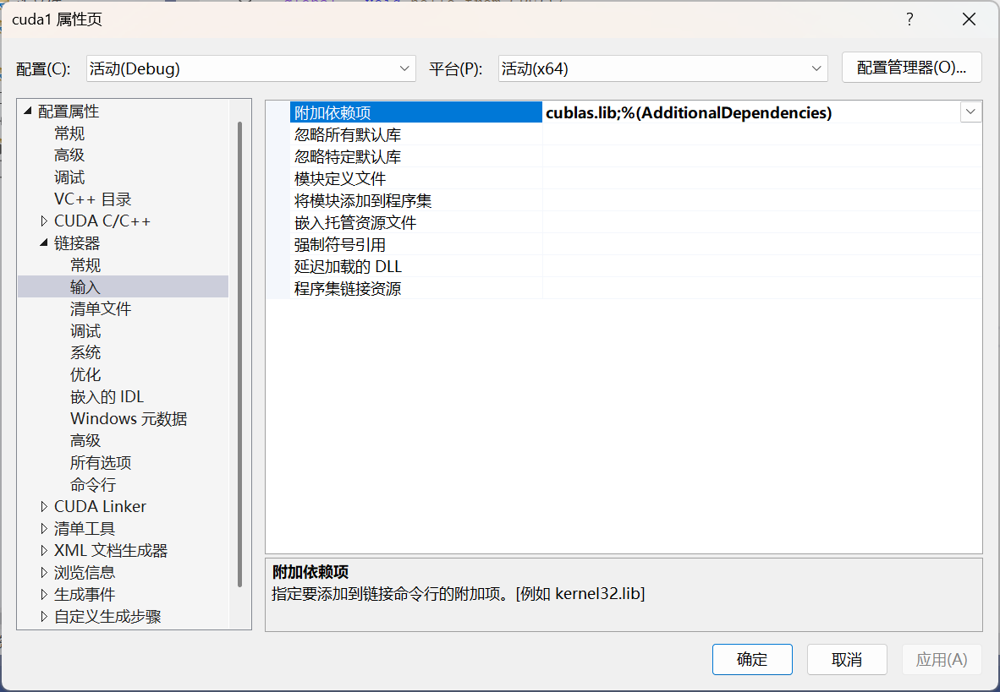

### 一.CUDA中的线程组织

#### 1.CUDA程序的基本结构与核函数
GPU有很多运算单元，但其仅仅是运算设备，我们需要CPU（统称为主机）来给他下命令。所以一个使用GPU的CUDA程序必须包含两大部分：主机代码和设备代码。
其中，主机代码是指“xxx.cu”中的所有代码，而设备代码又是指需要设备来执行的代码。
主机对设备的调用是通过核函数（Kernel function）实现的。所以一个简单CUDA程序结构就可以如下表示：
```c
int main(){
    /* 主机代码 */
    /* 核函数调用 */
    /* 主机代码 */
    return 0;
}
```
核函数可以理解为一种特殊的C++函数，它必须被限定词`__global__`修饰，且返回类型必须是`void`，例如：
```c
__global__ void hello_from_GPU(){
    printf("Hello World from GPU!\n");
}
```
另外，限定词与函数类型的位置可以互换：
```c
void __global__ hello_from_GPU(){
    printf("Hello World from GPU!\n");
}
```

#### 2.CUDA的简单HW程序
一个基本的使用到cuda核函数的HW程序:
``` c
#include <stdio.h>
#include "cuda_runtime.h"

/*初识cuda*/
__global__ void hello_from_GPU(){
	/*不能使用<iostream>与std*/
	printf("Hello World from GPU!\n");
}

int main()
{
	hello_from_GPU <<< 1, 1 >>> ();
	cudaDeviceSynchronize();//刷新缓冲区，同步主机和设备	
	return 0;
}
```

除了已经提到的核函数，还需要注意的部分：
- 调用核函数的格式代码：
`hello_from_GPU <<< 1, 1 >>> ();`
其中的三括号对“<<< >>>”与数字对(1,1)是用来指名核函数中的线程数与排列情况的。核函数的线程会被组织为**线程块**（Thread block）：前一个数字可以视作**线程块的个数**，而后一个数字可以视作**每个线程块的线程数**。一个核函数的全部线程块被称为网格（Grid），所以前一个数字，即线程块的个数，记为网格大小（Grid size）；而后一个数字，即线程块中的线程数，记为线程块大小（Block size）。
所以可以这么理解核函数的运行：一个核函数的运行需要一个由grid size x block size 个线程组成的网格（grid）来进行。
- 核函数中不支持c++的iostream，因为GPU本身就不是用来I/O的，iostream依赖于操作系统的I/O操作，而GPU不能访问这些资源。
- 调用完核函数后的语句`cudaDeviceSynchronize()`是用来同步主机与设备的缓冲区的，它能实现缓冲区的刷新。

#### 3.通过多线程的HW程序了解CUDA的一维线程组织形式
一个GPU中通常有几千个计算核心，为了充分利用它们，往往需要使得**总线程数>=计算核心数**，因为这会让计算和内存访问之间以及不同的计算之间合理重叠，从而减小计算核心的空闲时间。所以一个核函数调用多个线程往往是必须的。
现有如下程序：
``` c
#include <stdio.h>
#include "cuda_runtime.h"

/*初识cuda*/
__global__ void hello_from_GPU(){
	/*不能使用<iostream>与std*/
	printf("Hello World from GPU!\n");
}

int main()
{
	hello_from_GPU <<< 2, 4 >>> ();
	cudaDeviceSynchronize();//刷新缓冲区，同步主机和设备	
	return 0;
}
```
很容易理解，这个核函数的总线程数是2x4=8，且缓冲区也输出8行文字。那么下一个问题是，我如何知道哪个线程输出哪个结果？换言之，我该如何实现线程跟踪？这里就需要引出**线程索引**的概念。
为一个核函数所指派的线程的组织结构由执行配置（Execution configuration）决定，即
`<<<grid_size, block_size>>>`
其中，grid_size与block_size可以直接是整型变量，也可以是结构体类型变量。
- 首先，我们需要知道理论上的线程数最大值是多少。从Nvidia的Kepler（2012）架构开始，最大允许的线程块大小（即blcok_size）为1024，最大允许的网格大小（即grid_size）为$2^{31}-1$。理论上核函数可以调用的线程数很多，实际上则受GPU计算资源（SM、寄存器、共享内存等）限制。
```c
#include <stdio.h>
#include "cuda_runtime.h"

int main()
{
    /*获得最大线程块大小与网格大小*/
	cudaDeviceProp prop;
	cudaGetDeviceProperties(&prop, 0);
	printf("Max threads per block: %d\n", prop.maxThreadsPerBlock);
	printf("Max grid dimensions: (%d, %d, %d)\n",
		prop.maxGridSize[0], prop.maxGridSize[1], prop.maxGridSize[2]);
	return 0;
}
```
运行结果：
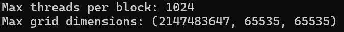
- 其次，既然线程在核函数中唯一的身份标识，且我们已经用两个参数指定了线程数目，那么每个线程的身份都可以由两个参数确定。在核函数内部，这两个值被保存于如下内建变量（built-in variable）中。
`blockIdx.x`:该变量指定一个线程在一个网格中的线程块指标，其取值范围为0~grid_size-1
`threadIdx.x`:该变量指定一个线程在一个线程块中的线程指标，其取值范围为0~block_size-1
此外，核函数也对应地内置了两个用于表示grid_size与block_size的重要内建变量：
`gridDim.x`:该变量的数值等于执行配置中变量grid_size的数值
`blockDim.x`:该变量的数值等于执行配置中变量block_size的数值
那么我们可以把上述HW程序改写为如下形式，以实现利用一维线程索引判断线程输出：
```c
#include <stdio.h>
#include "cuda_runtime.h"

/*一维线程索引*/

__global__ void hello_from_GPU(){
	// 使用线程索引
	// 所谓线程索引，就是唯一标识每个线程的坐标值
	const int bid = blockIdx.x;
	const int thid = threadIdx.x;
	printf("Hello World from Block %d , Thread %d !\n", bid, thid);
}

int main()
{
	hello_from_GPU <<< 2, 4 >>> ();
	cudaDeviceSynchronize();//同步主机和设备
	return 0;
}
```
输出结果：
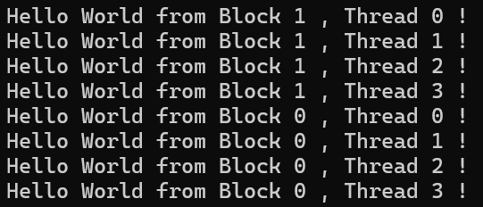
注意到有时候会是第0个线程块先完成计算，而有时候是第1个。这反映CUDA程序的一个执行特征：每个线程块的计算是独立的，程序计算的次序与每个线程块的计算无关。

#### 4.多维网络结构
`blockIdx`和`threadIdx`都是类型为`uint3`的结构体变量，其中包括`x、y、z`三个成员，它们都是无符号整数类型。而`gridDim`和`blockDim`都是类型为`dim3`的结构体变量，同样地，该结构体包括`x、y、z`三个`unsigned`类型成员。结构体`uint3`与`dim3`都在头文件`vector_types.h`中定义。
`blockIdx`、`threadIdx`、`gridDim`和`blockDim`这些自建变量仅可在核函数中有效(可见)，且满足如下范围：
- `blockIdx.x`、`blockIdx.y`、`blockIdx.z`的范围分别为0~`gridDim.x-1`	、0~`gridDim.y-1`、0~`gridDim.z-1`
- `threadIdx.x`、`threadIdx.y`、`threadIdx.z`的范围分别为0~`blockDim.x-1`、0~`blockDim.y-1`、0~`blockDim.z-1`
  
在之前的程序中，网格大小grid_size和线程块大小block_size是在调用核函数时通过**执行配置**指定的，例如在上述程序中，对应代码就是
```
<<< 2, 4 >>>
```
这两个整数的数值将分别赋给内建变量`gridDim.x`和`blockDim.x`，此时，`gridDim`和`blockDim`中没有被指定的成员取默认值1。也就是说，此时的网格与线程块其实是**一维**的。
所以，我们可以使用结构体`dim3`来定义**多维**的网格与线程块：
```
dim grid_size(Gx, Gy, Gz);
dim block_size(Bx, By, Bz);
// 如果某一维度大小为1，可以省略不写
dim grid_size(Gx, Gy); //z为1
dim block_size(Bx, Bz); //y为1
```
例如，如要定义一个2x2x1的网格与3x2x1的线程块，代码如下：
```
dim3 grid_size(2, 2);
dim3 block_size(3, 2);
```
可以想象成有$grid\_size=2 \times 2$个`blockIdx`编号分别为(0,0,0),(0,1,0),(1,0,0),(1,1,0)的抽屉，每个抽屉里又有$block\_size=3\times2$个`threadIdx`编号分别为(0,0,0),(0,1,0),(1,0,0),(1,1,0),(2,0,0),(2,1,0)个线程。
就像c++的多维数组的本质还是一维数组，多维的网格与线程块本质上仍然是一维的，所以我们前文所述的“线程id”`tid`可以被多维线程指标`threadIdx.x`、`threadIdx.y`和`threadIdx.z`表示为:
```
int tid = threadIdx.z * blockDim.x * blockDim.y +
	  threadIdx.y * blockDim.x + threadIdx.x;
```
从上式我们可以看出，x维度是最内层的，也是变化最快的；而z维度是最外层的，变化最慢的。
同样地，线程块的索引`bid`可以被多维线程块指标`blockIdx.x`、`blockIdx.y`和`blockIdx.z`表示为:
```
int bid = blockIdx.z * gridDim.x * gridDim.y +
	  blockIdx.y * gridDim.x + blockIdx.x;
```
另外也存在复合线程索引，此处先不表。
在一个线程块中的线程还可以细分为线程束(thread warp)，每个线程束包含相邻的`warpSize`个线程。`warpSize`也是一个自建变量，用于表示线程束大小。基于目前的GPU架构，其值都是32。也就是说，在一个线程块中，第0~31个线程可以被称为第0个线程束，第32~63个线程可以被称为第1个线程束，以此类推。另外，线程束中的线程在执行时，必须同时执行相同的指令，否则就会出现线程 `divergence`。
基于上述知识，我们可以进一步修改程序来详细展示使用多维线程块的核函数中的线程组织情况（以2x2x1的网格与3x2x1的线程块为例）：

```
#include <stdio.h>

/*多维线程索引*/

__global__ void hello_from_GPU(){
	/*获得当前线程的索引*/
    const int bid_x = blockIdx.x;
    const int bid_y = blockIdx.y;
    const int bid_z = blockIdx.z;
	const int thid_x = threadIdx.x;
	const int thid_y = threadIdx.y;
    const int thid_z = threadIdx.z;
	printf("Hello World from block-(%d, %d, %d) and thread-(%d, %d, %d) !\n", bid_x, bid_y, bid_z, thid_x, thid_y,thid_z);
}

int main()
{
    const dim3 grid_size(2, 2);
    const dim3 block_size(3, 2);
	hello_from_GPU <<< grid_size, block_size >>> ();
	cudaDeviceSynchronize();//同步主机和设备
	return 0;
}
```
运行结果：
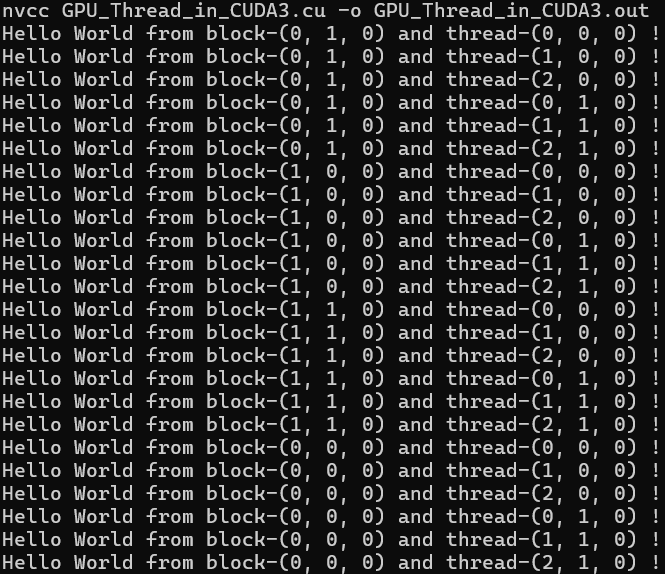
*可以看到，block和thread的执行顺序都是随机的，侧面证明了GPU硬件动态调度的没有顺序，也不存在优先级，即线程执行是独立的。*
CUDA对于能定义的网格大小和线程块大小做了限制，具体如下：
- 网格大小在x、y、z维度三个方向的最大允许值为$2^{31}-1$
、65535和65535；
- 线程块大小在x、y、z维度三个方向的最大允许值为1024、1024和64；
- 线程块的总大小，即`blockDim.x * blockDim.y * blockDim.z`不可大于1024，换言之，一个线程块最多存在1024个线程。

### 二. CUDA程序的基本框架
#### 1. 数组加法程序
```
/*add.cpp*/
#include <math.h>
#include <stdlib.h>
#include <stdio.h>

const double epsilon = 1.0e-15;
const double a = 1.23, b = 2.34,c=3.57;
void add(const double *x,const double *y,double *z,const int N);
void check(const double *z,const int N);

int main()
{
    const int N = 100000000;
    const int M = sizeof(double) * N;
    double *x = (double *)malloc(M);
    double *y = (double *)malloc(M);
    double *z = (double *)malloc(M);
    for (int i = 0; i < N; i++)
    {
        x[i] = a;
        y[i] = b;
    }
    add(x,y,z,N);
    check(z,N);

    free(x);
    free(y);
    free(z);
    
    return 0;
}

void add(const double *x,const double *y,double *z,const int N){
    for (int n = 0; n < N; n++)
    {
        z[n] = x[n] + y[n];
    }
}

void check(const double *z,const int N){
    bool error = false;
    for (int n = 0; n < N; n++){
        if(fabs(z[n] - c) > epsilon){
            printf("Error: z[%d] = %f\n",n,z[n]);
            error = true;
        }
    }
    printf("Test %s\n",error ? "HAS ERRORS" : "NO ERRORS");
}
```
这是一个很简单的实现两个double数相加判定的程序，特点在于分配了3个长度为$10^8$的一维数组，这将占用约2.4GB的内存。
在实际工程中，典型的CUDA程序的完整框架如下所示：
```
头文件包含
常量/宏定义
cpp自定义函数和CUDA核函数的声明
主程序部分
{
	分配主机与设备内存
	初始化主机中数据
	将需要的主机数据复制到设备内存
	调用核函数
	将需要的设备数据复制到主机内存
	检查结果并释放主机与设备内存
}
cpp自定义函数和CUDA核函数的定义(实现)
```
现对上述`add.cpp`添加使用CUDA的实现：
```
#include <math.h>
#include <stdlib.h>
#include <stdio.h>

const double epsilon = 1.0e-15;
const double a = 1.23, b = 2.34,c=3.57;
void __global__ add(const double *x,const double *y,double *z);
void check(const double *z,const int N);

int main()
{
    const int N = 100000000;
    const int M = sizeof(double) * N;
    double *h_x = (double *)malloc(M);
    double *h_y = (double *)malloc(M);
    double *h_z = (double *)malloc(M);

    for (int i = 0; i < N; i++)
    {
        h_x[i] = a;
        h_y[i] = b;
    }

    double *d_x, *d_y, *d_z;
    cudaMalloc(&d_x, M);
    cudaMalloc(&d_y, M);
    cudaMalloc(&d_z, M);
    cudaMemcpy(d_x, h_x, M, cudaMemcpyHostToDevice);
    cudaMemcpy(d_y, h_y, M, cudaMemcpyHostToDevice);

    const int block_size = 128;
    const int grid_size = N / block_size;
    add<<<grid_size,block_size>>>(d_x,d_y,d_z);

    cudaMemcpy(h_z, d_z, M, cudaMemcpyDeviceToHost);
    check(h_z,N);

    free(h_x);
    free(h_y);
    free(h_z);
    cudaFree(d_x);
    cudaFree(d_y);
    cudaFree(d_z);
    
    return 0;
}

void __global__ add(const double *x,const double *y,double *z){
    const int n = blockIdx.x * blockDim.x + threadIdx.x;
    z[n] = x[n] + y[n];
}

void check(const double *z,const int N){
    bool error = false;
    for (int n = 0; n < N; n++){
        if(fabs(z[n] - c) > epsilon){
            printf("Error: z[%d] = %f\n",n,z[n]);
            error = true;
        }
    }
    printf("Test %s\n",error ? "HAS ERRORS" : "NO ERRORS");
}
```
注：当CUDA版本小于8.0时，在编译时需要额外添加指定计算能力的参数，例如：
```
nvcc -arch=sm_75 -o add add.cu
```
由于现在CUDA版本默认较高，对于现有问题计算能力完全能够满足，所以无需添加指定计算能力的参数。

#### 2. 数组加法程序的分析
##### 1. 设备内存的分配与释放
与cpp程序不同，这里使用了`cudaMalloc`和`cudaFree`函数来分配和释放设备内存。它们的作用分别是在GPU设备分配内存与释放GPU设备内存。
与cpp中的`malloc()`函数动态分配内存类似，`cudaMalloc()`函数可以动态分配GPU设备内存，其定义如下：
```
cudaError_t cudaMalloc(void **devPtr, size_t size);
```
其中：
- `devPtr`：指向设备内存指针的指针，用于返回分配的设备内存地址。由于函数的功能是改变地址指针本身的数值，而非该指针所指向的内存缓冲区的变量，所以需要传递该指针的地址，才能达到连续分配内存的效果
- `size`：要分配的设备内存大小，单位为字节。
- 返回值是一个错误代号。如果调用成功，则返回`cudaSuccess`。
- 函数实现的是分配`size`字节的**线性内存（Linear Memory）**。所谓线性内存，就是指一段连续的、按字节编址的虚拟内存空间，可供CPU或GPU直接访问，功能性上可以看作`malloc()`的GPU版。它分配的地址具有简单的地址连续性（所以叫线性内存）。其与CUDA的其他内存类型（如纹理内存、常量内存）的区别暂时不表。
另外，为了区分CPU与GPU中的变量，在CUDA编程中的一个习惯是，使用`d_`前缀表示GPU设备变量，使用`h_`前缀表示CPU主机变量。

正如`malloc()`函数分配的主机内存最终需要`free()`函数释放，`cudaMalloc()`函数分配的设备内存也需要使用`cudaFree()`函数释放。其定义如下：
```
cudaError_t cudaFree(void *devPtr);
```
其中：
- `devPtr`：要释放的设备内存指针。
- 返回值是一个错误代号。如果调用成功，则返回`cudaSuccess`。
- 函数实现的是释放`devPtr`指向的设备内存。

需要再次说明的是，`cudaMalloc()`和`cudaFree()`函数都是CUDA专属的API，都只分配GPU设备内存。使用`malloc()`和`free()`、`new`和`delete`都是无效的，因为它们只能在CPU主机中进行内存分配与释放。
*存在一个名为统一内存（Unified Memory）的例外，不过这里按下不表。*

##### 2.CPU与GPU之间的数据传递
只有在成功分配GPU设备内存之后，才能将所需的数据从CPU主机传递到GPU设备中。其对应的CUDA运行API函数为`cudaMemcpy()`。定义如下：
```
cudaError_t cudaMemcpy
(
    void                  *dst,
    const void            *src,
    size_t                count,
    enum cudaMemcpyKind   kind
);
```
其中：
- `dst`是目标地址。可以是CPU主机地址，也可以是GPU设备地址。
- `src`是源地址。可以是CPU主机地址，也可以是GPU设备地址。
- `count`是复制数据的字节数。
- `kind`是一个`enum`类型的变量，用于标志数据传递方向。它只能取以下几个数值：
  - `cudaMemcpyHostToHost`，主机到主机
  - `cudaMemcpyHostToDevice`，主机到设备
  - `cudaMemcpyDeviceToHost`，设备到主机
  - `cudaMemcpyDeviceToDevice`，设备到设备
  - `cudaMemcpyDefault`，默认值，表示指针`dst`与`src`所指的地址**自动判断**数据传输方向，需要CUDA 6.0以上的64位主机，且支持统一虚拟寻址(Unified Virtual Addressing)
- 返回值是一个错误代号。如果调用成功，则返回`cudaSuccess`。
- 函数的作用是将`src`指向的内存缓冲区中的数据复制到`dst`指向的内存缓冲区中，复制的字节数为`count`，方向由`kind`决定。

在程序中，我们需要将主机中的数组`h_x`和`h_y`复制到设备中的数组`d_x`和`d_y`中。在核函数完成计算后，同样需要将设备中的数组`d_z`再迁移回`h_z`中由CPU完成`check()`。

##### 3.核函数中数据与线程的对应
考察代码中以下部分：
```
    const int block_size = 128;
    const int grid_size = N / block_size;
    add<<<grid_size,block_size>>>(d_x,d_y,d_z);
```
这三行确定了核函数的执行配置：使用具有128个线程的一维线程块，而线程块的数量为$10^{8}/128$。
对比add函数的cpp版本与cu版本，可以发现cu版本更为简单，因为它去掉了一层循环。在主机函数中，我们需要对数组中的每一个元素依次进行操作；而在设备核函数中，代码的核心逻辑变为了“单指令-多线程”。

##### 4.全局索引的计算
首先回顾一下内建变量的概念：
- `gridDim`：网格维度，是一个`dim3`类型的变量，表示网格中每个维度的线程块**数量**，可以理解为**网格在`x`、`y`、`z`方向上的尺寸**。
- `blockDim`：线程块维度，是一个`dim3`类型的变量，表示线程块中每个维度的线程**数量**，可以理解为**线程块在`x`、`y`、`z`方向上的尺寸**。  
- `threadIdx`：线程索引，是一个`dim3`类型的变量，用于表示当前线程在其线程块中的**索引**，可以理解为**线程在线程块内部的的`x`、`y`、`z`方向上的坐标**。
- `blockIdx`：线程块索引，是一个`dim3`类型的变量，用于表示当前线程块在整个网格中的**索引**，可以理解为**线程块在整个网格中的`x`、`y`、`z`方向上的坐标**。
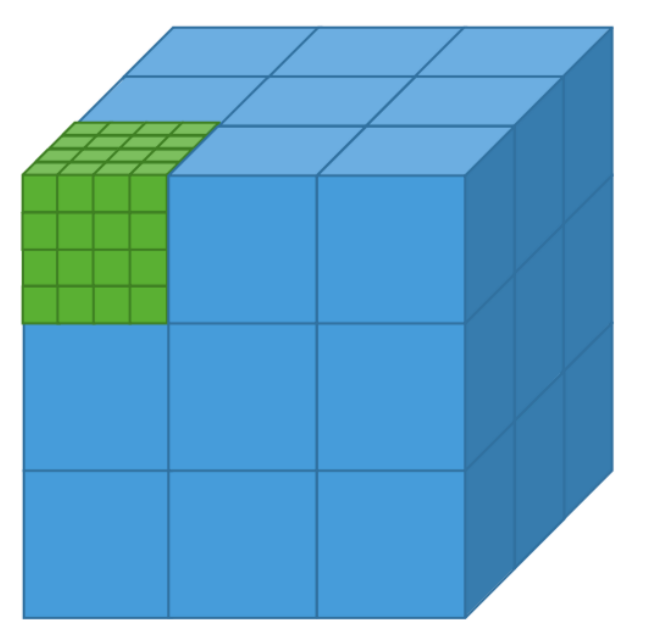
例如，在上图中，`gridDim`就是`(3,3,3)`，每一个线程块的`blockDim`就是`(4,4,4)`；
每一个线程块的坐标都可以用`(blockIdx.x,blockIdx.y,blockIdx.z)`表示，而每一个线程块内部的线程的坐标可以用`(threadIdx.x,threadIdx.y,threadIdx.z)`表示。

接下来以三维为例，介绍线程的全局索引的计算逻辑。假设计算绿色方块内的红色点处线程的全局索引：
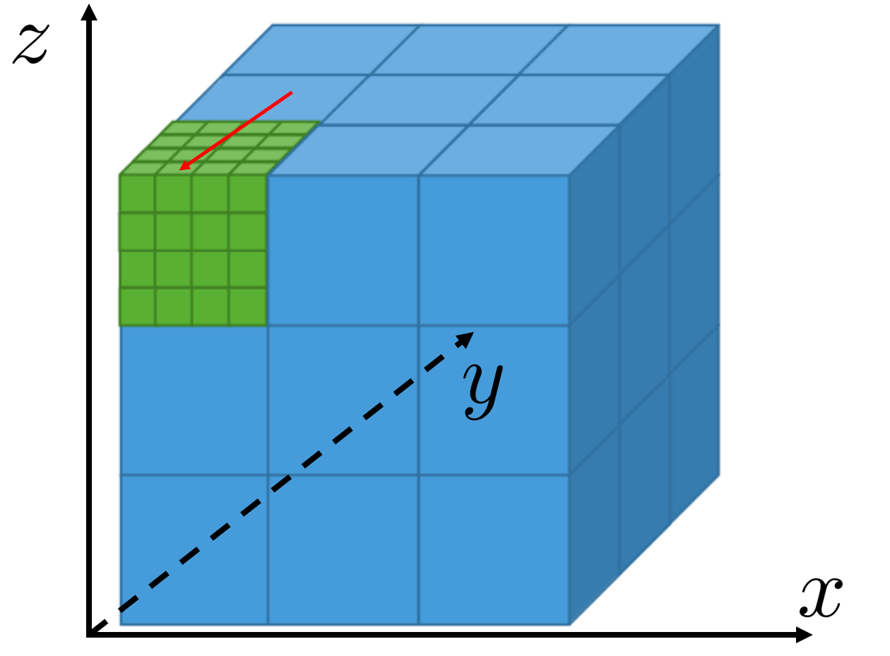
1) 先找到当前线程位于线程格中的哪一个线程块blockId：
```
blockId = blockIdx.x + blockIdx.y * gridDim.x + blockIdx.z * gridDim.x * gridDim.y;
```
拆开来讲：
- `blockIdx.z * gridDim.x * gridDim.y`，是指当前线程块在当前z层下的所有线程块的数量，即图中黄色部分；
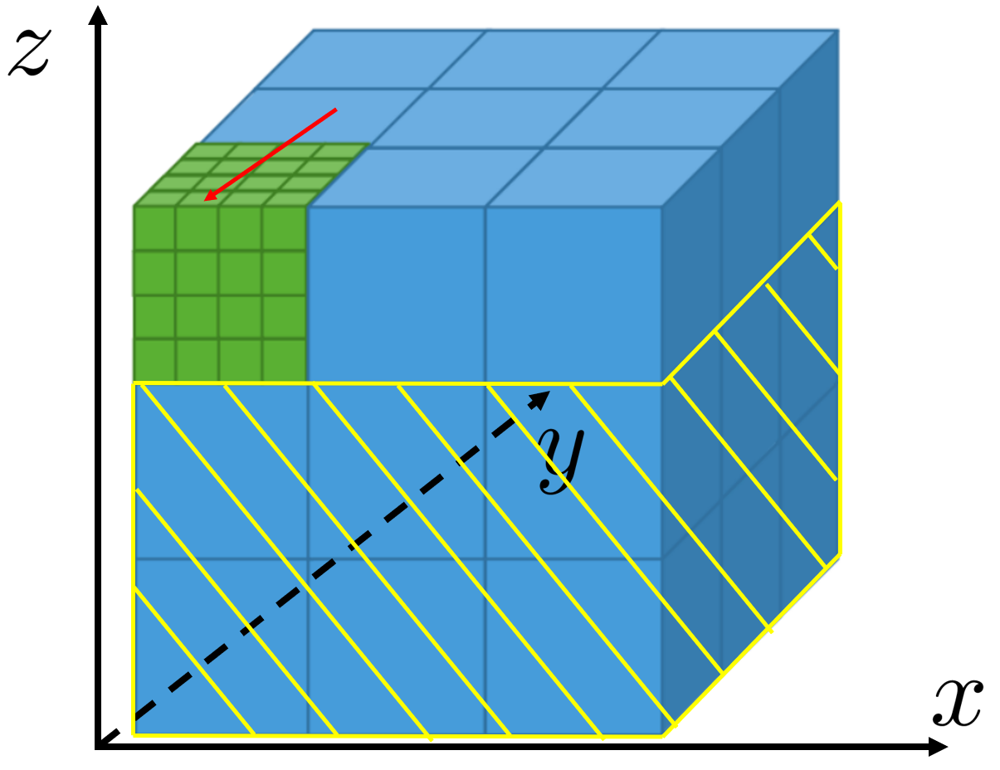

- `blockIdx.y * gridDim.x`，是指当前线程块在当前y层前的所有线程块的数量，在图中没有，因为此处线程块的y坐标为0；
- `blockIdx.x`，是指当前线程块在当前x轴上的坐标。
那么这三部分的和就表示**当前线程块在整个网格中**的全局索引。
2) 与之前的思路完全类似，再找到当前线程位于线程块中的哪一个线程：
```
threadId = threadIdx.x + threadIdx.y * blockDim.x + threadIdx.z * blockDim.x * blockDim.y;
```
3) 计算一个线程块中包含有多少个线程，这非常简单：
```
M = blockDim.x * blockDim.y * blockDim.z;
```
4) 计算当前线程的全局索引idx：
```
idx = blockId * M + threadId;
```
以三维为例子，接下来给出二维网格的全局索引计算公式：
```
idx = blockId * M +threadId
    = (blockIdx.x + blockIdx.y * gridDim.x) * M + threadId;
    = (blockIdx.x + blockIdx.y * gridDim.x) * (blockDim.x * blockDim.y) + threadIdx.x + threadIdx.y * blockDim.x

```

那么，在上文的核函数中，为什么使用了以下语句来确定当前线程的全局索引呢？
```
const int n = blockIdx.x * blockDim.x + threadIdx.x;
```
显然代码中网格是一维的，所以全局索引的计算逻辑就很简单，即：
```
当前线程块id * 线程块大小 + 当前线程id
```
另外，网格与线程块的维度不同时，其全局索引的基础计算逻辑其实没有任何区别，仅需要根据维度进行相应的乘法即可。

##### 5.核函数的其他要求
以下是核函数编写时的主要事项：
1) 返回类型必须是`void`。
2) 必须使用`__global__`关键字进行修饰，也可以加上其他cpp的限定符，例如`static`。次序可任意。
3) 函数名无特殊要求，与cpp要求一致，且支持cpp中的重载。
4) 不支持可变数量的参数列表。GPU不支持可变参数，可变参数也会破坏GPU的内存布局优化。
5) 可以想核函数传递非指针变量（如代码中的int N），其内容对每个线程可见。
6) 除非使用统一内存编程机制（后面介绍），否则传给核函数的数组指针必须指向GPU设备内存。
7) 核函数不可直接成为类的成员。通常的做法是使用一个调用核函数的包装函数，并将该包装函数定义为类成员。
8) 从计算能力3.5开始，CUDA引入了动态并行（dynamic parallelism）机制，核函数内部可以调用其它核函数，也可以递归调用了。
9) 无论是CPU调用还是GPU调用，核函数永远在GPU中执行。所有核函数调用**必须指定执行配置**（即三括号以及其中的函数）。

##### 6.核函数中if语句的必要性
其实，在前面的核函数代码中存在一个问题——
```
const int n = blockIdx.x * blockDim.x + threadIdx.x;
d_z[n] = d_x[n] + d_y[n];
```
代码中的N恰好是block_size的整数倍，不会引起问题，因为核函数中的线程数恰好等于数组元素个数（都是N）。
假设将N改为$10^{8}+1$，而`block_size`依旧为128不变。那么此时该如何确定`grid_size`的大小？如果依然为$10^{8}/128$，那么线程数就会小于数组大小，在当前**一个线程对应一个数组元素的方案下**无法处理剩下多出来的1个元素；而如果改为$10^{8}/128+1$，那么最后定义的线程数变为了$10^{8}+128$，尽管满足了旧有方案，但显然多出来了很多不必要的线程。
事实上，如果真出现了这类问题，需要从其它角度重新设计核函数，例如计算逻辑、网格与线程块大小等。不过有一点是毋庸置疑的——核函数的线程数不可大于数组元素个数，不然在执行全局索引计算时必然会发生数组越界问题。而核函数的线程数小于数组元素个数时，显然会导致数组中部分元素未被赋值，从而出现bug。
为了解决这个问题，我们需要在核函数中添加一个判断语句。完整核函数修改代码如下：
```
void __global__ add(const double *x, const double *y, double *z, int N)
{
    const int n = blockIdx.x * blockDim.x + threadIdx.x;
    if(n<N)
        z[n] = x[n] + y[n];
}
```
#### 3.自定义设备函数
核函数是在GPU设备中执行，被CPU主机端调用的函数。而自定义设备函数(Device Function)是在GPU设备中执行，且在GPU设备中被调用的函数。由于自定义设备函数只能被GPU设备调用，所以它只能被核函数或其它自定义设备函数调用。
##### 1. CUDA函数执行空间标识符
在CUDA编程中，使用如下空间标识符来确定一个函数在哪里被调用，以及在哪里被执行：
- `__global__`：用该标识符修饰的函数被称为核函数，一般在CPU主机端调用，在GPU设备端执行。如果使用动态并行，也可以递归调用自己或调用其它核函数。
- `__device__`：用该标识符修饰的函数被称为设备函数，只能在GPU设备端调用，在GPU设备端执行。
- `__host__`：用该标识符修饰的函数被称为主机函数，其实就是普通的cpp函数，在CPU主机端调用，在CPU主机端执行。而之所以额外提供这一个修饰符，是因为有时可以同时使用`__host__`和`__device__`修饰一个函数，该函数自然在CPU端和GPU端都可以被调用。编译器也支持同时针对主机与设备分别编译该函数。
同时也需要注意以下几点：
- `__global__`与`__device__`不可被同时修饰；
- `__host__`与`__global__`也不可被同时修饰；
- **除非显式禁用，CUDA编译器默认设备函数为内联函数。** 如果不使用内联函数修饰符而直接使用`__device__`修饰符，编译器会自行决定将自定义设备函数视作内联函数或非内联函数。此外，修饰符`__noinline__`与`__forceinline__`只能**建议**自定义设备函数为非内联函数或内联函数，编译器不一定接受（取决于GPU架构的内联优化策略）。

##### 2. 示例：为核函数添加设备函数
```
// 1.使用返回值的设备函数
double __device__ add1_device(const double x,const double y){
    return x + y;
}
void __global__ add1(const double *x,const double *y,double *z,int N){
    const int n = blockIdx.x * blockDim.x + threadIdx.x;
    if (n<N)
        z[n] = add1_device(x[n],y[n]);
}

// 2.使用指针的设备函数
void __device__ add2_device(const double x,const double y,double *z){
    *z = x + y;
}
void __global__ add2(const double *x,const double *y,double *z,int N){
    const int n = blockIdx.x * blockDim.x + threadIdx.x;
    if (n<N)
        add2_device(x[n],y[n],&z[n]);
}

// 3.使用引用的设备函数
void __device__ add3_device(const double x,const double y,double &z){
    z = x + y;
}
void __global__ add3(const double *x,const double *y,double *z,int N){
    const int n = blockIdx.x * blockDim.x + threadIdx.x;
    if (n<N)
        add3_device(x[n],y[n],z[n]);
}
```

### 三. CUDA程序的错误检测
CUDA提供了一系列的错误检测函数，用于在程序运行时检查CUDA API调用是否成功。本节讨论如何检测这些运行时错误（包括使用检查CUDA运行时API函数返回值的宏函数），以及如何使用CUDA-MEMCHECK工具。
#### 1.检测CUDA运行错误的宏函数
所有CUDA运行时的API函数都以`cuda`为前缀，且都存在一个返回值类型为`cudaError_t`的返回值。只有这些API函数返回值为`cudaSuccess`时，才代表该API函数调用成功。
我们可以写一个用于检测CUDA运行错误的头文件`error.cuh`，其包含一个宏函数：
```
#pragma once
#include <stdio.h>

#define CHECK(call)                                                         \
    do                                                                      \
    {                                                                       \
        const cudaError_t error_code = call;                                \ 
    if (error_code != cudaSuccess)                                          \
        {                                                                   \
            printf("CUDA Error:\n");                                        \
            printf("   File:   %s\n", __FILE__);                            \
            printf("   Line:   %d\n", __LINE__);                            \
            printf("   Error code:  %d\n", error_code);                     \
            printf("   Error text:  %s\n", cudaGetErrorString(error_code)); \
            exit(1);                                                        \
        }                                                                   \
    } while (0)
```
解析：
- *记得用“\\”续宏定义，反斜杠后也不可以有任何空格*
- `call`是一个CUDA运行时API参数
- `cudaGetErrorString`是CUDA运行时API函数，用于获取错误码对应的错误信息
在调用宏函数时，直接将CUDA运行时API函数作为参数传入该宏即可，例如：
```
CHECK(cudaMalloc(&d_x, N * sizeof(double)));
```

#### 2. 检测CUDA运行错误的宏函数的使用
1. 运行时API函数的检验
例如，这里故意将cudaMemcpyHosttoDevice写成cudaMemcpyHostToDevice，并观察`CHECK`宏的错误提示：
```
    //正确代码
    CHECK(cudaMemcpy(d_x, h_x, M, cudaMemcpyHostToDevice));
    CHECK(cudaMemcpy(d_y, h_y, M, cudaMemcpyHostToDevice));
    //错误代码
    // CHECK(cudaMemcpy(d_x, h_x, M, cudaMemcpyDeviceToHost));
    // CHECK(cudaMemcpy(d_y, h_y, M, cudaMemcpyDeviceToHost));

```
输出结果：
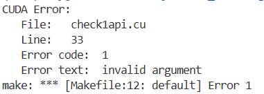
2. 核函数的检验
与官方的API函数不同，核函数默认返回`void`，无法返回任何值，所以若要捕捉调用核函数时可能发生的错误，需要在调用核函数后加上如下两条语句：
```
CHECK(cudaGetLastError());
CHECK(cudaDeviceSynchronize());
```
其中，`cudaGetLastError()`用于捕捉直到自己之前的最后一个错误，而`cudaDeviceSynchronize()`用于同步主机与设备。之所以要同步主机与设备，是因为核函数的调用是异步的，即CPU主机调用完GPU设备后，二者会自己运行自己的语句，核函数不会等待CPU主机代码运行完毕。所以需要`cudaDeviceSynchronize()`阻塞CPU直到GPU完成所有任务。
值得注意的是，同步函数往往是几位耗时的，并**不推荐在程序的较内层循环部分**调用同步函数。只要在核函数的调用之后还存在其它任何能返回错误值的CUDA API函数，都能够触发CPU主机与GPU设备的同步并捕捉到核函数调用中发生的错误。
以下述代码为例，展示对核函数调用的检查（部分）：
```
    // 正确代码
    // const int block_size = 128;
    // const int grid_size = N / block_size;
    // 错误代码
    const int block_size = 1280;
    const int grid_size = (N + block_size - 1) / block_size;
    add<<<grid_size,block_size>>>(d_x,d_y,d_z,N);
    CHECK(cudaGetLastError());
    CHECK(cudaDeviceSynchronize());
```
输出结果：
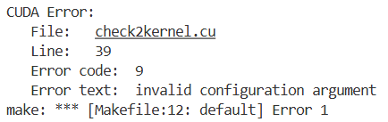
*这里故意将block_size设置为1280，而一个线程块的最大线程数只能是1024，所以会发生报错。*
*如果去掉`CHECK`宏，则只会输出`HAS ERRORS`，而无法提供详细的错误原因。*
此外，可以临时将环境变量`CUDA_LAUNCH_BLOCKING`设置为1，这样只会所有核函数的调用都将是同步而非异步。这仅适用于程序调试，毕竟会极大影响程序性能。
```
export CUDA_LAUNCH_BLOCKING=1
```

#### 3. 使用CUDA-MEMCHECK工具检测内存错误
CUDA提供了名为CUDA-MEMCHECK的工具集，包括memcheck、racecheck、initcheck、synccheck共四个工具，它们的调用由可执行文件cuda-memcheck调用。
基本命令：
```
cuda-memcheck --tool memcheck [option] <可执行程序.cu> [程序参数]
cuda-memcheck --tool racecheck [option] <可执行程序.cu> [程序参数]
cuda-memcheck --tool initcheck [option] <可执行程序.cu> [程序参数]
cuda-memcheck --tool synccheck [option] <可执行程序.cu> [程序参数]
```
- memcheck:检测工具错误，默认选项
- racecheck:检测数据竞争错误
- initcheck:检测未初始化内存错误
- synccheck:检测同步错误

### 四. GPU加速的关键
#### 1. 使用CUDA事件计时
cpp本身提供了多种对代码计时的方法，例如`clock()`、`gettimeofday()`、`time()`等。CUDA同样提供了一种基于CUDA事件（CUDA Event）的计时方式。下面给出了一个计时方式模板：
```
    cudaEvent_t start, stop;
    CHECK(cudaEventCreate(&start));
    CHECK(cudaEventCreate(&stop));
    CHECK(cudaEventRecord(start));
    // cudaEventQuery(start); //不能用宏函数

    /*
        需要计时的代码块
    */

    CHECK(cudaEventRecord(stop));
    CHECK(cudaEventSynchronize(stop));
    float time;
    CHECK(cudaEventElapsedTime(&time, start, stop));
    printf("Time: %f ms\n", time);
    CHECK(cudaEventDestroy(start));
    CHECK(cudaEventDestroy(stop));
```
解析：
- `cudaEventCreate()`:初始化事件类型(`cudaEvent_t`)变量`start`和`stop`
- `cudaEventRecord()`:记录一个事件，传入`start`代表事件开始，传入`stop`代表事件结束
- `cudaEventQuery()`:查询一个事件是否完成。TCC驱动模式的GPU可忽略，WDDM驱动模式的GPU必须保留。一般而言不需要，如出现异步队列插入问题则需要添加。
- 需要计时的代码块可以是CPU主机函数，可以是GPU设备函数，也可以是二者的混合。
- `cudaEventSynchronize()`:阻塞CPU主机，直到事件完成
- `cudaEventElapsedTime()`:计算两个事件之间的时间差，单位是ms
- `cudaEventDestroy()`:销毁一个CUDA事件

#### 2. 使用CUDA事件为C++计时
```
#include <math.h>
#include <stdlib.h>
#include <stdio.h>
#include "error.cuh"

#ifdef USE_DP
    typedef double real;
    const real EPSILON = 1.0e-15;
#else
    typedef float real;
    const real EPSILON = 1.0e-6f;
#endif

const int REPEATS = 10;
const real a = 1.23, b = 2.34,c=3.57;
void add(const real *x,const real *y,real *z,int N);
void check(const real *z,const int N);

int main()
{
    const int N = 100000000;
    const int M = sizeof(real) * N;
    real *x = (real *)malloc(M);
    real *y = (real *)malloc(M);
    real *z = (real *)malloc(M);

    for (int i = 0; i < N; i++)
    {
        x[i] = a;
        y[i] = b;
    }

    float t_sum=0,t2_sum=0;
    for (int repeat = 0;repeat <= REPEATS;repeat++)
    {
        cudaEvent_t start, stop;
        CHECK(cudaEventCreate(&start));
        CHECK(cudaEventCreate(&stop));
        CHECK(cudaEventRecord(start));

        add(x,y,z,N);

        CHECK(cudaEventRecord(stop));
        CHECK(cudaEventSynchronize(stop));
        float time;
        CHECK(cudaEventElapsedTime(&time, start, stop));
        printf("Time: %f ms\n", time);
        if(repeat >0)
        {
            t_sum += time;
            t2_sum += time * time;
        }

        CHECK(cudaEventDestroy(start));
        CHECK(cudaEventDestroy(stop));
    }
    const float t_ave = t_sum / REPEATS;
    const float t_err = sqrt(t2_sum / REPEATS - t_ave * t_ave);
    printf("Time = %g +- %g ms.\n",t_ave,t_err);
    check(z,N);

    free(x);
    free(y);
    free(z);
    
    return 0;
}

void add(const real *x,const real *y,real *z,int N){
    for (int n = 0; n < N; n++){
        z[n] = x[n] + y[n];
    }
}

void check(const real *z,const int N){
    bool error = false;
    for (int n = 0; n < N; n++){
        if(fabs(z[n] - c) > EPSILON){
            printf("Error: z[%d] = %f\n",n,z[n]);
            error = true;
        }
    }
    printf("Test %s\n",error ? "HAS ERRORS" : "NO ERRORS");
}
```
基于之前的add.cpp，这里的add1cpu.cu有如下改动：
- 直接使用`.cu`为源文件扩展名，避免使用g++编译时额外链接CUDA库；
- 使用宏条件控制程序中浮点数精度
- 使用CUDA事件对`add()`的调用进行了11次计时，其中第一次计时结果被忽略。原因在于一般而言，首次计算无论是GPU还是CPU机器都存在预热状态，时间较长，而根据后10次测试以最终计算平均值。
另外，在编译时添加`-O3`这一优化选项可以有效提升程序运行速度。`-O3`是gcc/clang/nvcc通用的编译优化选项之一，它能够实现循环优化、函数内联、删除冗余代码、优化指令调度等功能。所以加了`-O3`的程序会比不加的程序运行结果更好。
运行结果：
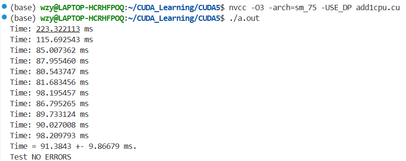

#### 3.使用CUDA事件为CUDA程序计时
```
#include <math.h>
#include <stdlib.h>
#include <stdio.h>
#include "error.cuh"

#ifdef USE_DP
    typedef double real;
    const real EPSILON = 1.0e-15;
#else
    typedef float real;
    const real EPSILON = 1.0e-6f;
#endif

const int REPEATS = 10;
const real a = 1.23, b = 2.34,c=3.57;
void __global__ add(const real *x,const real *y,real *z,int N);
void check(const real *z,const int N);

int main()
{
    const int N = 100000000;
    const int M = sizeof(real) * N;
    real *h_x = (real *)malloc(M);
    real *h_y = (real *)malloc(M);
    real *h_z = (real *)malloc(M);

    for (int i = 0; i < N; i++)
    {
        h_x[i] = a;
        h_y[i] = b;
    }

    real *d_x, *d_y, *d_z;
    CHECK(cudaMalloc(&d_x, M));
    CHECK(cudaMalloc(&d_y, M));
    CHECK(cudaMalloc(&d_z, M));
    CHECK(cudaMemcpy(d_x, h_x, M, cudaMemcpyHostToDevice));
    CHECK(cudaMemcpy(d_y, h_y, M, cudaMemcpyHostToDevice));

    const int block_size = 128;
    const int grid_size = (N + block_size - 1) / block_size;

    float t_sum=0,t2_sum=0;
    for (int repeat = 0;repeat <= REPEATS;repeat++)
    {
        cudaEvent_t start, stop;
        CHECK(cudaEventCreate(&start));
        CHECK(cudaEventCreate(&stop));
        CHECK(cudaEventRecord(start));

        add<<<grid_size,block_size>>>(d_x,d_y,d_z,N);

        CHECK(cudaEventRecord(stop));
        CHECK(cudaEventSynchronize(stop));
        float time;
        CHECK(cudaEventElapsedTime(&time, start, stop));
        printf("Time: %f ms\n", time);
        if(repeat >0)
        {
            t_sum += time;
            t2_sum += time * time;
        }

        CHECK(cudaEventDestroy(start));
        CHECK(cudaEventDestroy(stop));
    }
    const float t_ave = t_sum / REPEATS;
    const float t_err = sqrt(t2_sum / REPEATS - t_ave * t_ave);
    printf("Time = %g +- %g ms.\n",t_ave,t_err);
    
    CHECK(cudaMemcpy(h_z, d_z, M, cudaMemcpyDeviceToHost));
    check(h_z,N);

    free(h_x);
    free(h_y);
    free(h_z);
    CHECK(cudaFree(d_x));
    CHECK(cudaFree(d_y));
    CHECK(cudaFree(d_z));
    
    return 0;
}

void __global__ add(const real *x,const real *y,real *z,int N){
    const int n = blockIdx.x * blockDim.x + threadIdx.x;
    if (n < N){
        z[n] = x[n] + y[n];
    }
}

void check(const real *z,const int N){
    bool error = false;
    for (int n = 0; n < N; n++){
        if(fabs(z[n] - c) > EPSILON){
            printf("Error: z[%d] = %f\n",n,z[n]);
            error = true;
        }
    }
    printf("Test %s\n",error ? "HAS ERRORS" : "NO ERRORS");
}
```
运行结果：
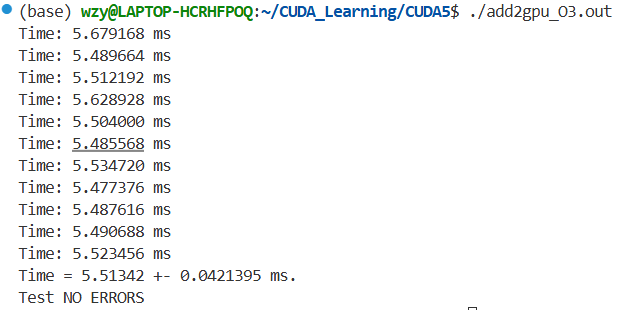
使用单精度浮点数时，时间显著小于CPU编程。
经过测试发现，使用双精度的耗时约为使用单精度耗时的2倍，这个结论对任意一款GPU都是适用的，说明与浮点数运算峰值TFLOPS无关，这是因为程序中存在数组相加，其执行速度是由显存带宽决定的。
另外，GPU的有效显存带宽（Effectively Memory Bandwidth）与理论显存带宽（Theoretical Memory Bandwidth）是不同的。这里使用的是4060显卡，程序中的数据量为$N*(2+1)*4字节=1.2GB$(2读1写)。所以这里的有效显存带宽约为$1.2/0.0055 \approx 218.2GB/s$，约为理论带宽($288GB/s$)的$75.8\%$。该数据进一步说明程序是以访问内存为主导的。
前面的程序`add2gpu.cu`仅对加法核函数进行了计时，这里额外对数据复制的操作加入计时得到程序`add3memcpy.cu`(类似代码已省略):
```
...前一致...
for (int repeat = 0;repeat <= REPEATS;repeat++)
    {
        cudaEvent_t start, stop;
        CHECK(cudaEventCreate(&start));
        CHECK(cudaEventCreate(&stop));
        CHECK(cudaEventRecord(start));

        CHECK(cudaMemcpy(d_x, h_x, M, cudaMemcpyHostToDevice));
        CHECK(cudaMemcpy(d_y, h_y, M, cudaMemcpyHostToDevice));
        add<<<grid_size,block_size>>>(d_x,d_y,d_z,N);
        CHECK(cudaMemcpy(h_z, d_z, M, cudaMemcpyDeviceToHost));

        CHECK(cudaEventRecord(stop));
        CHECK(cudaEventSynchronize(stop));
        float time;
        CHECK(cudaEventElapsedTime(&time, start, stop));
        printf("Time: %f ms\n", time);
        if(repeat >0)
        {
            t_sum += time;
            t2_sum += time * time;
        }

        CHECK(cudaEventDestroy(start));
        CHECK(cudaEventDestroy(stop));
    }
...后一致...
```
运行结果：
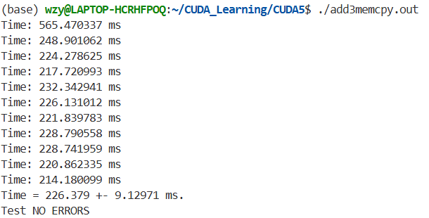
可以发现，核函数的运行时间竟然仅仅占据数据复制时间的$2.4\%$。对于目前的程序而言，这说明了两点：
1) CPU主机端与GPU设备端的数据传输速度就是GPU编程速度的核心瓶颈之一；
2) 仅仅是将来自主机端的数据相加再返回主机端的运算程序而言，使用GPU并不是一个明智的选择。

#### 4.影响GPU加速的若干因素
1) 数据传输比例
从`add3memcpy.cu`我们知道，CPU主机端与GPU设备端的数据传输速度就是GPU编程加速的核心瓶颈之一。而在GPU设备内部，其计算核心与设备内存的数据传输峰值远高于CPU与GPU之间数据传输的带宽。所以要实现GPU加速，就必须缩减主机端-设备端数据传输所花时间的比例。即便存在一些在GPU设备中速度不高的计算，也尽量使其在GPU中单独实现。
2) 算术强度
尽管在前文，使用CUDA核函数的计算远快于使用cpp的计算速度，然而这还不是GPU计算的极限速度。在本例中，数组相加的问题之所以很难达到更高的加速比，是因为该问题的算术强度（Arithmetic Intensity）不高。算术强度指**算术操作的工作量与必要的内存操作的工作量之比**。例如，在这里的数组相加问题中，在对每一组数据进行求和时，都需要先将一组数据从GPU设备内存中取出来，然后进行求和，最后将结果放回GPU设备内存。之所以说这个过程的算术强度低，因为相比取存数据的次数（2+1），计算次数仅为1。在CUDA中，GPU设备内部的**读写的代价相比计算而言也是十分高昂的**。
所以一个可能反直觉的结论是，越复杂的浮点数计算，加速比可能越高。为了解决算术强度低的问题，这里提供`arithmetic2gpu`：
```
#include <math.h>
#include <stdlib.h>
#include <stdio.h>
#include "error.cuh"

#ifdef USE_DP
    typedef double real;
#else
    typedef float real;
#endif

const int REPEATS = 10;
const real x0 = 100.0;
void __global__ arithmetic(real *x,const real x0,const int N);

int main(int argc, char **argv)
{
    if(argc != 2)
    {
        printf("Usage: %s <N>\n",argv[0]);
        return 1;
    }
    const int N = atoi(argv[1]);
    const int block_size = 128;
    const int grid_size = (N + block_size - 1) / block_size;

    const int M = sizeof(real) * N;
    real *h_x = (real *)malloc(M);
    real *d_x;
    CHECK(cudaMalloc(&d_x, M));

    float t_sum=0,t2_sum=0;
    for (int repeat = 0;repeat <= REPEATS;repeat++)
    {
        
        for (int i = 0; i < N; i++)
        {
            h_x[i] = 0.0;
        }
        CHECK(cudaMemcpy(d_x, h_x, M, cudaMemcpyHostToDevice));
        
        cudaEvent_t start, stop;
        CHECK(cudaEventCreate(&start));
        CHECK(cudaEventCreate(&stop));
        CHECK(cudaEventRecord(start));

        arithmetic<<<grid_size,block_size>>>(d_x,x0,N);

        CHECK(cudaEventRecord(stop));
        CHECK(cudaEventSynchronize(stop));
        float time;
        CHECK(cudaEventElapsedTime(&time, start, stop));
        printf("Time: %f ms\n", time);

        if(repeat >0)
        {
            t_sum += time;
            t2_sum += time * time;
        }

        CHECK(cudaEventDestroy(start));
        CHECK(cudaEventDestroy(stop));
    }
    const float t_ave = t_sum / REPEATS;
    const float t_err = sqrt(t2_sum / REPEATS - t_ave * t_ave);
    printf("Time = %g +- %g ms.\n",t_ave,t_err);

    free(h_x);
    CHECK(cudaFree(d_x));
    return 0;
}

void __global__ arithmetic(real *x,const real x0,const int N){
    const int n = blockIdx.x * blockDim.x + threadIdx.x;
    if(n < N)
    {
        real x_tmp = x[n];
        while(sqrt(x_tmp) < x0)
        {
            ++x_tmp;
        }
        x[n] = x_tmp;
    }
}

```
运行结果：
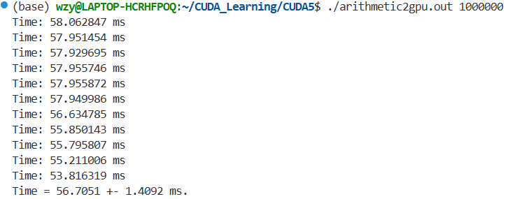
可以看到使用单精度浮点数，且数组长度为$10^6$时，其计算速度由显著提升，因为核函数潜入了一个10000次的循环，计算强度显然上升了。
3) 并行规模
为了说明这一问题，首先来简单说明一下GPU的硬件结构。一个GPU由多个流多处理器（Streaming Multiprocessor，SM）组成。每个SM都包含若干CUDA核心，且它们相互独立。根据架构不同，一个SM内最多驻留（reside）2048个或1024个线程，而一块GPU中通常存在几个到几十个SM不等。所以一块GPU一共可以驻留几万到几十万个线程。
那么，所谓并行规模，就是指核函数占用这些线程数目的比例。如果核函数中定义的线程数远小于GPU可支持驻留的线程数，那么就很难获得较高的加速比，也就是并行规模低。
由程序`arithmetic2gpu.cu`测试可知，当数组元素N设置的很大时，核函数的计算时间正比于数组大小。这是因为N足够大时，GPU设备满负荷运作，运算负载明显与计算时间呈正比关系。当数组元素N设置得不够大时，核函数的计算时间基本不变。这是因为N不够大时，GPU存在相当数量的空间计算资源，未达到满负荷之前，增加N并不会增加计算时间。
如果需要让GPU实现满负荷运作，则意味着要确定核函数定义的线程数的大小。该数值通常与GPU能够驻留的线程总数相当（1024/2048），也有可能更小些。所以在设置核函数的线程数时，要尽可能保证其能打到GPU满负荷工作的状态。
4) 总结
基于上述三点，对于编写与优化CUDA程序，最好需要从以下三个方面考虑：
- 减少CPU与GPU之间的数据传输，这通常是CUDA程序最耗时的部分；
- 提高核函数的算术强度，增加核函数中**计算**的比例；
- 增加核函数的并行规模，最大程度利用驻留线程总数；
#### 5. CUDA中的数学函数库
大致可以分为四类：
- 基本数学函数：包括sin()、cos()、exp()、log()、sqrt()、pow()等，且都是重载函数，都支持单精度与双精度；
- 快速近似函数：前缀使用`__`，例如`__sinf()`、`__cosf()`、`__expf()`、`__logf()`、`__sqrtf()`、`__powf()`等，这些函数牺牲精度换取速度，仅适用于对精度不敏感的场景；
- 内建函数（Intrinsics）：直接映射到GPU指令的函数，例如`__fadd_rn`(舍入加法)、`__fmul_rn`(舍入乘法)等；
- 特殊函数：例如bezier函数、gamma函数等，需要包含`cuda_math.h`、`cuda_runtime.h`这些头文件。
在使用这些函数时，需要综合考虑程序所需的效率与精度的平衡关系。
更多详情可以查阅官方[CUDA数学函数库](https://docs.nvidia.com/cuda/cuda-math-api)。

### 五. CUDA的内存组织
#### 1. CUDA内存组织简介
现代计算机内存通常使用组织结构（Hierarchy）以降低延迟、增加数据利用效率、提高计算速度。这种结构中存在诸多类型的内存，每一种内存根据设计需求不同具备不同的容量与延迟（Latency，处理器等待内存数据的时间）。一般而言，容量小的内存延迟低、速度快，当前需要被处理的数据一般置于此；容量大的内存延迟高、速度慢，当前无需被处理且随后需要被处理的数据一般置于此。
由于GPU的特殊架构，相比CPU架构，CUDA编程模型需要向程序员提供更多的控制权以更好控制计算。所以熟悉内存分级组织至关重要。
| 内存类型    | 物理位置     |   访问权限  |   可见范围 |  生命周期   |
|:-------------:|:-------------:|:-------------:|:-----------:|:-------------:|
|    全局内存    | 芯片外  |  读写 |  所有线程和主机端 |  由主机分配与释放 |
|    常量内存    | 芯片外  |  只读 |  所有线程和主机端 |  由主机分配与释放 |
| 纹理和表面内存 | 芯片外  |  一般只读 |  所有线程和主机端 |  由主机分配与释放 |
|    共享内存    | 芯片内  |  读写 | 单线程块 |  块结束后释放 |
|    局部内存    | 芯片外  | 读写  | 单线程  | 线程结束后释放 |
|   寄存器内存   | 芯片内  |  读写 |  单线程 |  线程结束后释放 |
#### 2. CUDA中不同类型的内存
##### 1.全局内存（Global Memory）
全局内存是指核函数的所有线程都能访问的内存区域。全局内存未存放在GPU芯片上，因此具有较高的延迟和较低的访问速度。一般而言，全局内存是所有GPU设备内存中最大的，所以全局内存的容量基本可视作显存容量。
全局内存的功能是为核函数提供数据，以及在主机与设备、设备与设备间传递数据。之前使用的`cudaMalloc()`函数所创建的内存，就是为全局内存变量分配设备内存，以便核函数访问。`cudaMemcpy()`所实现的Host-Device或Device-Device，其目的地也是全局内存。
全局内存的可读可写性可以体现在之前的语句中：
```
d_z[n] = d_x[n] + d_y[n];
```
对于线程n而言，该语句实现了从全局内存缓冲区中读取`d_x[n]`和`d_y[n]`，并将它们的和写入全局内存缓冲区中的`d_z[n]`。
全局内存对整个网格的所有线程可见，所有线程都可以读取和写入全局内存中的数据。
全局内存的生命周期是由CPU主机端决定的。从之前的例子也可以看出，由指针`d_x`、`d_y`、`d_z`所指向的全局内存缓冲区的生命周期从我们在主机端主动使用`cudaMalloc()`开始，到主机端主动使用`cudaFree()`结束。在这一期间，不同或相同的核函数中可以多次访问这些全局内存中的数据。
以上所有的全局内存都称为线性内存（Linear Memory）。在CUDA中还存在不透明的全局内存，称为CUDA Array，但Nvidia并不公开其数据排列方式，仅为纹理拾取服务，这里不做讨论。

之前的所有使用到的全局变量都是动态分配的全局变量，在CUDA中当然也允许使用静态全局变量，其所占用的内存数量在编译时就已确定。静态全局内存变量在定义时需要在所有主机与设备函数的外部定义，所以也可以视作一种cpp的全局变量。
静态全局内存变量定义格式如下：
```
__device__ T x; // 单变量
__device__ T y[N]; // 固定长度数组
```
T是变量类型，N是整型常数。下一个程序展示了静态全局内存变量的使用：
```
#include "error.cuh"
#include <stdio.h>
__device__ int d_x=1;
__device__ int d_y[2];

void __global__ my_kernel(void){
    d_y[0] += d_x;
    d_y[1] += d_x;
    printf("d_x = %d, d_y[0] = %d, d_y[1] = %d. \n",d_x,d_y[0],d_y[1]);
}

int main(){
    int h_y[2]={10,20};
    CHECK(cudaMemcpyToSymbol(d_y,h_y,sizeof(int)*2));
    my_kernel<<<1,1>>>();
    CHECK(cudaMemcpyFromSymbol(h_y,d_y,sizeof(int)*2));
    printf("h_y[0] = %d, h_y[1] = %d. \n",h_y[0],h_y[1]);
    return 0;
}
```
运行结果：
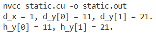
需要注意的是，核函数可以直接对静态全局内存变量进行访问，而主机函数中不可以。如果需要在静态全局内存与主机内存之间传递数据，就需要`cudaMemcpyToSymbol()`和`cudaMemcpyFromSymbol()`函数。二者的运行API原型如下：
```
cudaError_t cudaMemcpyToSymbol
(
    const void* symbol, // 静态全局内存变量名
    const void* src, // 主机内存缓冲区指针
    size_t count, // 复制的字节数
    size_t offset = 0, // 从symbol对应设备地址开始偏移的字节数
    cudaMemcpyKind kind = cudaMemcpyHostToDevice // 复制方向，可选参数
)
cudaError_t cudaMemcpyFromSymbol
(
    const void* dst, // 主机内存缓冲区指针
    const void* symbol, // 静态全局内存变量名
    size_t count, // 复制的字节数
    size_t offset = 0, // 从symbol对应设备地址开始偏移的字节数
    cudaMemcpyKind kind = cudaMemcpyDeviceToHost // 复制方向，可选参数
)
```
其中，symbol既可以是静态全局内存变量的变量名，也可以是常量内存变量的变量名。这里仅展示使用方法，后面会详述一种利用静态全局内存变量实现加速的方法。

##### 2.常量内存（Constant Memory）
常量缓存是有常量缓存的全局内存，数量有限，大小仅为64KB（现有GPU基本都为64KB）。它可以视作一种特殊的全局内存，生命周期与全局内存一致，不同之处在于，常量内存仅可读，且由于有缓存，内存访问速度快于全局内存。然而，高访问速度的前提是一整个线程束（相邻32线程）必须读取相同的内存常量数据。
一个常见的使用常量内存的方法是在核函数外面使用`__constant__`定义变量，并使用API函数`cudaMemcpyToSymbol()`将数据从主机端复制到设备的常量内存后供核函数使用。另外，给出核函数传递的参数（传值而非传指针）就存放在常量内存中，但一个核函数只能使用4KB常量内存。
另一个使用常量内存的方法就是在核函数中调用主机端定义的常量，例如之前`add()`函数的`const int N`就通过传值的方式传送给核函数中的线程使用。而在核函数内部的代码段`if(n < N)`中，这个参数N被每一个线程使用了。每一个线程都能直接访问该数值，这也是常量内存访问比全局内存访问快的原因。

##### 3.纹理内存（Texture Memory）和表面内存（Surface Memory）
纹理内存是CUDA设定的一种只读内存，它通过名为“纹理拾取”的方式实现在纹理内存中对数据的访问。纹理拾取，即访问纹理内存来获取CUDA数组中数据的过程。
纹理内存通常有两种使用方式:
- 将数据从主机端拷贝到设备端，然后将这一部分数据绑定到纹理内存。系统通过纹理拾取来获取这部分数据。
- 将数据从铸锻拷贝到设备端中某一段连续的全局内存中，然后将这一段全局内存绑定到纹理内存。系统通过纹理拾取来获取全局内存中的数据。
那么，为什么要特地设计这一种内存呢？纹理内存一开始是专门为那些在内存访问模式中存在大量空间局部性（Spatial Locality）的图形应用程序而设计的，这些程序在现在可以被一般认为是OpenGL和DirectX等的渲染流水线。所谓的“空间局部性（Spatial Locality）”，意思是在该程序中，一个线程读取的位置可能与邻近线程读取的位置非常接近，如下图所示：
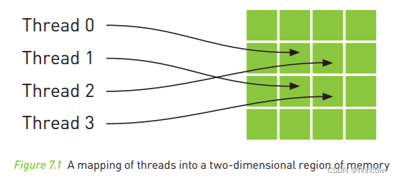

很显然，这四个地址并非内存逻辑上的连续，在一般的CPU缓存模式中，这些地址比不可能被缓存。于是纹理内存被开发出来，专门为了加速这种访问模式。
为了实现这种加速访问，同时也是纹理内存的另一个优势：纹理内存具有硬件插值功能，包括最邻近插值和双线性插值这两种插值方式。如果纹理拾取时输入的访问坐标地址是浮点数，纹理内存将自动根据设置插值方式对浮点坐标进行插值，然后返回插值结果。这个插值过程不需要开发者来实现，是硬件自动完成的，开发者只需要设置好插值方式为最邻近插值或者双线性插值即可，因此可以节省很多计算时间。
因此，纹理内存的一个重要使用方式是：若在CUDA优化程序中如果需要浮点坐标插值，且纹理内存的数据为float浮点型数据，那么可以考虑使用纹理内存的硬件插值特性来加速计算。不过需要注意，其仅当纹理内存的数据为float浮点型数据时，双线性插值模式才是有效的。
一个借助纹理内存的自动插值实现使用CUDA优化图像缩放的例子：
```
//定义纹理内存变量
texture<float, cudaTextureType2D, cudaReadModeElementType>  tex_src;


__global__ void resize_img_ker(int row, int col, float x_a, float y_a, uchar *out)
{
  int x = threadIdx.x + blockDim.x * blockIdx.x;  //col
  int y = threadIdx.y + blockDim.y * blockIdx.y;  //row


  if (x < col && y < row)
  {
    float xx = x*x_a;
    float yy = y*y_a;
    //这里的xx和yy都是浮点数，tex2D函数返回的数值已经过硬件插值了，所以无需再进行插值
    out[y*col+x] = (uchar)tex2D(tex_src, xx, yy);
  }
}

```
理解了纹理内存，表面内存就比较好理解了。表面内存（Surface Memory）更像是CUDA设定的纹理内存的“可续写扩展”，它以牺牲纹理内存的一部分特性为代价，允许对CUDA数组进行写入操作。
表面内存的用法：
```
// 表面内存的声明
// 二维表面示例
surface<void, cudaSurfaceType2D> surfRef; 

// 与支持读写的CUDA数组进行绑定
cudaArray* cuArray;
cudaMallocArray(&cuArray, &channelDesc, width, height, cudaArraySurfaceLoadStore);
// 绑定表面引用到CUDA数组
cudaBindSurfaceToArray(surfRef, cuArray);
```
注意事项：
- 纹理内存和表面内存都需要计算能力3.0及以上的GPU。
- 纹理内存和表面内存不保证与全局内存写入的一致性。具体而言，如果在核函数中既写入全局内存（或表面内存），又希望通过纹理内存读取同一块数据，结果可能是未定义的。应避免此种操作，或通过分离内核和同步来确保安全。
- 纹理内存针对2D空间局部访问优化。表面内存的写入操作不缓存。应根据实际访问模式选择。
- 二者使用完都需要及时解绑。

##### 4.寄存器（Register）
在核函数中定义的不加任何限定符的变量一般而言就存放在寄存器（Register）中。需要注意的是，并非所有不加任何限定符的变量都存放在寄存器中，这些变量也有可能存放局部内存中。另外，之前的各类自建变量（如`gridDim`、`blockDim`、`threadIdx`、`blockIdx`以及`warpSize`）都存放在特殊的寄存器中。这也是核函数访问这些内建变量高效的原因。
在之前的数组求和的示例中，我们已经使用过寄存器变量：
```
const int n = blockIdx.x * blockDim.x + threadIdx.x; // n就是寄存器变量
```
这句语句的作用就是定义一个寄存器变量n，并将赋值号右侧计算所得值赋给n（一次写入），而在之后的语句
```
z[n] = x[n] + y[n];
```
中，该变量n又被使用（一次读取）。
寄存器变量仅仅被一个线程可见。这意味着每一个线程都一个变量n的副本。进一步说明，尽管在代码中都是n这一变量名，但是在不同的线程中该寄存器变量的值史可以不同的，每一个线程都只能对它的副本进行读写，寄存器的生命周期也与所属线程的生命周期一致。
寄存器是内存与芯片上的（on-chip），所以它是所有内存中访问速度最快的，然而其数量与大小也很有限。通常一个寄存器占有32byte的内存，所以使用一个双精度浮点数会占用两个寄存器。

##### 5.局部内存（Local Memory）
从用法上来看，局部内存与寄存器几乎一致。局部内存可能存放那些寄存器放不下的变量，以及索引值不能在编译时就确定的数组。
尽管从用法来看，局部内存与寄存器几乎没有区别，但是从硬件角度来看，局部内存实际上是全局内存的一部分，所以局部内存的延迟也很高。

##### 6.共享内存（Shared Memory）
共享内存与寄存器类似，都是在芯片上的内存。它具有仅次于寄存器的读写速度，且数量有限。不同于寄存器的地方在于，共享内存对于整个线程块可见，生命周期也与整个线程块一致。每个线程块都有一个共享内存变量的副本。所以共享内存变量的数值在不同的线程块中是可以不同的。一个线程块中的所有线程都可以访问该线程块的共享内存变量副本，但不能访问其它线程块的。共享内存的设计是为了减少对于全局的访问，以及优化对全局内存的访问模式。

##### 7.L1和L2缓存
从费米架构开始，有了SM层次的L1缓存（一级缓存）以及设备层次的L2缓存（二级缓存）。我们可以将L1缓存与L2缓存视作一个专用于高效地分级处理数据的中转站：L2缓存是所有SM共享的、统一的大型公共仓库，所有进出GPU全局内存的数据都必须经过该缓存中；而L1缓存是每个SM独有的小型仓库，它离计算核心非常近，所以速度极快。

从硬件角度来看，L1缓存与共享内存都在一块高速的片上，二者只有功能的区别：
- 共享内存：其在前文已详述，简单来说就是将数据从全局内存中加载至共享内存中，防止对全局内存的大量访问，以便多个线程块在频繁时实现访问的加速。从编程角度考虑，只需要使用`__shared__`关键字在核函数中声明即可。
- L1缓存（L1 Cache）：是不可编程的、由硬件自动管理的、自动缓存来自全局内存数据的区域。

L1缓存与共享内存都共享同一块物理硬件资源，二者的总大小是固定的，开发者可以使用编译选项或运行时API分配二者之间的容量：
```
cudaFuncSetCacheConfig(func, cudaFuncCachePreferShared); // 偏好共享内存，或编译时使用-Xptxas -dlcm=ca
cudaFuncSetCacheConfig(func, cudaFuncCachePreferL1); // 偏好L1缓存，或编译时使用-Xptxas -dlcm=cs
```
二者默认均分。

从硬件角度来看，L2缓存是所有SM和内存控制器之间的一个统一缓存层。在功能性上，L2缓存负责所有对全局内存的访问。当SM发出内存请求时，请求首先会到达L2缓存。如果数据在L2中（这个过程称为命中），则直接返回给SM，避免了耗时的全局内存访问；如果数据不在L2中（未命中），则从全局内存中获取数据，并存入L2缓存，同时返回给请求的SM。
与L1缓存类似，L2缓存也是不可编程的，它的操作完全由硬件控制。
L2缓存是维护全局内存一致性的关键。它确保了所有SM看到的内存视图是一致的。

##### 8.线程访问数据的经典路径
我们总共学习了全局内存、常量内存、纹理内存和表面内存、寄存器、局部内存、共享内存、L1和L2缓存。现在我们以一个线程访问数据的过程为例，复习以上内存的作用。
1. 现在，线程基于所执行的指令，请求操作一个变量数据。
   首先，根据该数据的性质做判断，以知晓自己要去何处寻找该数据：
   如果是线程私有数据（例如kernel内定义的自动变量），则优先使用**寄存器**，如果寄存器放不下，就置于全局内存中的**局部内存**中；
   如果是整个线程块共享和协作数据（如被`__shared__`修饰的数组变量），那就加载到**共享内存**中，再从共享内存中访问；
   如果是无需频繁读写的只读数据（如被`__constant__`修饰的变量），那就优先使用**常量内存**；
   如果是需要读写的大型数据（数组、指针访问），那就直接访问**全局内存**；如果该指针通过`cudaBindTexture`绑定了，那就基于**纹理内存**的指令进行纹理拾取，且纹理缓存有配套机制实现高效读取。
2. 根据数据类型，请求对数据进行访问。
   如果是寄存器/共享内存中的数据，那么其路径为`线程 -> 寄存器`或`线程 -> 共享内存`。二者都直接从对应空间中读取数据，不经过L1/L2缓存，速度极快。
   如果是寄存器溢出到局部内存的数据，那么其路径为`线程 -> (生成访问请求) -> L1缓存 -> L2缓存 -> 全局内存`。在这个过程中，编译器暗中将该变量的存储位置重定向到了全局内存中的一个特定地址——即局部内存的位置。
   如果是访问常量内存数据，那么其路径为`线程 -> 常量缓存 -> (若未命中) -> L2缓存 -> 全局内存`。在这个过程中，SM会在线程发出请求后优先检查常量缓存，如果该数据已被其它线程读取过（即命中），那么就即刻返回；如果未命中，则从L2/全局内存中获取。最佳情况是同一个warp的所有线程读取同一个常量内存地址，这样就实现了一次读取、全部广播。
   如果是通过纹理/表面内存访问数据，那么其路径为`线程 -> texture操作指令 -> 纹理缓存 -> (若未命中) -> L2缓存 -> 全局内存`。线程会基于特殊指令进行访问，且请求会优先抵达纹理缓存中，如果命中，系统会基于附带的插值/滤波进行数据返回；如果未命中则从标准路径获取数据。
   如果是直接访问全局内存中的数据（也是最常见的情况），那么其路径为`线程 -> (生成访问请求) -> L1缓存 -> (若未命中) -> L2缓存 -> (若未命中) -> 全局内存`。这是最复杂，且最常见的路径。需要注意的是，内存访问必定是合并的，即一个Warp中的线程连续进行访问，因为运行时需要最大化内存带宽利用率。

#### 3. SM及其占有率
##### 1.SM的构成
在第四章我们已经简单介绍了GPU的流处理器（SM）。一个GPU Device是由多个SM构成的，而一个SM还包含如下资源：
- 寄存器。
- 共享内存。
- 常量内存的缓存。
- 纹理和表面内存的缓存。
- L1缓存。
- 2个或4个线程束调度器（Warp Scheduler），用于在不同线程的上下文之间迅速切换，以及为准备就绪的线程束发出执行指令。
- 若干执行核心，包括INT32（整型数运算）、FP32（单精度浮点数运算）、FP64（双精度浮点数运算）、SFUs（Special Function units，单精度浮点数超越函数特殊函数单元）、张量核心（Tensor Cores，适用于机器学习的低精度矩阵计算）。
##### 2.SM的占有率（Occupancy）
由于一个SM的计算资源总归是有限的，所以一个SM中驻留的线程数通常是达不到理想最大值的。SM的占有率（Occupancy）就是指每个SM上同时活跃的线程束数量与该SM所能支持的最大线程束数量之比。
在第四章，我们讨论了并行规模。并行规模较小时，有些SM会出现没有被利用，即占有率为0%的情况，这也是导致程序运行效率低的原因之一。当并行规模较大时，SM的占有率也并非能达到100%。
为了彻底解释清楚SM的占有率问题，我们首先需要知道两个指标：
1) 一个SM中最多能拥有的线程块个数设为$N_b$，它通常为16（开普勒架构和图灵架构）或32（麦克斯韦架构、帕斯卡架构和伏特架构）；
2) 一个SM中最多能拥有的线程个数设为$N_t$，它通常为2048（从开普勒架构到伏特架构）或1024（图灵架构）。
当并行规模足够大，即核函数执行配置中定义的总线程数足够多时，又需要分为以下三种情况来具体分析：
1. 寄存器与共享内存使用较少时。此时SM的占有率**完全由执行配置中的线程块大小决定**。为什么我们之前多次将线程块大小`block_size`设为128？因为在SM中，线程的执行是以线程束为单位执行的，我们的线程块大小也最好设为线程束大小（通常为32）的整数倍。假如设定了一个`block_size=100`的线程块，那么在这一个线程块中的线程束组成为$3*32+4$，即三个完整的线程束与一个只有4线程的不完整的线程束。在执行核函数中的诸多指令时，**所有线程束所花的时间必定都是相同的，这就造成了计算资源的浪费**。基于这个原因，我们设定的线程块大小应不小于$N_b/N_t$，且能整除$N_t$，这样才能得到100%的占有率。
2. 有限的寄存器数量对占有率存在约束时。基于目前各架构最常见寄存器数目（64K），一个SM最多能使用的寄存器为$64*1024$个。假设此时的$N_t$，即一个SM中最多能拥有的线程个数为2048，且核函数设定每个线程最多使用32个寄存器。那么
3. 