# OpenGL学习笔记+仓库

[参考教程：LearnOpenGL CN](https://learnopengl-cn.github.io/)

## 入门
### OpenGL
#### OpenGL的简介
OpenGL是什么？一般它被认为是一个API，包含了一系列可以操作图形、图像的函数。然而，OpenGL本身并不是一个API，它仅仅是一个由Khronos组织制定并维护的规范(Specification)。
OpenGL规范严格规定了每个函数该如何执行，以及它们的输出值。至于内部具体每个函数是如何实现(Implement)的，将由OpenGL库的开发者自行决定。因为OpenGL规范并没有规定实现的细节，具体的OpenGL库允许使用不同的实现，只要其功能和结果与规范相匹配，作为用户不会感受到功能上的差异。
实际的OpenGL库的开发者通常是显卡的生产商。使用Apple系统的时候，OpenGL库是由Apple自身维护的;在Linux下，有显卡生产商提供的OpenGL库，也有一些爱好者改编的版本。这也意味着任何时候OpenGL库表现的行为与规范规定的不一致时，基本都是库的开发者留下的bug。
#### 核心模式与立刻渲染模式
早期的OpenGL使用立即渲染模式（Immediate mode，也就是固定渲染管线），这个模式下绘制图形很方便。OpenGL的大多数功能都被库隐藏起来，开发者很少有控制OpenGL如何进行计算的自由。而开发者迫切希望能有更多的灵活性。随着时间推移，规范越来越灵活，开发者对绘图细节有了更多的掌控。立即渲染模式确实容易使用和理解，但是效率太低。因此从OpenGL3.2开始，规范文档开始废弃立即渲染模式，并鼓励开发者在OpenGL的**核心模式(Core-profile)**下进行开发，这个分支的规范完全移除了旧的特性。
当使用OpenGL的核心模式时，OpenGL迫使我们使用现代的函数。当我们试图使用一个已废弃的函数时，OpenGL会抛出一个错误并终止绘图。现代函数的优势是更高的灵活性和效率，然而也更难于学习。立即渲染模式从OpenGL实际运作中抽象掉了很多细节，因此它在易于学习的同时，也很难让人去把握OpenGL具体是如何运作的。现代函数要求使用者真正理解OpenGL和图形编程，它有一些难度，然而提供了更多的灵活性，更高的效率，更重要的是可以更深入的理解图形编程。
所以此教程面向OpenGL3.3的核心模式。虽然上手更困难，但这份努力是值得的。现今，更高版本的OpenGL已经发布（教程所示的最新版本为4.5），由于**所有OpenGL的更高的版本都是在3.3的基础上**引入了额外的功能，并没有改动核心架构，所以学习3.3版本即可。新版本只是引入了一些更有效率或更有用的方式去完成同样的功能。因此，所有的概念和技术在现代OpenGL版本里都保持一致。
#### 扩展
OpenGL的一大特性就是对扩展(Extension)的支持，当一个显卡公司提出一个新特性或者渲染上的大优化，通常会以扩展的方式在驱动中实现。如果一个程序在支持这个扩展的显卡上运行，开发者可以使用这个扩展提供的一些更先进更有效的图形功能。通过这种方式，开发者不必等待一个新的OpenGL规范面世，就可以使用这些新的渲染特性了，只需要简单地检查一下显卡是否支持此扩展。通常，当一个扩展非常流行或者非常有用的时候，它将最终成为未来的OpenGL规范的一部分。
使用扩展的代码大多看上去如下：
```
if(GL_ARB_extension_name)
{
    // 使用硬件支持的全新的现代特性
}
else
{
    // 不支持此扩展: 用旧的方式去做
}
```
#### 状态机
所谓**状态机，就是一个对事物“在不同状态下，如何响应事件并发生状态切换”的抽象数学模型**。一个标准的状态机通常包含状态（States）、事件/输入（Events/Inputs）、转移（Transitions）、初始状态（Initial State）、接受状态（可选，用于某些类型的状态机）五大部分。
OpenGL自身是一个巨大的状态机：一系列的变量描述OpenGL此刻应当如何运行。**OpenGL的状态通常被称为OpenGL上下文(Context)**。我们通常使用如下途径去更改OpenGL状态：设置选项，操作缓冲。最后，我们使用当前OpenGL上下文来渲染。
例如，当我们想告诉OpenGL去画线段而不是三角形的时候，我们通过改变一些上下文变量来改变OpenGL状态，从而告诉OpenGL如何去绘图。一旦我们改变了OpenGL的状态为绘制线段，下一个绘制命令就会画出线段而不是三角形。
当使用OpenGL的时候，我们会遇到一些**状态设置函数(State-changing Function)**，这类函数将会改变上下文。以及状态使用函数，这类函数会根据当前OpenGL的状态执行一些操作。只要记住：OpenGL本质上是个大状态机，就能更容易理解它的大部分特性。

### L1-1 : 创建一个窗口
基于状态机的理解，我们首先要做的是创建OpenGL的Context以及一个用于显示的窗口。然而，这些操作在每个系统上都是不一样的，OpenGL有意将这些操作抽象(Abstract)出去。这意味着我们不得不自己处理创建窗口，定义OpenGL上下文以及处理用户输入。
幸运的是，有一些库已经提供了我们所需的功能，其中一部分是特别针对OpenGL的。这些库节省了我们书写操作系统相关代码的时间，提供给我们一个窗口和一个OpenGL上下文用来渲染。最流行的几个库有GLUT，SDL，SFML和GLFW。在教程里我们将使用GLFW。你可以随意选用其他类似的库，大多数库的配置方法和GLFW差不多。

#### GLFW
GLFW是一个专门针对OpenGL的C语言库，它提供了一些渲染物体所需的最低限度的接口。它允许用户创建OpenGL上下文、定义窗口参数以及处理用户输入。
这里我们直接使用Linux/Ubuntu上的GLFW库，只需要在shell中输入：
```
sudo apt install -y libglfw3-dev libglew-dev
```
并在编译时加入`-lglfw` `-lGLEW` `-lGL` `-lm` `-ldl`这些链接即可
头文件：
```
#include <GLFW\glfw3.h>
```
我的GLFW就安装在`\usr\include\GLFW`目录下
#### GLAD
OpenGL只是一个标准/规范，具体的实现是由驱动开发商针对特定显卡实现的。由于OpenGL驱动版本众多，它大多数函数的位置都无法在编译时确定下来，需要在运行时查询。所以任务就落在了开发者身上，开发者需要在运行时获取函数地址并将其保存在一个函数指针中供以后使用。取得地址的方法因平台而异，在Windows上会是类似这样：
```
// 定义函数原型
typedef void (*GL_GENBUFFERS) (GLsizei, GLuint*);
// 找到正确的函数并赋值给函数指针
GL_GENBUFFERS glGenBuffers  = (GL_GENBUFFERS)wglGetProcAddress("glGenBuffers");
// 现在函数可以被正常调用了
GLuint buffer;
glGenBuffers(1, &buffer);
```
这其实相当繁琐，我们需要对每个可能使用的函数都要重复这个过程。幸运的是，有些库能简化此过程，其中GLAD是目前最新，也是最流行的库。
GLAD是一个开源的库，它能解决我们上面提到的那个繁琐的问题。GLAD的配置与大多数的开源库有些许的不同，GLAD使用了一个[在线服务](https://glad.dav1d.de/)。在这里我们能够告诉GLAD需要定义的OpenGL版本，并且根据这个版本加载所有相关的OpenGL函数。
打开GLAD的在线服务，将语言(Language)设置为C/C++，在API选项中，选择3.3以上的OpenGL(gl)版本（我们的教程中将使用3.3版本，但更新的版本也能用）。之后将模式(Profile)设置为Core，并且保证选中了生成加载器(Generate a loader)选项。现在可以先（暂时）忽略扩展(Extensions)中的内容。都选择完之后，点击生成(Generate)按钮来生成库文件。
GLAD会提供一个zip压缩文件，包含两个头文件目录，和一个glad.c文件。将两个头文件目录（glad和KHR）复制到Include文件夹中（或者增加一个额外的项目指向这些目录），并添加glad.c文件到你的工程中。
我这里懒得弄CMake，在编译时使用Makefile，额外链接一下即可。
```
# 编译器与编译选项
CXX      = g++
CXXFLAGS = -std=c++11 -Wall -Wextra -O2
INCLUDES = -I/usr/include -I../glad/include

# 链接库与库路径
LDFLAGS  = -L/usr/local/lib
LIBS     = -lglfw -lGLEW -lGL -lm -ldl

# 最终生成的可执行文件名
TARGET = opengl_app

# 源文件与目标文件定义
# 自动查找当前目录下所有 .cpp 文件
SRCS = $(wildcard *.cpp)
# 添加GLAD源文件路径
GLAD_SRC = ../glad/src/glad.c
# 将所有 .cpp 文件名转换为对应的 .o 文件名
OBJS = $(SRCS:.cpp=.o) glad.o

# 默认目标：编译整个项目
all: $(TARGET)

# 链接目标：将 .o 文件链接为最终可执行文件
$(TARGET): $(OBJS)
	$(CXX) -o $@ $(OBJS) $(LIBS)

# 编译规则：将每个 .cpp 文件编译为 .o 文件
# 使用模式规则，$< 代表第一个依赖文件（.cpp），$@ 代表目标文件（.o）
%.o: %.cpp
	$(CXX) $(CXXFLAGS) $(INCLUDES) -c $< -o $@

# 编译GLAD C源文件 - 需要不同的编译选项（C语言）
glad.o: $(GLAD_SRC)
	$(CXX) $(CXXFLAGS) -I../glad/include -c $(GLAD_SRC) -o glad.o

# 清理目标：删除编译生成的中间文件和可执行文件
clean:
	rm -f $(OBJS) $(TARGET) glad.0

# 检查GLAD文件是否存在
check-glad:
	@if [ ! -f "../glad/src/glad.c" ]; then \
		echo "错误：找不到GLAD源文件"; \
		echo "请确保GLAD安装在 ~/OpenGL/glad/ 目录下"; \
		echo "目录结构应为："; \
		echo "  ~/OpenGL/glad/include/glad/glad.h"; \
		echo "  ~/OpenGL/glad/src/glad.c"; \
		exit 1; \
	else \
		echo "✓ GLAD文件检查通过"; \
	fi
	@if [ ! -f "../glad/include/glad/glad.h" ]; then \
		echo "错误：找不到GLAD头文件"; \
		exit 1; \
	fi

```

#### 实用资源
[GLFW: Window Guide](https://www.glfw.org/docs/latest/window_guide.html)：GLFW官方的配置GLFW窗口的指南。

#### 窗口的创建
首先试试GLFW与GLAD能否正常工作
```
#include <glad/glad.h>
#include <GLFW/glfw3.h>
```
*如果编译后cpp文件得到大量的 undefined reference 错误，这意味着程序并未链接到GLFW库。*
##### GLFW窗口的实例化
首先创建如下`main`函数
```
int main()
{
    glfwInit();
    glfwWindowHint(GLFW_CONTEXT_VERSION_MAJOR, 3);
    glfwWindowHint(GLFW_CONTEXT_VERSION_MINOR, 3);
    glfwWindowHint(GLFW_OPENGL_PROFILE, GLFW_OPENGL_CORE_PROFILE);
#ifdef __APPLE__
    //glfwWindowHint(GLFW_OPENGL_FORWARD_COMPAT, GL_TRUE);// MacOS需要额外加这行代码
#endif

    return 0;
}
```
这里我们做的包括`glfwInit()` `glfwWindowHint()` 这两个方法。
- `glfwInit()`：顾名思义，初始化GLFW
- `glfwWindowHint()`:用于设置可以影响窗口/缓冲区/上下文的提示。什么意思呢？之前说了我们在创建上下文时，必须兼容客户端的API版本（例如OpenGL3.3），并还要告诉GLFW我们使用核心模式（core-profile）。所以这里将主版本号(Major)和次版本号(Minor)都设为3，并明确告诉GLFW我们只使用OpenGL功能的一个子集——核心模式（没有我们已不再需要的向后兼容特性）。
##### GLFW窗口对象的创建
```
GLFWwindow *window = glfwCreateWindow(800, 600, "LearnOpenGL", NULL, NULL);
    if (window == NULL)
    {
        std::cout << "Failed to create GLFW Window" << std::endl;
        glfwTerminate();
        return -1;
    }
    glfwMakeContextCurrent(window);
```
大多数代码都是望文生义，无所多讲，这里介绍`glfwCreateWindow()`函数的详细用法以及`glfwMakeContextCurrent(window)`函数的含义
- `glfwCreateWindow()`：完整的函数定义
```
GLFWwindow* glfwCreateWindow(int width, int height, const char* title, GLFWmonitor* monitor, GLFWwindow* share)
```
其中，最后两项中的`monitor`代表用于全屏模式的监视器，具体而言用于指定窗口应该在哪台显示器上显示
```
// 在副显示器显示
int monitorCount;
GLFWmonitor** monitors = glfwGetMonitors(&monitorCount);
GLFWwindow *window = glfwCreateWindow(800, 600, "LearnOpenGL", monitors[1], NULL);
```
`share`表示资源共享的上下文窗口，指定与哪个已有窗口共享资源，如果输入的为有效的窗口指针，说明新窗口与指定窗口贡献OpenGL上下文资源（通常包括纹理、着色器程序、顶点缓冲区、帧缓冲区等）
- `glfwMakeContextCurrent(window)`：正如之前所属，OpenGL的上下文就是状态机的一个完整示例，OpenGL需要一些API函数来知道自己该操作哪个状态机，这就需要一个当前上下文来知道该使用或修改哪一套状态。
`glfwMakeContextCurrent(window)`的作用就是将指定的window窗口的OpenGL上下文设置为当前线程的当前上下文,这样在window的所有OpenGL调用就不会影响别的窗口

##### 初始化GLAD
```
    if (!gladLoadGLLoader((GLADloadproc)glfwGetProcAddress))
    {
        std::cout << "Failed to initialize GLAD" << std::endl;
        return -1;
    }
```
在之前的教程中已经提到过，GLAD是用来管理OpenGL的函数指针的，所以在调用任何OpenGL的函数之前我们需要初始化GLAD。

##### 视口(Viewport)的初始化
在我们开始渲染之前还有一件重要的事情要做，我们必须告诉OpenGL渲染窗口的尺寸大小，即视口(Viewport)，这样OpenGL才只能知道怎样根据窗口大小显示数据和坐标。我们可以通过调用glViewport函数来设置视口的尺寸(Dimension)：
```
glViewport(0, 0, 800, 600);
```
在幕后，OpenGL使用glViewport定义的位置与宽高进行2D坐标的转换，将OpenGL的位置坐标转换为屏幕坐标。
*实际上也可以将视口的维度设置为比GLFW的维度小，这样子之后所有的OpenGL渲染将会在一个更小的窗口中显示，这样子的话我们也可以将一些其它元素显示在OpenGL视口之外。*
在更一般的场景中，当用户改变窗口的大小的时候，视口也应该被调整。我们可以对窗口**注册一个回调函数**(Callback Function)，它会在每次窗口大小被调整的时候被调用。这个回调函数的原型如下：
```
void framebuffer_size_callback(GLFWwindow* window, int width, int height);
```
这个**帧缓冲大小函数**需要一个GLFWwindow作为它的第一个参数，以及两个整数表示窗口的新维度。每当窗口改变大小，GLFW会调用这个函数并填充相应的参数进行处理。
```
void framebuffer_size_callback(GLFWwindow* window, int width, int height)
{
    glViewport(0, 0, width, height);
}
```
我们还需要注册这个函数，告诉GLFW我们希望每当窗口调整大小的时候调用这个函数：
```
glfwSetFramebufferSizeCallback(window, framebuffer_size_callback);
```

##### 准备引擎
此刻的代码可以编译并运行了，然而它并不会输出任何东西，因为它只绘制一个图像之后程序就立即退出并关闭窗口。我们希望程序在我们主动关闭它之前不断绘制图像并能够接受用户输入。因此，我们需要在程序中添加一个while循环，我们可以把它称之为渲染循环(Render Loop)，它能在我们让GLFW退出前一直保持运行。
一个简单的Render Loop：
```
while(!glfwWindowShouldClose(window))
{
    glfwSwapBuffers(window);
    glfwPollEvents();    
}
```
- `glfwWindowShouldClose()`:该函数在我们每次循环的开始前检查一次GLFW是否被要求退出，如果是的话，该函数返回true，渲染循环将停止运行，之后我们就可以关闭应用程序。
- `glfwPollEvents()`：该函数会检查有没有触发什么事件（比如键盘输入、鼠标移动等）、更新窗口状态，并调用对应的回调函数（可以通过回调方法手动设置）。
- `glfwSwapBuffers()`：该函数会交换颜色缓冲（它是一个储存着GLFW窗口每一个像素颜色值的大缓冲），它在一次迭代中被用来绘制，并且将会作为输出显示在屏幕上。
为什么要使用双缓冲？单缓冲绘图的不真实感源于图像绘制存在顺序（从左往右、从上到下），所以不是瞬间呈现的。使用双缓冲能保证渲染的真实感。**前缓冲**保存最终输出的图像，所有的**渲染指令在后缓冲上绘制**，渲染指令执行完毕后Swap前后缓冲，这样就能立刻显示图像，消除不真实感。

##### 清理资源
使用`glfwTerminate()`清理分配的所有资源，一定要养成分配必清理的好习惯！

##### 用户输入
我们希望能够在GLFW中实现一些简单的输入控制。这里使用了GLFW里的`glfwGetKey()`函数，这个函数将会返回这个按键是否正在被按下。
此外，为了保持Render Loop代码的可读性，我们另外需要创建一个`processInput()`函数：
```
void processInput(GLFWwindow *window)
{
    if(glfwGetKey(window, GLFW_KEY_ESCAPE) == GLFW_PRESS)
        glfwSetWindowShouldClose(window, true);
}
```
*如果用户没有按下ESC，`glfwGetKey`将会返回`GLFW_RELEASE`；如果按下了ESC，会在状态机中将`WindowShouldClose`属性设置为 `true`来关闭GLFW*

##### Render Loop的基本结构
我们要把所有的渲染(Rendering)操作放到渲染循环中，因为我们想让这些渲染指令在每次渲染循环迭代的时候都能被执行。大概的代码将会是这样的:
```
while(!glfwWindowShouldClose(window))
{
    // 输入
    processInput(window);

    // 渲染指令
    ...

    // 检查并调用事件，交换缓冲
    glfwPollEvents();
    glfwSwapBuffers(window);
}
```
此时，输出的屏幕是黑色的。每次Render迭代开始时都会清屏。除非使用ESC更改`WindowShouldClose`的状态。
这里还可以调用`glClearColor()`函数来设置清空屏幕所用的颜色，使用`glClear()`函数清除颜色缓冲。最终实现改变背景颜色的效果：
```
    while(!glfwWindowShouldClose(window)){
        // 输入部分
        processInput(window); // 按下ESC可以关闭窗口

        // 渲染指令
        glClearColor(0.2f,0.3f,0.3f,1.0f);
        glClear(GL_COLOR_BUFFER_BIT);。

        // 检查、调用事件，交换缓冲
        glfwSwapBuffers(window);
        glfwPollEvents(); 
    }
```
- `glClear()`:该函数用来清空屏幕的颜色缓冲，它接受一个缓冲位(Buffer Bit)来指定要清空的缓冲。
可能的缓冲位有`GL_COLOR_BUFFER_BIT`，`GL_DEPTH_BUFFER_BIT`和`GL_STENCIL_BUFFER_BIT`。由于现在我们只关心颜色值，所以我们只清空颜色缓冲（color buffer）。

### L1-2 : 绘制一个三角形
#### OpenGL的图形渲染管线（Graphics Pipeline）
首先记忆三个极为基础且重要的概念
- 顶点数组对象：Vertex Array Object，VAO
- 顶点缓冲对象：Vertex Buffer Object，VBO
- 元素缓冲对象：Element Buffer Object，EBO 或 索引缓冲对象 Index Buffer Object，IBO

在OpenGL中，所有的具体模型都在3D空间中，而屏幕输出的是2D像素数组，这就使得OpenGL的工作就是**通过其图形渲染管线将3D坐标转化为适合于当前屏幕的2D坐标**。
OpenGL的渲染管线主要负责两个部分：
- 3D坐标转换为2D坐标。
- 将2D坐标转换为带颜色的像素。

*`2D坐标`和`2D像素`是两个不同的概念，2D坐标表示一个点在2D空间中的位置，2D像素是这个点的近似值.*

总的来说，OpenGL的图形渲染管线就是接收一组3D坐标，然后把它们转变为屏幕上的有色2D像素输出。
##### 图元
为了让OpenGL知道我们的坐标和颜色值构成的到底是什么，OpenGL需要程序员去指定这些数据所表示的渲染类型。我们希望把这些数据渲染成一系列的点、三角形或是线。做出的这些提示叫做图元(Primitive)，任何一个绘制指令的调用都将把图元传递给OpenGL。这通常包括：GL_POINTS、GL_TRIANGLES、GL_LINE_STRIP

##### 图形渲染管线的基本流程
图形渲染管线可以被划分为几个阶段，每个阶段将会把前一个阶段的输出作为输入。所有这些阶段都是高度专门化的，它们通常都有一个特定的函数，并且很容易并行执行。
正是由于它们具有并行执行的特性，所以就适合在GPU上为每一个（渲染管线）阶段运行各自的小程序，从而实现在图形渲染管线中快速处理数据。**这些小程序叫做着色器(Shader)**。OpenGL着色器是用OpenGL着色器语言(OpenGL Shading Language, GLSL)写成的，在之后会深入研究。
回到渲染管线的流程上，基本可以认为分为以下六个阶段：
1. 图形渲染管线的第一个部分是顶点着色器（Vertex Shader），输入为一个顶点的3D坐标，输出为标准化设备坐标，同时VS允许对其属性进行一些基本处理
2. VS的输出可以选择性地传递给几何着色器(Geometry Shader)。几何着色器将一组顶点作为输入，这些顶点形成图元，并且能够通过发出新的顶点来形成新的(或其他)图元来生成其他形状。
3. 下一个阶段是图元装配(Primitive Assembly)阶段，其将顶点着色器（或几何着色器）输出的所有顶点作为输入（如果是GL_POINTS，那么就是一个顶点），并将所有的点装配成指定图元的形状；本节例子中是两个三角形。
4. PA阶段的输出会被传入光栅化阶段(Rasterization Stage)，这里它会把图元映射为最终屏幕上相应的像素，生成供片段着色器使用的片段(Fragment)。在片段着色器运行之前会执行裁切(Clipping)。裁切会丢弃超出你的视图以外的所有像素，用来提升执行效率。
5. 片段着色器(Fragment Shader)的主要目的是计算一个像素的最终颜色，这也是所有OpenGL高级效果产生的地方。通常，片段着色器包含3D场景的数据（比如光照、阴影、光的颜色等等），这些数据可以被用来计算最终像素的颜色。
6. 在所有对应颜色值确定以后，最终的对象将会被传到最后一个阶段，叫做Alpha测试和混合(Blending)阶段。这个阶段检测片段的对应的深度和模板(Stencil)值（后面会讲），用它们来判断这个像素是其它物体的前面还是后面，决定是否应该丢弃。这个阶段也会检查alpha值（物体的透明度）并对物体进行混合(Blend)。所以，即使在片段着色器中计算出来了一个像素输出的颜色，在渲染多个三角形的时候最后的像素颜色也可能完全不同。
这就是使用OpenGL渲染管线时必定会进行的6个步骤。大多数场合下，我们只需要配置顶点（VS）和片段着色器（FS）即可，几何着色器（GS）可选。
在本节中，为了绘制一个三角形，我们必须定义至少一个VS和FS。
#### 顶点坐标在OpenGL的管线中的处理流程
基本流程：顶点坐标——(VS on GPU)——裁剪坐标——(透视算法)——标准化设备坐标(NDC)——(视口变换(glViewport))——屏幕空间坐标(Screen-space Coordinates, S-s C)——>FS

我们首先定义顶点数据，并将它发送给图形渲染管线的第一个阶段：顶点着色器。顶点着色器会在 GPU 上处理这些顶点，将其变换到裁剪空间。经过后续的透视除法，顶点坐标被转换为标准化设备坐标 (NDC)。

接着，通过视口变换 (glViewport 设置)，NDC 被映射到屏幕空间坐标，从而确定每个顶点在窗口中的位置。光栅化阶段根据这些屏幕空间坐标生成片段，并将片段传递给片段着色器进行处理。

- NDC坐标范围问题：OpenGL不是简单地把所有的3D坐标变换为屏幕上的2D像素；OpenGL仅当3D坐标在3个轴（x、y和z）上-1.0到1.0的范围内时才处理它。    所有在这个范围内的坐标叫做标准化设备坐标(Normalized Device Coordinates)，其范围是x、y和z值在-1.0到1.0的一小段空间。任何落在范围外的坐标都会被丢弃/裁剪，不会显示在屏幕上。

在我们将顶点数据发送给位于GPU上的顶点着色器后，VS会在GPU上创建内存（储存顶点数据），并配置OpenGL如何解释这些内存，并指定其如何发送给显卡。

之后，我们就使用顶点缓冲对象VBO管理这个内存。使用这些缓冲对象的好处是我们可以一次性的发送一大批数据到显卡上，而不是每个顶点发送一次。从CPU把数据发送到显卡相对较慢，所以只要可能我们都要尝试尽量一次性发送尽可能多的数据。当数据发送至显卡的内存中后，顶点着色器几乎能立即访问顶点，这是个非常快的过程。

VBO是教程中第一个出现的OpenGL对象。就像OpenGL中的其它对象一样，这个缓冲有一个独一无二的ID，所以我们可以使用`glGenBuffers()`函数**生成**一个带有缓冲ID的VBO对象：
```
unsigned int VBO;
glGenBuffers(1, &VBO);
```
OpenGL有很多缓冲对象类型，VBO的缓冲类型是`GL_ARRAY_BUFFER`。OpenGL允许我们同时绑定多个缓冲，只要它们是不同的缓冲类型。我们可以使用`glBindBuffer`函数把新创建的缓冲绑定到`GL_ARRAY_BUFFER`目标上：
```
glBindBuffer(GL_ARRAY_BUFFER, VBO);
```
- `glBindBuffer(缓冲目标，缓冲对象)`：如何理解这一过程——**"缓冲对象与缓冲目标绑定"**？`glBindBuffer()`的作用是将缓冲对象与缓冲目标绑定，由于OpenGL是一个巨型状态机，缓冲目标（例如`GL_ARRAY_BUFFER`）就是其中的用于代表顶点数据的重要“状态”。后续的`glBufferData()`函数并不关心我们具体是VBO1还是VBO2，我们对数据的操控必须只影响状态。**我们得通过改变绑定状态来实现不同数据源之间的切换。**此外，在渲染一个复杂场景时，我们可能需要多个VBO（比如位置、法线、颜色分开存储）。只需要用 `glBindBuffer()` 快速切换当前活跃的VBO，然后进行绘制，而无需重新指定数据。
- 缓冲目标通常包括：`GL_ARRAY_BUFFER`与顶点数据挂钩、`GL_ELEMENT_ARRAY_BUFFER`与索引数据挂钩、`GL_UNIFORM_BUFFER`与统一变量挂钩

典型示例
```
// 假设我们有两个VBO，一个存顶点位置，一个存顶点颜色
unsigned int VBO_positions, VBO_colors;

// 配置位置VBO
glBindBuffer(GL_ARRAY_BUFFER, VBO_positions); // 把“位置工具箱”挂上挂钩
glBufferData(GL_ARRAY_BUFFER, ..., positionData, ...); // 数据放入位置工具箱
glVertexAttribPointer(0, ...); // 告诉管线如何从位置工具箱取数据

// 配置颜色VBO
glBindBuffer(GL_ARRAY_BUFFER, VBO_colors); // 现在把“颜色工具箱”挂上同一个挂钩
glBufferData(GL_ARRAY_BUFFER, ..., colorData, ...); // 数据放入颜色工具箱
glVertexAttribPointer(1, ...); // 告诉管线如何从颜色工具箱取数据

// 绘制时，两个VBO的数据都会被使用
```

通过`glBindBuffer(GL_ARRAY_BUFFER, VBO);`实现绑定后，我们使用的任何在`GL_ARRAY_BUFFER`目标上的缓冲调用都会用来配置当前绑定的缓冲(VBO)。然后我们可以调用`glBufferData()`函数，它会把之前定义的顶点数据复制到缓冲的内存中：
```
glBufferData(GL_ARRAY_BUFFER, sizeof(vertices), vertices, GL_STATIC_DRAW);
```
- `glBufferData()`:glBufferData是一个专门用来把用户定义的数据复制到当前绑定缓冲的函数。它的第一个参数是目标缓冲的类型：顶点缓冲对象当前绑定到GL_ARRAY_BUFFER目标上。第二个参数指定传输数据的大小(以字节为单位)；用一个简单的sizeof计算出顶点数据大小就行。第三个参数是我们希望发送的实际数据。
- 第四个参数指定了我们希望显卡如何管理给定的数据。它有三种形式：
- - `GL_STATIC_DRAW` ：数据不会或几乎不会改变。
- - `GL_DYNAMIC_DRAW`：数据会被改变很多。
- - `GL_STREAM_DRAW` ：数据每次绘制时都会改变。
- 三角形的位置数据不会改变，每次渲染调用时都保持原样，所以它的使用类型最好是`GL_STATIC_DRAW`。如果，比如说一个缓冲中的数据将频繁被改变，那么使用的类型就是`GL_DYNAMIC_DRAW`或`GL_STREAM_DRAW`，这样就能确保显卡把数据放在能够高速写入的内存部分。

现在我们已经把顶点数据储存在显卡的内存中，用VBO这个顶点缓冲对象管理。下面我们会创建一个顶点着色器和片段着色器来真正处理这些数据。现在我们开始着手创建它们吧。

#### 顶点着色器的使用
顶点着色器(Vertex Shader)是几个可编程着色器中的一个。如果我们打算做渲染的话，现代OpenGL需要我们至少设置一个顶点着色器（VS）和一个片段着色器（FS）。我们会简要介绍一下着色器以及配置两个非常简单的着色器来绘制我们第一个三角形。下一节中我们会更详细的讨论着色器。

##### VS的编写
我们需要做的第一件事是用着色器语言GLSL(OpenGL Shading Language)编写顶点着色器，然后编译这个着色器，这样我们就可以在程序中使用它了。下面是一个非常基础的GLSL顶点着色器的源代码：
```
#version 330 core
layout (location = 0) in vec3 aPos;

void main()
{
    gl_Position = vec4(aPos.x, aPos.y, aPos.z, 1.0);
}
```
可以看到，GLSL看起来很像C语言。每个着色器都起始于一个版本声明。OpenGL 3.3以及和更高版本中，GLSL版本号和OpenGL的版本是匹配的（比如说GLSL 420版本对应于OpenGL 4.2）。我们同样明确表示我们会使用核心模式。

下一步，使用`in`关键字，在顶点着色器中声明所有的输入顶点属性(Input Vertex Attribute)。现在我们只关心位置(Position)数据，所以我们只需要一个顶点属性。GLSL有一个向量数据类型，它包含1到4个float分量，包含的数量可以从它的后缀数字看出来。由于每个顶点都有一个3D坐标，我们就创建一个vec3输入变量aPos。我们同样也通过layout (location = 0)设定了输入变量的位置值(Location)。

*为什么我们会需要这个位置值？`vec.w`分量不是用作表达空间中的位置的，而是用在所谓透视除法(Perspective Division)上。*

当前这个顶点着色器可能是我们能想到的最简单的顶点着色器了，因为我们对输入数据什么都没有处理就把它传到着色器的输出了。在真实的程序里输入数据通常都不是标准化设备坐标，所以我们首先必须先把它们转换至OpenGL的可视区域内。

##### VS的编译
现在，我们暂时将顶点着色器的源代码**硬编码在代码文件顶部**的C风格字符串中：
```
const char *vertexShaderSource = "#version 330 core\n"
    "layout (location = 0) in vec3 aPos;\n"
    "void main()\n"
    "{\n"
    "   gl_Position = vec4(aPos.x, aPos.y, aPos.z, 1.0);\n"
    "}\0";
```
为了能够让OpenGL使用它，我们必须在运行时动态编译它的源代码。

我们首先要做的是创建一个着色器对象，注意还是用ID来引用的。所以我们储存这个顶点着色器为`unsigned int`，然后用`glCreateShader()`创建这个着色器：
```
unsigned int vertexShader;
vertexShader = glCreateShader(GL_VERTEX_SHADER);
```
我们把需要创建的着色器类型以参数形式提供给`glCreateShader`。由于我们正在创建一个顶点着色器，传递的参数是`GL_VERTEX_SHADER`。

下一步我们把这个着色器源码附加到着色器对象上，然后编译它：
```
glShaderSource(vertexShader, 1, &vertexShaderSource, NULL);
glCompileShader(vertexShader);
```
`glShaderSource`函数把要编译的着色器对象作为第一个参数。第二参数指定了传递的源码字符串数量，这里只有一个。第三个参数是顶点着色器真正的源码，第四个参数我们先设置为NULL。

那么我们如何知道编译是否成功？如果错误，具体错误是什么？可以这样操作：
```
int  success;
char infoLog[512];
glGetShaderiv(vertexShader, GL_COMPILE_STATUS, &success);
```
首先我们定义一个整型变量来表示是否成功编译，还定义了一个储存错误消息的容器。然后我们用`glGetShaderiv`检查是否编译成功。如果编译失败，我们会用`glGetShaderInfoLog`获取错误消息，然后打印它。
```
if(!success)
{
    glGetShaderInfoLog(vertexShader, 512, NULL, infoLog);
    std::cout << "ERROR::SHADER::VERTEX::COMPILATION_FAILED\n" << infoLog << std::endl;
}
```

#### FS的编译
片段着色器所做的是计算像素最后的颜色输出。在这里为了简单，我们的FS将会一直输出橘黄色。
```
#version 330 core
out vec4 FragColor;

void main()
{
    FragColor = vec4(1.0f, 0.5f, 0.2f, 1.0f);
} 
```
FS只需要一个输出变量，这个变量是一个4分量向量，它表示的是最终的输出颜色，我们应该自己将其计算出来。声明输出变量可以使用`out`关键字，这里我们命名为`FragColor`。我们将一个Alpha值为1.0(1.0代表完全不透明)的橘黄色的vec4赋值给颜色输出。

编译片段着色器的过程与顶点着色器类似，只不过我们使用`GL_FRAGMENT_SHADER`常量作为着色器类型：
```
unsigned int fragmentShader;
fragmentShader = glCreateShader(GL_FRAGMENT_SHADER);
glShaderSource(fragmentShader, 1, &fragmentShaderSource, NULL);
glCompileShader(fragmentShader);
```
两个着色器现在都编译了，剩下的事情是把两个着色器对象链接到一个用来渲染的**着色器程序(Shader Program)**中。

#### 着色器程序（Shader Program）
着色器程序对象(Shader Program Object)是多个着色器合并之后并最终链接完成的版本。如果要使用刚才编译的着色器我们必须把它们**链接(Link)**为一个着色器程序对象，然后在渲染对象的时候激活这个着色器程序。已激活着色器程序的着色器将在我们发送渲染调用的时候被使用。

当链接着色器至一个程序的时候，它会把每个着色器的输出链接到下个着色器的输入。当输出和输入不匹配的时候，会得到一个连接错误。

创建一个程序对象很简单：
```
unsigned int shaderProgram;
shaderProgram = glCreateProgram();
```
`glCreateProgram()`函数创建一个程序，并返回新创建程序对象的ID引用。现在我们需要把之前编译的着色器附加到程序对象上，然后用`glLinkProgram()`链接它们：
```
glAttachShader(shaderProgram, vertexShader);
glAttachShader(shaderProgram, fragmentShader);
glLinkProgram(shaderProgram);
```
代码应该很清楚，我们把着色器附加到了程序上，然后用`glLinkProgram()`链接。

就像着色器的编译一样，我们也可以检测链接着色器程序是否失败，并获取相应的日志。与上面不同，我们不会调用`glGetShaderiv()`和`glGetShaderInfoLog()`，现在我们使用：
```
glGetProgramiv(shaderProgram, GL_LINK_STATUS, &success);
if(!success) {
    glGetProgramInfoLog(shaderProgram, 512, NULL, infoLog);
    ...
}
```
得到的结果就是一个程序对象，我们可以调用`glUseProgram()`函数，用刚创建的程序对象作为它的参数，以激活这个程序对象：
```
glUseProgram(shaderProgram);
```
在`glUseProgram()`函数调用之后，每个着色器调用和渲染调用都会使用这个程序对象（也就是之前写的着色器）了。在把着色器对象链接到程序对象以后，记得删除着色器对象，我们不再需要它们了：
```
glDeleteShader(vertexShader);
glDeleteShader(fragmentShader);
```
现在，我们已经把输入顶点数据发送给了GPU，并指示了GPU如何在VS和FS中处理它。但是，OpenGL还不知道它该如何解释内存中的顶点数据，以及它该如何将顶点数据链接到顶点着色器的属性上。我们需要告诉OpenGL怎么做。

#### 链接顶点属性至VBO
顶点着色器允许我们指定任何以顶点属性为形式的输入。这使其具有很强的灵活性的同时，它还的确意味着我们必须手动指定输入数据的哪一个部分对应顶点着色器的哪一个顶点属性。所以，我们必须在渲染前指定OpenGL该如何解释顶点数据。

我们的顶点缓冲数据会被解析为下面这样子：
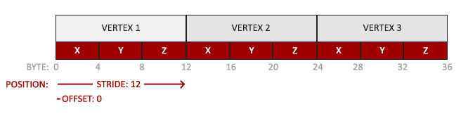
- 位置数据被储存为32位（4字节）浮点值。
- 每个位置包含3个这样的值。
- 在这3个值之间没有空隙（或其他值）。这几个值在数组中紧密排列(Tightly Packed)。
- 数据中第一个值在缓冲开始的位置。
知道了VBO的存储方式，我们就可以使用`glVertexAttribPointer()`函数告诉OpenGL该如何解析顶点数据应用到逐个顶点属性上了：
```
glVertexAttribPointer(0, 3, GL_FLOAT, GL_FALSE, 3 * sizeof(float), (void*)0);
glEnableVertexAttribArray(0);
```
- `glVertexAttribPointer()`:该函数是OpenGL中连接CPU端顶点数据到GPU着色器的关键桥梁，这个函数告诉GPU当前绑定到GL_ARRAY_BUFFER的VBO里存储的数据，应该**按什么格式解释**，以及**传递给着色器的哪个顶点属性**。
```
glVertexAttribPointer(
    GLuint index,           // 顶点属性位置（对应着色器中的location）
    GLint size,             // 每个顶点属性的分量数量（1-4）
    GLenum type,            // 数据的原生类型（GL_FLOAT等）
    GLboolean normalized,   // 是否归一化整数数据
    GLsizei stride,         // 相邻顶点数据之间的字节跨度
    const void* offset      // 当前顶点数据在缓冲区中的起始偏移
);
```
- - `index`：指定这个数据对应顶点着色器中哪个输入变量。例如之前VS声明 `layout(location = 0) in vec3 aPos;`，则此处应填 0。`index`必须与着色器中的 `location` 完全对应。
- - `size`：每个顶点在此属性上的数据维度分量。例如顶点(x,y,z)，size=3；颜色(r,g,b,a)，size=4
- - `type`：数据类型。`GL_FLOAT`常用于位置(pos)、纹理坐标；`GL_INT`常用于整数ID、索引；`GL_UNSIGNED_BYTE`常用于颜色(RGBA)
- - `normalized`：告诉OpenGL我们是否希望数据被标准化，只有`GL_TRUE`与`GL_FALSE`两个输入。前者会强制将整数转换为浮点数，对颜色数据特别有用(0~255变为0.0~1.0)；后者会使得数据按原类型传递。
- - `stride`：步长，用于描述在连续的顶点属性组之间的间隔。在这里由于下个组位置数据在3个float之后，我们把步长设置为`3 * sizeof(float)`。要注意的是由于我们知道这个数组是紧密排列的，即在两个顶点属性之间没有空隙，所以我们也**可以设置为0来让OpenGL决定**具体步长是多少。
- - `offset`：偏移量，用于解释从当前绑定缓冲区的起始位置开始，到此属性数据的字节偏移量。
- - 如果我们把vertices设定成位置(x,y,z) + 颜色(r,g,b) + 纹理(u,v)的模式：
```
// 位置(x,y,z) + 颜色(r,g,b) + 纹理(u,v)
float vertices[] = {
    x1, y1, z1, r1, g1, b1, u1, v1,  // 顶点1
    x2, y2, z2, r2, g2, b2, u2, v2,  // 顶点2
    // ...
};
// stride = 8 * sizeof(float) = 32字节
```
- - 那么位置顶点属性指针、颜色顶点指针、纹理坐标指针的stride都是`8\*sizeof(float)`，offset分别是`0`、`3\*sizeof(float)`、`6\*sizeof(float)`
每个顶点属性从一个VBO管理的内存中获得它的数据，而具体是从哪个VBO（程序中可以有多个VBO）获取则是通过在调用`glVertexAttribPointer`时绑定到`GL_ARRAY_BUFFER`的VBO决定的。由于在调用`glVertexAttribPointer`之前绑定的是先前定义的VBO对象，顶点属性0现在会链接到它的顶点数据。
自此，所有东西都已经设置好了：我们使用一个顶点缓冲对象(VBO)将顶点数据初始化至缓冲中，建立了一个顶点和一个片段着色器，并告诉了OpenGL如何把顶点数据链接到顶点着色器的顶点属性上。在OpenGL中绘制一个物体，代码会像是这样：
```
// 0. 复制顶点数组到缓冲中供OpenGL使用
glBindBuffer(GL_ARRAY_BUFFER, VBO);
glBufferData(GL_ARRAY_BUFFER, sizeof(vertices), vertices, GL_STATIC_DRAW);
// 1. 设置顶点属性指针
glVertexAttribPointer(0, 3, GL_FLOAT, GL_FALSE, 3 * sizeof(float), (void*)0);
glEnableVertexAttribArray(0);
// 2. 使用着色器程序
glUseProgram(shaderProgram);
// 3. 绘制物体
    ...
```
然而这里还有一个问题：每当我们绘制一个物体的时候都必须重复这一过程。如果有超过5个顶点属性，上百个不同物体该怎么办？绑定正确的缓冲对象，为每个物体配置所有顶点属性很快就变成一件麻烦事。有没有一些方法可以使我们把所有这些状态配置储存在一个对象中，并且可以通过绑定这个对象来恢复状态呢？
#### 使用VAO绑定
顶点数组对象(Vertex Array Object, VAO)可以像顶点缓冲对象那样被绑定，任何随后的顶点属性调用都会储存在这个VAO中。这样的好处就是，当配置顶点属性指针时，你只需要将那些调用执行一次，之后再绘制物体的时候只需要绑定相应的VAO就行了。这使在不同顶点数据和属性配置之间切换变得非常简单，只需要绑定不同的VAO就行了。
*OpenGL的核心模式要求我们必须使用VAO，它必须知道该如何处理我们的顶点输入。如果我们绑定VAO失败，OpenGL会拒绝绘制任何东西。*
一个VAO会储存以下这些内容：
- `glEnableVertexAttribArray()`和`glDisableVertexAttribArray`的调用。（启用与禁用）
- 通过`glVertexAttribPointer()`设置的顶点属性配置。
- 通过`glVertexAttribPointer()`调用与顶点属性关联的顶点缓冲对象。

与VBO类似，首先要使用`glBindVertexArray()`绑定VAO：
```
unsigned int VAO;
glGenVertexArrays(1, &VAO);
```
从绑定之后起，我们应该绑定和配置对应的VBO和属性指针，之后解绑VAO供之后使用。当我们打算绘制一个物体的时候，我们只要在绘制物体前简单地把VAO绑定到希望使用的设定上就行了:
```
// ..:: 初始化代码（只运行一次 (除非你的物体频繁改变)） :: ..
// 1. 绑定VAO
glBindVertexArray(VAO);
// 2. 把顶点数组复制到缓冲中供OpenGL使用
glBindBuffer(GL_ARRAY_BUFFER, VBO);
glBufferData(GL_ARRAY_BUFFER, sizeof(vertices), vertices, GL_STATIC_DRAW);
// 3. 设置顶点属性指针
glVertexAttribPointer(0, 3, GL_FLOAT, GL_FALSE, 3 * sizeof(float), (void*)0);
glEnableVertexAttribArray(0);

[...]

// ..:: 绘制代码（渲染循环中） :: ..
// 4. 绘制物体
glUseProgram(shaderProgram);
glBindVertexArray(VAO);
someOpenGLFunctionThatDrawsOurTriangle();
```

#### 在主循环中绘制三角形
OpenGL给我们提供了`glDrawArrays()`函数，它使用当前激活的着色器，之前定义的顶点属性配置，和VBO的顶点数据（通过VAO间接绑定）来绘制图元。
```
glUseProgram(shaderProgram);
glBindVertexArray(VAO);
glDrawArrays(GL_TRIANGLES, 0, 3);
```
- `glDrawArrays()`：第一个参数是我们打算绘制的OpenGL图元的类型。我们希望绘制三角形，所以传递`GL_TRIANGLES`给它。第二个参数指定了顶点数组的起始索引，这里填`0`。最后一个参数指定我们打算绘制多少个顶点，这里是`3`（只从数据中渲染一个三角形，它只有3个顶点长）。

#### 元素缓冲对象(Element Buffer Object，EBO)/索引缓冲对象(Index Buffer Object，IBO)
假设我们想绘制一个矩形，我们可以绘制两个三角形来组成一个矩形（OpenGL主要处理三角形）。这会生成下面的顶点的集合：
```
float vertices[] = {
    // 第一个三角形
    0.5f, 0.5f, 0.0f,   // 右上角
    0.5f, -0.5f, 0.0f,  // 右下角
    -0.5f, 0.5f, 0.0f,  // 左上角
    // 第二个三角形
    0.5f, -0.5f, 0.0f,  // 右下角
    -0.5f, -0.5f, 0.0f, // 左下角
    -0.5f, 0.5f, 0.0f   // 左上角
};
```
可以看到，有几个顶点叠加了。因为我们指定了右下角和左上角两次。一个矩形只有4个而不是6个顶点，这样就产生50%的额外开销。如果我们试图建立上千上万个三角形模型，重复开销的问题会产生一大堆浪费。更好的解决方案是只储存不同的顶点，并设定绘制这些顶点的顺序。这样子我们只要储存4个顶点就能绘制矩形了，之后只要指定绘制的顺序就行了。
元素缓冲区对象的工作方式正是如此。EBO是一个缓冲区，就像一个VBO一样，它存储 OpenGL 用来决定要绘制哪些顶点的索引。这种名为索引绘制(Indexed Drawing)正是我们问题的解决方案。
首先，我们先要定义（不重复的）顶点，和绘制出矩形所需的索引：
```
float vertices[] = {
    0.5f, 0.5f, 0.0f,   // 右上角
    0.5f, -0.5f, 0.0f,  // 右下角
    -0.5f, -0.5f, 0.0f, // 左下角
    -0.5f, 0.5f, 0.0f   // 左上角
};

unsigned int indices[] = {
    // 注意索引从0开始! 
    // 此例的索引(0,1,2,3)就是顶点数组vertices的下标，
    // 这样可以由下标代表顶点组合成矩形

    0, 1, 3, // 第一个三角形
    1, 2, 3  // 第二个三角形
};
```
当使用索引的时候，我们只定义了4个顶点，而不是6个。
下一步，采用与VBO类似的方法创建元素缓冲对象：
```
unsigned int EBO;
glGenBuffers(1, &EBO);
```
我们先绑定EBO，然后用`glBufferData()`把索引复制到缓冲里。同样，我们会把这些函数调用放在绑定和解绑函数调用之间，只不过这次我们把缓冲的类型定义为`GL_ELEMENT_ARRAY_BUFFER`以当作缓冲目标。
```
glBindBuffer(GL_ELEMENT_ARRAY_BUFFER, EBO);
glBufferData(GL_ELEMENT_ARRAY_BUFFER, sizeof(indices), indices, GL_STATIC_DRAW);
```
这里需要额外注意的是，与`GL_ARRAY_BUFFER`（VBO）不同，VAO不会记录VBO本身，只记录`glVertexAttribPointer()`调用时设置的属性格式（如数据类型、偏移量等）。在调用`glVertexAttribPointer(0, ...)`时，它读取的是当前绑定到`GL_ARRAY_BUFFER的VBO`，但只记录格式信息。而对于`GL_ELEMENT_ARRAY_BUFFER`（EBO）而言，VAO直接记录EBO对象本身，当VAO激活时绑定的EBO会成为VAO状态的一部分。
所以后续可以解绑，即`glBindBuffer(GL_ARRAY_BUFFER, 0)`是安全的，因为VAO已经“记住了”格式;如果解绑EBO，即执行`glBindBuffer(GL_ELEMENT_ARRAY_BUFFER, 0)`，那么VAO会“忘记”这个EBO，导致后续绘制失败。

最后就是绘制了，但是我们用`glDrawElements()`来替换`glDrawArrays()`函数，表示我们要**从索引缓冲区渲染三角形**。使用`glDrawElements()`时，我们会使用当前绑定的EBO中的索引进行绘制：
```
glBindBuffer(GL_ELEMENT_ARRAY_BUFFER, EBO);
glDrawElements(GL_TRIANGLES, 6, GL_UNSIGNED_INT, 0);
```
- `glDrawElements()`：
```
void glDrawElements(
    GLenum mode,           // 绘制图元类型
    GLsizei count,         // 要绘制的顶点数（实际是索引数）
    GLenum type,           // 索引数据类型
    const void* indices    // 索引数据的偏移量
);
```
- 第一个参数指定了我们绘制的模式，这和`glDrawArrays()`的一样；第二个参数是我们打算绘制顶点的个数，这里填6，也就是说我们一共需要绘制6个顶点；第三个参数是索引的类型，这里是`GL_UNSIGNED_INT`；最后一个参数里我们可以指定EBO中的偏移量（或者传递一个索引数组，但是这是当你不在使用索引缓冲对象的时候），但是我们会在这里填写0。

##### 使用线框模式
要想用线框模式绘制三角形，可以在主渲染循环之前通过`glPolygonMode(GL_FRONT_AND_BACK, GL_LINE)`函数配置OpenGL如何绘制图元。第一个参数表示我们打算将其应用到所有的三角形的正面和背面，第二个参数告诉我们用线来绘制。之后的绘制调用会一直以线框模式绘制三角形，直到我们用`glPolygonMode(GL_FRONT_AND_BACK, GL_FILL)`将其设置回默认模式。

#### 复习：OpenGL的渲染管线、着色器的使用、VAO/VBO/EBO的定义与使用
##### OpenGL的渲染管线
顶点着色器（可编程）——几何着色器（可编程）——图元装配（不可编程）——光栅化（不可编程）——片段着色器（可编程）——测试与混合
##### Shader的使用
- 使用GLSL写源码
- 创建Shader对象`glCreateShader(GL_VERTEX_SHADER)`、`glCreateShader(GL_FRAGMENT_SHADER)`
- 附着GLSL源码至Shader对象上`glShaderSource()`
- 编译Shader对象`glCompileShader()`
- 创建Shader程序`glCreateProgram()`
- 将程序与所有Shader对象链接`glAttachShader(... , ...)`
- 编译Shader程序`glCompileProgram()`
- 删除Shader对象，在主渲染循环中使用ShaderProgram
```
const char *vertexShaderSource = "#version 330 core\n"
                                 "layout (location = 0) in vec3 aPos;\n"
                                 "void main()\n"
                                 "{\n"
                                 "   gl_Position = vec4(aPos.x, aPos.y, aPos.z, 1.0);\n"
                                 "}\0";

const char *fragmentShaderSource = "#version 330 core\n"
                                   "out vec4 FragColor;\n"
                                   "void main()\n"
                                   "{\n"
                                   "   FragColor = vec4(1.0f, 0.5f, 0.2f, 1.0f);\n"
                                   "}\0";

    // 创建FS对象以及FS对象
    unsigned int vertexShader = glCreateShader(GL_VERTEX_SHADER), fragmentShader = glCreateShader(GL_FRAGMENT_SHADER);
    glShaderSource(vertexShader, 1, &vertexShaderSource, NULL);
    glShaderSource(fragmentShader, 1, &fragmentShaderSource, NULL);
    glCompileShader(vertexShader);
    glCompileShader(fragmentShader);
    checkShaderCompile(vertexShader);
    checkShaderCompile(fragmentShader);

    // 创建着色器程序
    unsigned int shaderProgram = glCreateProgram();
    glAttachShader(shaderProgram, vertexShader);
    glAttachShader(shaderProgram, fragmentShader);
    glLinkProgram(shaderProgram);
    checkProgramLink(shaderProgram);

    ...
    glUseProgram(shaderProgram);

    // 清理着色器对象
    glDeleteShader(vertexShader);
    glDeleteShader(fragmentShader);
```
##### VAO/VBO/EBO的定义与使用
```
    // 创建对象
    unsigned int VBO, VAO, EBO;
    glGenVertexArrays(1, &VAO);
    glGenBuffers(1, &VBO);
    glGenBuffers(1, &EBO);

    // 激活对象
    glBindVertexArray(VAO);
    // 配置VBO
    glBindBuffer(GL_ARRAY_BUFFER, VBO);
    glBufferData(GL_ARRAY_BUFFER, sizeof(vertices), vertices, GL_STATIC_DRAW);
    // 配置EBO
    glBindBuffer(GL_ELEMENT_ARRAY_BUFFER, EBO);
    glBufferData(GL_ELEMENT_ARRAY_BUFFER, sizeof(indices), indices, GL_STATIC_DRAW);

    // 定义属性与格式
    glVertexAttribPointer(0, 3, GL_FLOAT, GL_FALSE, 3 * sizeof(float), (void *)0);
    glEnableVertexAttribArray(0);

    // 对象解绑
    glBindBuffer(GL_ARRAY_BUFFER, 0);
    // glBindBuffer(GL_ELEMENT_ARRAY_BUFFER, 0); // EBO与VAO深度绑定，已成为VAO的一部分，这里解绑GL_ELEMENT_ARRAY_BUFFER会导致VAO丢失EBO数据！
    glBindVertexArray(0);

    ...

    glUseProgram(shaderProgram); // 启用着色器程序
    glBindVertexArray(VAO); // 绑定VAO。由于我们只创建了一个VAO，所以其实也没必要次次绑定，不过为了逻辑严谨保留这行代码
    // glDrawArrays(GL_TRIANGLES, 0, 3); // 不使用EBO时，使用glDrawArrays()绘制图形
    glDrawElements(GL_TRIANGLES, 6, GL_UNSIGNED_INT, (void *)0); // 使用EBO时，改用glDrawElements()绘制
    // glBindVertexArray(0); // 解绑VAO，同样没必要每次都解绑VAO
```
- 什么时候使用多个VAO/VBO呢？

| 场景	| 推荐方案	| 原因 |
|-----|-----|-----|
|相同几何体，不同变换/着色器	| 单VAO + 不同着色器/变换矩阵	| VAO只存储顶点属性布局，不存储具体变换 |
|不同几何体（立方体 vs 球体）|	多VAO（每个几何体一个）	| 顶点数据完全不同|
|顶点数据格式不同	| 多VAO	| 如：一个有法线一个无法线|
|需要独立更新顶点数据|	多VBO |	如：动态变形的网格 vs 静态网格|
|实例化渲染|	单VAO + 实例化数组VBO	|相同几何体大量复制|

### L1-3 : 着色器
####  GLSL
着色器是使用一种叫GLSL的类C语言写成的。GLSL是为图形计算量身定制的，它包含一些针对向量和矩阵操作的有用特性。
着色器的开头总是要声明版本，接着是输入和输出变量、`uniform`和`main`函数。每个着色器的入口点都是`main`函数，在这个函数中我们处理所有的输入变量，并将结果输出到输出变量中。`uniform`后面会进行讲解。
一个典型的着色器有下面的结构：
```
#version version_number
in type in_variable_name;
in type in_variable_name;

out type out_variable_name;

uniform type uniform_name;

void main()
{
  // 处理输入并进行一些图形操作
  ...
  // 输出处理过的结果到输出变量
  out_variable_name = weird_stuff_we_processed;
}
```
当我们特别谈论到顶点着色器的时候，每个输入变量也叫顶点属性(Vertex Attribute)。我们能声明的顶点属性是有上限的，它一般由硬件来决定。OpenGL确保至少有16个包含4分量的顶点属性可用，但是有些硬件或许允许更多的顶点属性，你可以查询`GL_MAX_VERTEX_ATTRIBS`来获取具体的上限：
```
int nrAttributes;
glGetIntegerv(GL_MAX_VERTEX_ATTRIBS, &nrAttributes);
std::cout << "Maximum nr of vertex attributes supported: " << nrAttributes << std::endl;
```
通常情况下它至少会返回16，大部分情况下是够用的。
#### OpenGL的数据类型
和其他编程语言一样，GLSL有数据类型可以来指定变量的种类。GLSL中包含C等其它语言大部分的默认基础数据类型：`int`、`float`、`double`、`uint`和`bool`。GLSL也有两种容器类型，分别是向量(Vector)和矩阵(Matrix)，其中矩阵会在之后再讨论。
##### 向量
GLSL中的向量是一个可以包含有2、3或者4个分量的容器，分量的类型可以是前面默认基础类型的任意一个。它们可以是下面的形式（n代表分量的数量）：
| 类型 | 含义 |
|-----|------|
| `vecn` | 包含n个`float`分量的默认向量 |
| `bvecn` | 包含n个`bool`分量的向量 |
| `ivecn` | 包含n个`int`分量的向量 |
| `uvecn` | 包含n个`unsigned int`分量的向量 | 
| `dvecn` | 包含n个`double`分量的向量 |

大多数时候我们使用`vecn`，因为`float`足够满足大多数要求了。

一个向量的分量可以通过`vec.x`这种方式获取，这里x是指这个向量的第一个分量。你可以分别使用`.x`、`.y`、`.z`和`.w`来获取它们的第1、2、3、4个分量。GLSL也允许你对颜色使用`rgba`，或是对纹理坐标使用`stpq`访问相同的分量。

向量这一数据类型也允许一些有趣而灵活的分量选择方式，叫做重组(Swizzling)。重组允许这样的语法：
```
vec2 someVec;
vec4 differentVec = someVec.xyxx;
vec3 anotherVec = differentVec.zyw;
vec4 otherVec = someVec.xxxx + anotherVec.yxzy;
```
你可以使用上面4个字母任意组合来创建一个和原来向量一样长的（同类型）新向量，只要原来向量有那些分量即可；然而，你不允许在一个`vec2`向量中去获取`.z`元素。我们也可以把一个向量作为一个参数传给不同的向量构造函数，以减少需求参数的数量：
```
vec2 vect = vec2(0.5, 0.7);
vec4 result = vec4(vect, 0.0, 0.0);
vec4 otherResult = vec4(result.xyz, 1.0);
```
向量是一种灵活的数据类型，我们可以把它用在各种输入和输出上。学完教程你会看到很多新颖的管理向量的例子。

#### 输入与输出
GLSL定义了`in`和`out`关键字专门来实现着色器程序的数据输入与输出。每个着色器使用这两个关键字设定输入和输出，只要一个输出变量与下一个着色器阶段的输入匹配，它就会传递下去。但在顶点和片段着色器中会有点不同。
VS应该接收的是一种特殊形式的输入，否则就会效率低下。VS的输入特殊在，它从顶点数据中直接接收输入。为了定义顶点数据该如何管理，我们使用`location`这一元数据指定输入变量，这样我们才可以在CPU上配置顶点属性。我们已经在前面的教程看过这个了：`layout (location = 0)`。VS需要为它的输入提供一个额外的`layout`标识，这样我们才能把它链接到顶点数据。
我们也可以忽略`layout (location = 0)`标识符，通过在OpenGL代码中使用`glGetAttribLocation`查询属性位置值(Location)，但是在着色器中设置它们会更容易程序员理解，而且节省你（和OpenGL）的工作量。
另一个例外是FS，它需要一个`vec4`颜色输出变量，因为FS需要生成一个最终输出的颜色。如果你在FS没有定义输出颜色，OpenGL默认会把你的物体渲染为黑色（或白色）。
所以，如果我们打算从一个着色器向另一个着色器发送数据，我们必须在发送方着色器中声明一个输出，在接收方着色器中声明一个类似的输入。当类型和名字都一样的时候，OpenGL就会把两个变量链接到一起，它们之间就能发送数据了（这是在链接程序对象时完成的）。为了展示这是如何工作的，我们会稍微改动一下之前教程里的那个着色器，让VS为FS决定颜色。

##### 顶点着色器
```
#version 330 core
layout (location = 0) in vec3 aPos; // 位置变量的属性位置值为0

out vec4 vertexColor; // 为片段着色器指定一个颜色输出

void main()
{
    gl_Position = vec4(aPos, 1.0); // 注意我们如何把一个vec3作为vec4的构造器的参数
    vertexColor = vec4(0.5, 0.0, 0.0, 1.0); // 把输出变量设置为暗红色
}
```
##### 片段着色器
```
#version 330 core
out vec4 FragColor;

in vec4 vertexColor; // 从顶点着色器传来的输入变量（名称相同、类型相同）

void main()
{
    FragColor = vertexColor;
}
```
我们在VS中声明了一个`vertexColor`变量作为`vec4`输出，并在FS中声明了一个类似的`vertexColor`。由于它们名字相同且类型相同，片段着色器中的`vertexColor`就和顶点着色器中的`vertexColor`链接了。由于我们在顶点着色器中将颜色设置为深红色，最终的三角形也是深红色的。

#### `Uniform`
Uniform是另一种将应用程序在 CPU 上传递数据到 GPU 上的着色器的方式，但`uniform`和顶点属性有些不同：
- 首先，`uniform`是全局的(Global)，这意味着`uniform`变量必须在每个着色器程序对象中都是独一无二的，而且它可以被着色器程序的任意着色器在任意阶段访问。
- 其次，无论把`uniform`值设置成什么，`uniform`会一直保存它们的数据，直到它们被重置或更新。

要在 GLSL 中声明 `uniform`，我们只需在着色器中使用 `uniform` 关键字，并带上类型和名称。从那时起，我们就可以在着色器中使用新声明的 `uniform`:
```
#version 330 core
out vec4 FragColor;

uniform vec4 ourColor; // 在OpenGL程序代码中设定这个变量

void main()
{
    FragColor = ourColor;
}
```
我们在FS中声明了一个`uniform vec4`的`ourColor`，并把FS的输出颜色设置为`uniform`值的内容。因为`uniform`是全局变量，我们可以在任何着色器中定义它们，而无需通过VS作为中介。VS中不需要这个`uniform`，所以我们不用在那里定义它。*如果声明了一个`uniform`却在GLSL代码中没用过，编译器会静默移除这个变量，导致最后编译出的版本中并不会包含它，这可能导致几个非常麻烦的错误。*
这个`uniform`变量现在还是空的，如果要给它添加任何数据，我们首先需要找到着色器中`uniform`属性的索引/位置值。当我们得到`uniform`的索引/位置值后，我们就可以更新它的值了。这次我们不去给像素传递单独一个颜色，而是让它随着时间改变颜色：
```
float timeValue = glfwGetTime();
float greenValue = (sin(timeValue) / 2.0f) + 0.5f;
int vertexColorLocation = glGetUniformLocation(shaderProgram, "ourColor");
glUseProgram(shaderProgram);
glUniform4f(vertexColorLocation, 0.0f, greenValue, 0.0f, 1.0f);
```
- 首先，我们通过`glfwGetTime()`获取运行的秒数。然后我们使用sin函数让颜色在0.0到1.0之间改变，最后将结果储存到`greenValue`里。
- 接着，我们用`glGetUniformLocation()`查询`uniform ourColor`的位置值。我们为查询函数提供着色器程序和uniform的名字（这是我们希望获得的位置值的来源）。如果`glGetUniformLocation()`返回`-1`，就代表没有找到这个位置值。
- 最后，我们可以通过`glUniform4f()`函数设置uniform值。注意，查询`uniform`地址不要求你之前使用过着色器程序，但是更新一个`uniform`之前你必须先使用程序（调用`glUseProgram()`），因为它是在当前激活的着色器程序中设置`uniform`的。

因为OpenGL在其核心是一个C库，所以它不支持类型重载，在函数参数不同的时候就要为其定义新的函数；`glUniform()`是一个典型例子。这个函数有一个特定的后缀，标识设定的`uniform`的类型。可能的后缀有：

| 后缀 | 含义 |
|-----|-----|
| f	| 函数需要一个`float`作为它的值 |
| i	| 函数需要一个`int`作为它的值 |
| ui | 函数需要一个`unsigned int`作为它的值 |
| 3f | 函数需要3个`float`作为它的值 |
| fv | 函数需要一个`float`向量/数组作为它的值 |

每打算配置一个OpenGL的选项时，就可以简单地根据这些规则选择适合你的数据类型的重载函数。在我们的例子里，我们希望分别设定`uniform`的4个float值，所以我们通过`glUniform4f()`传递我们的数据(注意，我们也可以使用fv版本)。
知道设置`uniform`变量的值后可以使用它们来渲染了。如果我们打算让颜色慢慢变化，我们就要在循环的每一次迭代中更新这个`uniform`，否则三角形就不会改变颜色。下面我们就计算`greenValue`然后每个渲染迭代都更新这个`uniform`：
```
while(!glfwWindowShouldClose(window))
{
    // 输入
    processInput(window);

    // 渲染
    // 清除颜色缓冲
    glClearColor(0.2f, 0.3f, 0.3f, 1.0f);
    glClear(GL_COLOR_BUFFER_BIT);

    // 激活着色器
    glUseProgram(shaderProgram);

    // 更新uniform颜色
    float timeValue = glfwGetTime();
    float greenValue = sin(timeValue) / 2.0f + 0.5f;
    int vertexColorLocation = glGetUniformLocation(shaderProgram, "ourColor");
    glUniform4f(vertexColorLocation, 0.0f, greenValue, 0.0f, 1.0f);

    // 绘制三角形
    glBindVertexArray(VAO);
    glDrawArrays(GL_TRIANGLES, 0, 3);

    // 交换缓冲并查询IO事件
    glfwSwapBuffers(window);
    glfwPollEvents();
}
```
这里的代码对之前代码是一次非常直接的修改。这次，我们在每次迭代绘制三角形前先更新uniform值。如果正确更新了uniform，三角形会逐渐由绿变黑再变回绿色。

#### 多属性的顶点数据传入
在前面的教程中，我们了解了如何填充VBO、配置顶点属性指针以及如何把它们都储存到一个VAO里。实际上，为了程序运行方便，通常顶点数据还包括颜色数据与纹理材质坐标数据，这里我们先把颜色数据加进顶点数据中。
我们将把颜色数据添加为3个float值至vertices数组。我们将把三角形的三个角分别指定为红色、绿色和蓝色：
```
float vertices[] = {
    // 位置              // 颜色
     0.5f, -0.5f, 0.0f,  1.0f, 0.0f, 0.0f,   // 右下
    -0.5f, -0.5f, 0.0f,  0.0f, 1.0f, 0.0f,   // 左下
     0.0f,  0.5f, 0.0f,  0.0f, 0.0f, 1.0f    // 顶部
};
```
由于现在有更多的数据要发送到VS，我们有必要去调整一下VS，使它能够接收颜色值作为一个顶点属性输入。需要注意的是我们用`layout`标识符来把`aColor`属性的位置值设置为`1`：
```
#version 330 core
layout (location = 0) in vec3 aPos;   // 位置变量的属性位置值为 0 
layout (location = 1) in vec3 aColor; // 颜色变量的属性位置值为 1

out vec3 ourColor; // 向片段着色器输出一个颜色

void main()
{
    gl_Position = vec4(aPos, 1.0);
    ourColor = aColor; // 将ourColor设置为我们从顶点数据那里得到的输入颜色
}
```
由于我们不再使用uniform来传递片段的颜色了，现在使用ourColor输出变量，我们必须再修改一下片段着色器：

#version 330 core
out vec4 FragColor;  
in vec3 ourColor;

void main()
{
    FragColor = vec4(ourColor, 1.0);
}
因为我们添加了另一个顶点属性，并且更新了VBO的内存，我们就必须重新配置顶点属性指针。更新后的VBO内存中的数据现在看起来像这样：
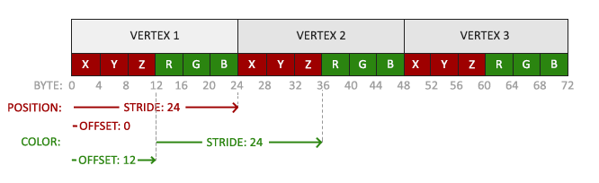
知道了现在使用的布局，我们就可以使用`glVertexAttribPointer()`函数更新顶点格式，
```
// 位置属性
glVertexAttribPointer(0, 3, GL_FLOAT, GL_FALSE, 6 * sizeof(float), (void*)0);
glEnableVertexAttribArray(0);
// 颜色属性
glVertexAttribPointer(1, 3, GL_FLOAT, GL_FALSE, 6 * sizeof(float), (void*)(3* sizeof(float)));
glEnableVertexAttribArray(1);
```
glVertexAttribPointer函数的前几个参数比较明了。这次我们配置属性位置值为1的顶点属性。颜色值有3个float那么大，我们不去标准化这些值。

由于我们现在有了两个顶点属性，所以重新计算步长值。为获得数据队列中下一个属性值（比如位置向量的下个x分量）我们必须向右移动6个float，其中3个是位置值，另外3个是颜色值。这使我们的步长值为6乘以float的字节数（=24字节）。
同样，这次我们必须指定一个偏移量。对于每个顶点来说，位置顶点属性在前，所以它的偏移量是0。颜色属性紧随位置数据之后，所以偏移量就是`3 * sizeof(float)`，用字节来计算就是12字节。
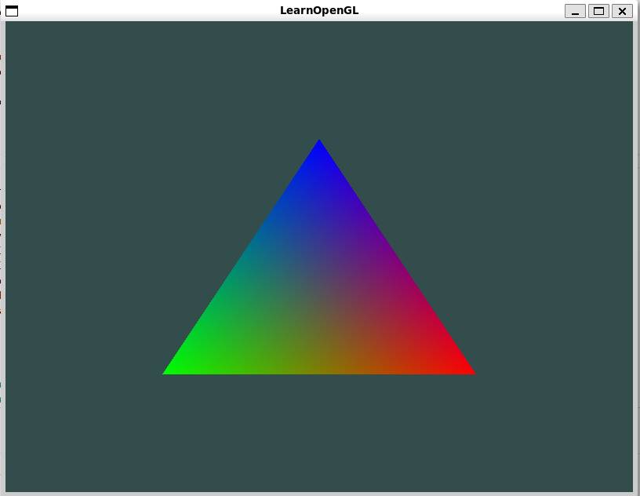
输出结果可能不是现在看到的大调色板。这是因为在FS中进行的所谓片段插值(Fragment Interpolation)的结果。当渲染一个三角形时，光栅化(Rasterization)阶段通常会造成比原指定顶点更多的片段。光栅会根据每个片段在三角形形状上所处相对位置决定这些片段的位置。基于这些位置，它会插值(Interpolate)所有FS的输入变量。比如说，我们有一个线段，上面的端点是绿色的，下面的端点是蓝色的。如果一个FS在线段的70%的位置运行，它的颜色输入属性就会是一个绿色和蓝色的线性结合；更精确地说就是30%蓝 + 70%绿。
在这个三角形中,我们有3个顶点，和相应的3个颜色，从这个三角形的像素来看它可能包含50000左右的片段，FS为这些像素进行插值颜色。如果你仔细看这些颜色就应该能明白了：红首先变成到紫再变为蓝色。片段插值会被应用到FS的所有输入属性上。

#### 创建Shader类
编写、编译、管理着色器是件麻烦事。我们打算写一个类来让我们后续的工作轻松一点，它可以从硬盘读取着色器，然后编译并链接它们，并对它们进行错误检测，这就变得很好用了。这也会让你了解该如何封装目前所学的知识到一个抽象对象中。
我们会把着色器类全部放在在头文件里，主要是为了学习用途，当然也方便移植。我们先来添加必要的include，并定义类结构：
```
#ifndef SHADER_H
#define SHADER_H

#include <glad/glad.h>; // 包含glad来获取所有的必须OpenGL头文件

#include <string>
#include <fstream>
#include <sstream>
#include <iostream>


class Shader
{
public:
    // 程序ID
    unsigned int ID;

    // 构造器读取并构建着色器
    Shader(const char* vertexPath, const char* fragmentPath);
    // 使用/激活程序
    void use();
    // uniform工具函数
    void setBool(const std::string &name, bool value) const;  
    void setInt(const std::string &name, int value) const;   
    void setFloat(const std::string &name, float value) const;
};

#endif
```
构造函数：读取文件，并将代码输入并编译+链接
```
Shader::Shader(const char *vertexPath, const char *fragmentPath)
{
    std::string vertexCode;
    std::string fragmentCode;
    std::ifstream vShaderFile;
    std::ifstream fShaderFile;
    vShaderFile.exceptions(std::ifstream::failbit | std::ifstream::badbit);
    fShaderFile.exceptions(std::ifstream::failbit | std::ifstream::badbit);
    try
    {
        vShaderFile.open(vertexPath);
        fShaderFile.open(fragmentPath);
        std::stringstream vShaderStream, fShaderStream;
        vShaderStream << vShaderFile.rdbuf();
        fShaderStream << fShaderFile.rdbuf();
        vShaderFile.close();
        fShaderFile.close();
        vertexCode = vShaderStream.str();
        fragmentCode = fShaderStream.str();
    }
    catch (std::ifstream::failure &e)
    {
        std::cout << "ERROR::SHADER::FILE_NOT_SUCCESSFULLY_READ: " << e.what() << std::endl;
    }
    const char *vShaderCode = vertexCode.c_str();
    const char *fShaderCode = fragmentCode.c_str();

    unsigned int vertex = glCreateShader(GL_VERTEX_SHADER), fragment = glCreateShader(GL_FRAGMENT_SHADER);
    glShaderSource(vertex, 1, &vShaderCode, NULL);
    glCompileShader(vertex);
    checkCompileErrors(vertex, "VERTEX");
    glShaderSource(fragment, 1, &fShaderCode, NULL);
    glCompileShader(fragment);
    checkCompileErrors(fragment, "FRAGMENT");
    ID = glCreateProgram();
    glAttachShader(ID, vertex);
    glAttachShader(ID, fragment);
    glLinkProgram(ID);
    checkCompileErrors(ID, "PROGRAM");

    glDeleteShader(vertex);
    glDeleteShader(fragment);
}
```
之后，我们可以把顶点和片段着色器储存为两个名为`shader.vs`和`shader.fs`的文件。并在主程序中创建Shader类即可：
```
    Shader ourShader("shader.vs","shader.fs");
    while(...){
        ...
        ourShader.use();
        ...
    }
```

### L1-4 : 纹理

纹理(Texture)是一个2D图片，它可以用来添加物体的细节；你可以想象纹理是一张绘有砖块的纸，无缝折叠贴合到你的3D的房子上，这样你的房子看起来就像有砖墙外表了。因为我们可以在一张图片上插入非常多的细节，这样就可以让物体非常精细而不用指定额外的顶点。除了图像以外，纹理也可以被用来储存大量的数据，这些数据可以发送到着色器上。

为了能够把纹理映射(Map)到三角形上，我们需要指定三角形的每个顶点各自对应纹理的哪个部分。这样每个顶点就会关联着一个纹理坐标(Texture Coordinate)，用来标明该从纹理图像的哪个部分采集片段颜色。之后在图形的其它片段上进行片段插值(Fragment Interpolation)。

纹理坐标在x和y轴上，范围为0到1之间（注意我们使用的是2D纹理图像）。使用纹理坐标获取纹理颜色叫做采样(Sampling)。纹理坐标起始于(0, 0)，也就是纹理图片的左下角，终止于(1, 1)，即纹理图片的右上角。


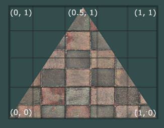

我们为三角形指定了3个纹理坐标点。如上图所示，我们希望三角形的左下角对应纹理的左下角，因此我们把三角形左下角顶点的纹理坐标设置为(0, 0)；同理右下方的顶点设置为(1, 0)；三角形的上顶点对应于图片的上中位置所以我们把它的纹理坐标设置为(0.5, 1.0)。我们只要给顶点着色器传递这三个纹理坐标就行了，接下来它们会被传到片段着色器中，它会为每个片段进行纹理坐标的插值。

纹理坐标看起来就像这样：
```
float texCoords[] = {
    0.0f, 0.0f, // 左下角
    1.0f, 0.0f, // 右下角
    0.5f, 1.0f  // 上中
};
```
对纹理采样的解释非常宽松，它可以采用几种不同的插值方式。所以我们需要自己告诉OpenGL该怎样对纹理采样。

#### 纹理环绕方式
纹理坐标的范围通常是从(0, 0)到(1, 1)，那如果我们把纹理坐标设置在范围之外会发生什么？OpenGL默认的行为是重复这个纹理图像（我们基本上忽略浮点纹理坐标的整数部分），但OpenGL提供了更多的选择：

| 环绕方式 | 描述 |
|------|------|
|GL_REPEAT|对纹理的默认行为。重复纹理图像。|
|GL_MIRRORED_REPEAT	| 和GL_REPEAT一样，但每次重复图片是镜像放置的。|
|GL_CLAMP_TO_EDGE	| 纹理坐标会被约束在0到1之间，超出的部分会重复纹理坐标的边缘，产生一种边缘被拉伸的效果。 |
|GL_CLAMP_TO_BORDER	| 超出的坐标为用户指定的边缘颜色。 |

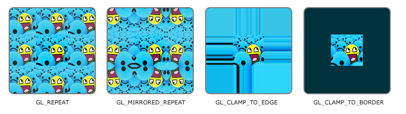

这里对应的gl函数为`glTexParameter()`，该函数对单独的一个坐标轴设置（s、t（如果是使用3D纹理那么还有一个r），它们和x、y、z是等价的）：
```
glTexParameteri(GL_TEXTURE_2D, GL_TEXTURE_WRAP_S, GL_MIRRORED_REPEAT);
glTexParameteri(GL_TEXTURE_2D, GL_TEXTURE_WRAP_T, GL_MIRRORED_REPEAT);
```
- 第一个参数指定了纹理目标；我们使用的是2D纹理，因此纹理目标是`GL_TEXTURE_2D`。
- 第二个参数需要我们指定设置的选项与应用的纹理轴。我们打算配置的是WRAP选项，并且指定S和T轴。
- 最后一个参数需要我们传递一个环绕方式(Wrapping)，在这个例子中OpenGL会给当前激活的纹理设定纹理环绕方式为`GL_MIRRORED_REPEAT`。

如果我们选择纹理的环绕方式为`GL_CLAMP_TO_BORDER`，我们还需要指定一个边缘的颜色。这需要使用`glTexParameter()`函数的fv后缀形式，用`GL_TEXTURE_BORDER_COLOR`作为它的选项，并且传递一个`float`数组作为边缘的颜色值：
```
float borderColor[] = { 1.0f, 1.0f, 0.0f, 1.0f };
glTexParameterfv(GL_TEXTURE_2D, GL_TEXTURE_BORDER_COLOR, borderColor);
```

##### 纹理过滤
纹理坐标不依赖于分辨率(Resolution)，它可以是任意浮点值，所以OpenGL需要知道怎样将纹理像素(Texture Pixel)映射到纹理坐标。Texture Pixel也叫Texel，你可以想象你打开一张.jpg格式图片，不断放大你会发现它是由无数像素点组成的，这个点就是纹理像素；注意不要和纹理坐标搞混，纹理坐标是你给模型顶点设置的那个数组，OpenGL以**这个顶点的纹理坐标数据**去查找纹理图像上的像素，然后进行采样提取纹理像素的颜色。当你有一个很大的物体，但是纹理的分辨率很低的时候这就变得很重要了。
OpenGL也有对于纹理过滤(Texture Filtering)的选项。纹理过滤有很多个选项，但是现在我们只讨论最重要的两种：`GL_NEAREST`和`GL_LINEAR`:
- `GL_NEAREST`（也叫邻近过滤，Nearest Neighbor Filtering）是OpenGL默认的纹理过滤方式。当设置为`GL_NEAREST`的时候，OpenGL会选择中心点最接近纹理坐标的那个像素。下图中你可以看到四个像素，加号代表纹理坐标。左上角那个纹理像素的中心距离纹理坐标最近，所以它会被选择为样本颜色：


- `GL_LINEAR`（也叫线性过滤，(Bi)linear Filtering）会基于纹理坐标附近的纹理像素，计算出一个插值，近似出这些纹理像素之间的颜色。一个纹理像素的中心距离纹理坐标越近，那么这个纹理像素的颜色对最终的样本颜色的贡献越大。下图中你可以看到返回的颜色是邻近像素的混合色：


那么这两种纹理过滤方式有怎样的视觉效果呢？让我们看看在一个很大的物体上应用一张低分辨率的纹理会发生什么吧（纹理被放大了，每个纹理像素都能看到）：


`GL_NEAREST`产生了颗粒状的图案，我们能够清晰看到组成纹理的像素，而`GL_LINEAR`能够产生更平滑的图案，很难看出单个的纹理像素。`GL_LINEAR`可以产生更真实的输出，但有些开发者更喜欢8-bit风格，所以他们会用`GL_NEAREST`选项。

当进行放大(Magnify)和缩小(Minify)操作的时候可以设置纹理过滤的选项，比如你可以在纹理被缩小的时候使用邻近过滤，被放大时使用线性过滤。我们需要使用`glTexParameter()`函数为放大和缩小指定过滤方式。这段代码看起来会和纹理环绕方式的设置很相似：
```
glTexParameteri(GL_TEXTURE_2D, GL_TEXTURE_MIN_FILTER, GL_NEAREST);
glTexParameteri(GL_TEXTURE_2D, GL_TEXTURE_MAG_FILTER, GL_LINEAR);
```

##### 多级渐远纹理
想象一下，假设我们有一个包含着上千物体的大房间，每个物体上都有纹理。有些物体会很远，但其纹理会拥有与近处物体同样高的分辨率。由于远处的物体可能只产生很少的片段，OpenGL从高分辨率纹理中为这些片段获取正确的颜色值就很困难，因为它需要对一个跨过纹理很大部分的片段只拾取一个纹理颜色。在小物体上这会产生不真实的感觉，更不用说对它们使用高分辨率纹理浪费内存的问题了。

OpenGL使用一种叫做多级渐远纹理(Mipmap)的概念来解决这个问题，它简单来说就是一系列的纹理图像，后一个纹理图像是前一个的二分之一。多级渐远纹理背后的理念很简单：距观察者的距离超过一定的阈值，OpenGL会使用不同的多级渐远纹理，即最适合物体的距离的那个。由于距离远，解析度不高也不会被用户注意到。同时，多级渐远纹理另一加分之处是它的性能非常好。让我们看一下多级渐远纹理是什么样子的：
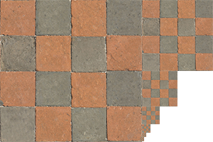

手工为每个纹理图像创建一系列多级渐远纹理很麻烦，幸好OpenGL有一个`glGenerateMipmap()`函数，在创建完一个纹理后调用它OpenGL就会承担接下来的所有工作了。
在渲染中切换多级渐远纹理级别(Level)时，OpenGL在两个不同级别的多级渐远纹理层之间会产生不真实的生硬边界。就像普通的纹理过滤一样，切换多级渐远纹理级别时你也可以在两个不同多级渐远纹理级别之间使用NEAREST和LINEAR过滤。为了指定不同多级渐远纹理级别之间的过滤方式，你可以使用下面四个选项中的一个代替原有的过滤方式：
| 过滤方式 | 描述 |
|------|------|
|GL_NEAREST_MIPMAP_NEAREST | 使用最邻近的多级渐远纹理来匹配像素大小，并使用邻近插值进行纹理采样|
|GL_LINEAR_MIPMAP_NEAREST	| 使用最邻近的多级渐远纹理级别，并使用线性插值进行采样|
|GL_NEAREST_MIPMAP_LINEAR	| 在两个最匹配像素大小的多级渐远纹理之间进行线性插值，使用邻近插值进行采样 |
|GL_LINEAR_MIPMAP_LINEAR	| 在两个邻近的多级渐远纹理之间使用线性插值，并使用线性插值进行采样 |

同样可以使用`glTexParameteri()`将过滤方式设置为前面四种提到的方法之一：
```
glTexParameteri(GL_TEXTURE_2D, GL_TEXTURE_MIN_FILTER, GL_LINEAR_MIPMAP_LINEAR);
glTexParameteri(GL_TEXTURE_2D, GL_TEXTURE_MAG_FILTER, GL_LINEAR);
```
一个常见的错误是，将放大过滤的选项设置为多级渐远纹理过滤选项之一。这样没有任何效果，因为多级渐远纹理主要是使用在纹理被缩小的情况下的：纹理放大不会使用多级渐远纹理，为放大过滤设置多级渐远纹理的选项会产生一个GL_INVALID_ENUM错误代码。

#### 加载与创建纹理
使用纹理之前要做的第一件事是把它们加载到我们的应用中。纹理图像可能被储存为各种各样的格式，每种都有自己的数据结构和排列。一个加载方案是选一个需要的文件格式，比如`.PNG`，然后自己写一个图像加载器，把图像转化为字节序列。写自己的图像加载器虽然不难，但仍然挺麻烦的，而且如果要支持更多文件格式呢？另一个解决方案也许是一种更好的选择，使用一个支持多种流行格式的图像加载库来为我们解决这个问题。比如说我们要用的`stb_image.h`库。
下载`stb_image.h`头文件，并另创建一个新的C++文件，输入以下代码：
```
#define STB_IMAGE_IMPLEMENTATION
#include "stb_image.h"
```
通过定义`STB_IMAGE_IMPLEMENTATION`，预处理器会修改头文件，让其只包含相关的函数定义源码，等于是将这个头文件变为一个 .cpp 文件了。现在只需要在你的程序中包含`stb_image.h`并编译就可以了。
下面的教程中，我们会使用一张木箱的图片。要使用`stb_image.h`加载图片，我们需要使用它的`stbi_load`函数：
```
int width, height, nrChannels;
unsigned char *data = stbi_load("container.jpg", &width, &height, &nrChannels, 0);
```
这个函数首先接受一个图像文件的位置作为输入。接下来它需要三个int作为它的第二、第三和第四个参数，stb_image.h将会用图像的宽度、高度和颜色通道的个数填充这三个变量。我们之后生成纹理的时候会用到的图像的宽度和高度的。

##### 生成纹理
类似VBO/EBO，纹理也是通过ID引用的：
```
unsigned int texture;
glGenTextures(1, &texture);
```
与之前的生成函数类似，前一个参数代表生成纹理数量，后一个参数代表用于存储的数组。之后再实现绑定：
```
glBindTexture(GL_TEXTURE_2D,texture);
```
纹理绑定完成后，使用之前的图片数据，通过`glTexImage2D()`函数生成纹理：
```
glTexImage2D(GL_TEXTURE_2D,0,GL_RGB,width,height,0,GL_RGB,GL_UNSIGNED_BYTE,data);
glGenerateMipmap(GL_TEXTURE_2D);
```
- `glTexImage2D()`:
- 第一个参数指定了纹理目标(Target)。设置为`GL_TEXTURE_2D`意味着会生成与当前绑定的纹理对象在同一个目标上的纹理（任何绑定到`GL_TEXTURE_1D和GL_TEXTURE_3D`的纹理不会受到影响）。
- 第二个参数为纹理指定多级渐远纹理的级别，如果你希望单独手动设置每个多级渐远纹理的级别的话。这里我们填0，也就是基本级别。如果level=1，那就意味着1/2分辨率；level=2则是1/4分辨率。
- 第三个参数告诉OpenGL我们希望把纹理储存为何种格式。我们的图像只有RGB值，因此我们也把纹理储存为RGB值。
- 第四个和第五个参数设置最终的纹理的宽度和高度。我们之前加载图像的时候储存了它们，所以我们使用对应的变量。
- 第六个参数总是被设为0（历史遗留的问题）。
- 第七第八个参数定义了源图的格式和数据类型。我们使用RGB值加载这个图像，并把它们储存为char(byte)数组，我们将会传入对应值。
- 最后一个参数是真正的图像数据。

当调用`glTexImage2D`时，当前绑定的纹理对象就会被附加上纹理图像。然而，目前只有基本级别(Base-level)的纹理图像被加载了(即第二个参数level=0的)，如果要使用多级渐远纹理，我们必须手动设置所有不同的图像（不断递增第二个参数）。也就是变成如下这样：
```// 绑定纹理
glBindTexture(GL_TEXTURE_2D, texture);

// 设置基本级别 (Level 0) - 原始图像
glTexImage2D(GL_TEXTURE_2D, 0, GL_RGB, 1024, 1024, 0, GL_RGB, GL_UNSIGNED_BYTE, data0);

// 手动设置Level 1 (512x512)
unsigned char* data1 = generateMipmap(data0, 512, 512); // 需要自己生成
glTexImage2D(GL_TEXTURE_2D, 1, GL_RGB, 512, 512, 0, GL_RGB, GL_UNSIGNED_BYTE, data1);

// 手动设置Level 2 (256x256)
unsigned char* data2 = generateMipmap(data1, 256, 256);
glTexImage2D(GL_TEXTURE_2D, 2, GL_RGB, 256, 256, 0, GL_RGB, GL_UNSIGNED_BYTE, data2);
// ... 一直到1x1像素！
```
这自然过于繁琐了，所以我们可以直接在生成纹理之后调用`glGenerateMipmap()`。这会为当前绑定的纹理自动生成所有需要的多级渐远纹理。

生成一个纹理的完整过程：
```
unsigned int texture;
glGenTextures(1, &texture);
glBindTexture(GL_TEXTURE_2D, texture);
// 为当前绑定的纹理对象设置环绕、过滤方式
glTexParameteri(GL_TEXTURE_2D, GL_TEXTURE_WRAP_S, GL_REPEAT);   
glTexParameteri(GL_TEXTURE_2D, GL_TEXTURE_WRAP_T, GL_REPEAT);
glTexParameteri(GL_TEXTURE_2D, GL_TEXTURE_MIN_FILTER, GL_LINEAR);
glTexParameteri(GL_TEXTURE_2D, GL_TEXTURE_MAG_FILTER, GL_LINEAR);
// 加载并生成纹理
int width, height, nrChannels;
unsigned char *data = stbi_load("container.jpg", &width, &height, &nrChannels, 0);
if (data)
{
    glTexImage2D(GL_TEXTURE_2D, 0, GL_RGB, width, height, 0, GL_RGB, GL_UNSIGNED_BYTE, data);
    glGenerateMipmap(GL_TEXTURE_2D);
}
else
{
    std::cout << "Failed to load texture" << std::endl;
}
stbi_image_free(data);
```

#### 应用纹理
这里使用1-2中提供的矩形：
```
    float vertices[] = {
    //     ---- 位置 ----       ---- 颜色 ----     - 纹理坐标 -
        0.5f,  0.5f, 0.0f,   1.0f, 0.0f, 0.0f,   1.0f, 1.0f,   // 右上
        0.5f, -0.5f, 0.0f,   0.0f, 1.0f, 0.0f,   1.0f, 0.0f,   // 右下
        -0.5f, -0.5f, 0.0f,   0.0f, 0.0f, 1.0f,   0.0f, 0.0f,   // 左下
        -0.5f,  0.5f, 0.0f,   1.0f, 1.0f, 0.0f,   0.0f, 1.0f    // 左上
    };

    unsigned int indices[] = {
        0, 1, 3,
        1, 2, 3
    };
```
由于我们添加了一个额外的顶点属性，我们必须告诉OpenGL我们新的顶点格式，注意步长变成了`8 * sizeof(float)`：
```
glVertexAttribPointer(2, 2, GL_FLOAT, GL_FALSE, 8 * sizeof(float), (void*)(6 * sizeof(float)));
glEnableVertexAttribArray(2);
```

##### 调整VS
只需要再加一个接收器，并将纹理坐标传给FS即可：
```
#version 330 core
layout (location = 0) in vec3 aPos;
layout (location = 1) in vec3 aColor;
layout (location = 2) in vec3 aTexCoord;
out vec3 ourColor;
out vec3 TexCoord;
void main()
{
    gl_Position = vec4(aPos,1.0);
    ourColor = aColor;
    TexCoord = aTexCoord;
}
```

##### 调整FS
片段着色器也应该能访问纹理对象，但是我们怎样能把纹理对象传给片段着色器呢？GLSL有一个供纹理对象使用的内建数据类型，叫做采样器(Sampler)，它以纹理类型作为后缀，比如`sampler1D`、`sampler3D`，或在我们的例子中的`sampler2D`。我们可以简单声明一个`uniform sampler2D`把一个纹理添加到片段着色器中，稍后我们会把纹理赋值给这个uniform。
```
#version 330 core
out vec4 FragColor;
in vec3 ourColor;
in vec2 TexCoord;
uniform sampler2D ourTexture;
void main()
{
  FragColor = texture(ourTexture, TexCoord);
}
```
这里使用了GLSL内建的`texture()`函数来采样纹理的颜色，第一个参数是纹理采样器，第二个参数是对应的纹理坐标。返回的是纹理颜色值。

##### 主render loop中的调用
调用`glDrawElements()`之前绑定纹理即可，它会自动把纹理赋值给片段着色器的采样器：
```
glBindTexture(GL_TEXTURE_2D, texture);
glBindVertexArray(VAO);
glDrawElements(GL_TRIANGLES, 6, GL_UNSIGNED_INT, 0);
```

#### 纹理单元
为什么`sampler2D`变量是个`uniform`，我们却不用`glUniform`给它赋值呢？使用`glUniform1i`，我们可以给纹理采样器分配一个位置值，这样的话我们能够在一个片段着色器中设置多个纹理。**一个纹理的位置值通常称为一个纹理单元(Texture Unit)。**一个纹理的默认纹理单元是0，它是默认的激活纹理单元，所以前面部分我们没有分配一个位置值。

纹理单元的主要目的是**让我们在着色器中可以使用多于一个的纹理**。通过把纹理单元赋值给采样器，我们可以一次绑定多个纹理，只要我们首先激活对应的纹理单元。就像`glBindTexture()`一样，我们可以使用`glActiveTexture()`激活纹理单元，传入我们需要使用的纹理单元：
```
glActiveTexture(GL_TEXTURE0); // 在绑定纹理之前先激活纹理单元
glBindTexture(GL_TEXTURE_2D, texture);
```
激活纹理单元之后，接下来的`glBindTexture()`函数调用会绑定这个纹理到当前激活的纹理单元，纹理单元`GL_TEXTURE0`默认总是被激活，所以我们在前面的例子里当我们使用`glBindTexture()`的时候，无需激活任何纹理单元。OpenGL至少保证有16个纹理单元以供使用，也就是说我们可以激活从`GL_TEXTURE0`到`GL_TEXTRUE15`。由于它们都是按顺序定义的，所以我们也可以通过`GL_TEXTURE0 + 8`的方式获得`GL_TEXTURE8`，这在当我们需要循环一些纹理单元的时候会很有用。
我们仍然需要编辑FS来接收另一个采样器：
```
#version 330 core
out vec4 FragColor;
in vec3 ourColor;
in vec2 TexCoord;
uniform sampler2D texture1;
uniform sampler2D texture2;
void main()
{
  FragColor = mix(texture(texture1, TexCoord),texture(texture2,TexCoord),0.2);
}
```
这里使用GLSL内建的`mix()`函数来输出两个纹理的结合。`mix()`函数需要接受两个值作为参数，并对它们根据第三个参数进行线性插值。如果第三个值是0.0，它会返回第一个输入；如果是1.0，会返回第二个输入值。0.2会返回80%的第一个输入颜色和20%的第二个输入颜色，即返回两个纹理的混合色。
加载另一个纹理的流程与上面所属的第一次类似，不过这里载入的是一张包含alpha的`.png`文件，所以在使用`glTexImage2D()`函数时要使用`GL_RGBA`参数：
```
data = stbi_load("/home/wzy/OpenGL/resources/awesomeface.png", &width, &height, &nrChannels, 0);
if(data){
    glTexImage2D(GL_TEXTURE_2D, 0, GL_RGB, width, height, 0, GL_RGBA, GL_UNSIGNED_BYTE, data);
    glGenerateMipmap(GL_TEXTURE_2D);
}
```
在将两个纹理绑定之前，还需要使用`glUniform1i()`设置每个采样器的方式告诉OpenGL每个着色器采样器属于哪个纹理单元。只需要设置一次即可，放在渲染循环的前面：
```
ourShader.use(); // 不要忘记在设置uniform变量之前激活着色器程序！
glUniform1i(glGetUniformLocation(ourShader.ID, "texture1"), 0); // 手动设置
ourShader.setInt("texture2", 1); // 或者使用着色器类设置

while(...) 
{
    [...]
}
```
最后就是修改主渲染循环的渲染流程，先绑定两个纹理到对应的纹理单元，然后定义哪个uniform采样器对应哪个纹理单元：
```
while (...)
    {
        ...

        // 绑定材质
        glActiveTexture(GL_TEXTURE0);
        glBindTexture(GL_TEXTURE_2D,texture1);
        glActiveTexture(GL_TEXTURE1);
        glBindTexture(GL_TEXTURE_2D,texture2);

        // 绘制矩形        
        ourShader.use();
        glBindVertexArray(VAO);
        glDrawElements(GL_TRIANGLES, 6, GL_UNSIGNED_INT, (void *)0);   
        ...
    }
```

注意到结果的笑脸上下颠倒了，这是因为OpenGL要求y轴0.0坐标是在图片的底部的，但是图片的y轴0.0坐标通常在顶部。`stb_image.h`能够在图像加载时帮助我们翻转y轴，只需要在加载任何图像前加入以下语句即可：
```
stbi_set_flip_vertically_on_load(true);
```

### L1-5 : 变换
矩阵知识略
#### GLM
可以使用Open**GL** **M**athematics来实现
Ubuntu使用apt安装即可
```
sudo apt-get install libglm-dev
```
我们需要的绝大多数功能包含以下三个头文件即可：
```
#include <glm/glm.hpp>
#include <glm/gtc/matrix_transform.hpp>
#include <glm/gtc/type_ptr.hpp>
```
0.9.9版本后默认矩阵为零矩阵，所以创建初始矩阵请改为以下代码：
```
glm::mat4 mat = glm::mat4(1.0f);
```

以后，我们会定义一个`glm::mat4`类型的矩阵`trans`，并将其初始化为单位矩阵，来实现我们的向量变换。例如下列代码：
```
glm::mat4 trans;
trans = glm::rotate(trans, glm::radians(90.0f), glm::vec3(0.0, 0.0, 1.0));
trans = glm::scale(trans, glm::vec3(0.5, 0.5, 0.5));
```
意思就是先绕着z轴旋转90度，然后缩放0.5倍。
那么如何把该矩阵传递给Shader？GLSL当然有mat4类型，所以设定一个`uniform mat4`的transform矩阵即可。
```
#version 330 core
layout (location = 0) in vec3 aPos;
layout (location = 1) in vec2 aTexCoord;

out vec2 TexCoord;

uniform mat4 transform;

void main()
{
    gl_Position = transform * vec4(aPos, 1.0f);
    TexCoord = vec2(aTexCoord.x, aTexCoord.y);
}
```
在把位置向量传给`gl_Position`之前，我们先添加一个`uniform`，并且将其与变换矩阵相乘。我们的箱子现在应该是原来的二分之一大小并（向左）旋转了90度。当然，我们仍需要把变换矩阵传递给着色器：
```
unsigned int transformLoc = glGetUniformLocation(ourShader.ID, "transform");
glUniformMatrix4fv(transformLoc, 1, GL_FALSE, glm::value_ptr(trans));
```
我们首先查询uniform变量的地址，然后用`glUniformMatrix4fv()`函数把矩阵数据发送给着色器。
- `glUniformMatrix4fv()`:
- - 第一个参数：`uniform`的位置值
- - 第二个参数：告诉OpenGL将要发送多少个矩阵，这里是1。
- - 第三个参数：询问是否希望对我们的矩阵进行转置(Transpose)，也就是说交换矩阵的行和列。OpenGL开发者通常使用一种内部矩阵布局，叫做列主序(Column-major Ordering)布局。GLM的默认布局就是列主序，所以并不需要转置矩阵，我们填GL_FALSE。
- - 第四个参数：真正的转换矩阵数据，但是GLM并不是把它们的矩阵储存为OpenGL所希望接受的那种，因此我们要先用GLM的自带的函数`value_ptr()`来变换这些数据。

现在做点更有意思的，让箱子随时间放缩+旋转。将`trans`矩阵中的部分坐标值按时间变化即可。

### L1-6 : 坐标系统
在L1-2我们谈论了OpenGL的渲染管线，谈及OpenGL会在每次VS运行后将所有顶点转化为标准化设备坐标NDC，即所有顶点的坐标范围都是[-1,1]。之后，我们将NDC传入光栅器，最后在二维平面上输出。
将坐标变换为标准化设备坐标NDC，接着再转化为屏幕坐标的过程通常是分步进行的，也就是类似于流水线那样子。在流水线中，物体的顶点在最终转化为屏幕坐标之前还会被变换到多个坐标系统(Coordinate System)。将物体的坐标变换到几个过渡坐标系(Intermediate Coordinate System)的优点在于，在这些特定的坐标系统中，一些操作或运算更加方便和容易，这一点很快就会变得很明显。对我们来说比较重要的总共有5个不同的坐标系统：
- 局部空间(Local Space，或者称为物体空间(Object Space))
- 世界空间(World Space)
- 观察空间(View Space，或者称为视觉空间(Eye Space))
- 裁剪空间(Clip Space)
- 屏幕空间(Screen Space)
这就是一个顶点在最终被转化为片段之前需要经历的所有不同状态。
#### 概述
为了将坐标从一个坐标系变换到另一个坐标系，我们需要用到几个变换矩阵，最重要的几个分别是模型(Model)、观察(View)、投影(Projection)三个矩阵。我们的顶点坐标起始于局部空间(Local Space)，在这里它称为局部坐标(Local Coordinate)，它在之后会变为世界坐标(World Coordinate)，观察坐标(View Coordinate)，裁剪坐标(Clip Coordinate)，并最后以屏幕坐标(Screen Coordinate)的形式结束。下面的这张图展示了整个流程以及各个变换过程做了什么：


1. 局部坐标是对象相对于局部原点的坐标，也是物体起始的坐标。
2. 下一步是将局部坐标变换为世界空间坐标，世界空间坐标是处于一个更大的空间范围的。这些坐标相对于世界的全局原点，它们会和其它物体一起相对于世界的原点进行摆放。
3. 接下来我们将世界坐标变换为观察空间坐标，使得每个坐标都是从摄像机或者说观察者的角度进行观察的。
4. 坐标到达观察空间之后，我们需要将其投影到裁剪坐标。裁剪坐标会被处理至-1.0到1.0的范围内，并判断哪些顶点将会出现在屏幕上。
5. 最后，我们将裁剪坐标变换为屏幕坐标，我们将使用一个叫做视口变换(Viewport Transform)的过程。视口变换将位于-1.0到1.0范围的坐标变换到由glViewport函数所定义的坐标范围内。最后变换出来的坐标将会送到光栅器，将其转化为片段。
我们之所以将顶点变换到各个不同的空间,是因为有些操作在特定的坐标系统中才有意义且更方便。例如，当需要对物体进行修改的时候，在局部空间中来操作会更说得通；如果要对一个物体做出一个相对于其它物体位置的操作时，在世界坐标系中来做这个才更说得通，等等。如果我们愿意，我们也可以定义一个直接从局部空间变换到裁剪空间的变换矩阵，但那样会失去很多灵活性。

接下来我们将要更仔细地讨论它们。
#### 局部空间
局部空间是指物体所在的坐标空间，使用**模型自身的独立坐标系**，原点通常位于模型中心、底部或某个逻辑点。这个空间用于解答模型上的点**相对于模型自己在哪里？**其与其他模型无关。想象在一个建模软件中创建了一个立方体，其原点有可能位于(0, 0, 0)，即便它有可能最后在程序中处于完全不同的位置。甚至有可能你创建的所有模型都以(0, 0, 0)为初始位置（然而它们会最终出现在世界的不同位置）。所以，你的模型的所有顶点都是在局部空间中：它们相对于你的物体来说都是局部的。
我们一直使用的那个箱子的顶点是被设定在-0.5到0.5的坐标范围中，(0, 0)是它的原点。这些都是局部坐标。
#### 世界空间
世界空间中的坐标正如其名：是指各Vertex相对于世界的坐标，是场景的全局统一坐标系，所有物体共享同一个原点和坐标轴方向。该空间用于解答**这个模型在整个场景的哪个位置？**如果我们希望将物体分散在世界上摆放，这就是你希望物体变换到的空间。物体的坐标从局部变换到世界空间的变换是由模型矩阵(Model Matrix)实现的。

模型矩阵是一种变换矩阵，它能通过对物体进行位移、缩放、旋转来将它置于它本应该在的位置或朝向。通常对于一个顶点$\mathbf{v}_{local}=(x_1,y_1,z_1,1)$，我们可以用模型矩阵$\mathbf{M}_{model}$将其变换为世界坐标$\mathbf{v}_{world}$：
$$
\mathbf{v}_{world} = \mathbf{M}_{model} \times \mathbf{v}_{local}
$$
对于绝大多数情况，标准变换顺序为：顶点坐标 → [缩放 S] → [旋转 R] → [平移 T] → 世界坐标
即$M_{model} = T \times R \times S$
需要注意的是，其变换顺序不能变换。如果顺序发生改变，顶点变换结果会发生完全不同的变化。记忆口诀为**先平移，再旋转，最后缩放（SRT）**。
#### 观察空间
观察空间经常被人们称之OpenGL的摄像机(Camera)（所以有时也称为摄像机空间(Camera Space)或视觉空间(Eye Space)）。观察空间是将世界空间坐标转化为用户视野前方的坐标而产生的结果。因此观察空间就是从摄像机的视角所观察到的空间。而这通常是由一系列的位移和旋转的组合来完成，平移/旋转场景从而使得特定的对象被变换到摄像机的前方。这些组合在一起的变换通常存储在一个观察矩阵(View Matrix)里，它被用来将世界坐标变换到观察空间。在下一节中我们将深入讨论如何创建一个这样的观察矩阵来模拟一个摄像机。
#### 裁剪空间
在一个顶点着色器运行的最后，OpenGL期望所有的坐标都能落在一个特定的范围内，且任何在这个范围之外的点都应该被裁剪掉(Clipped)。被裁剪掉的坐标就会被忽略，所以剩下的坐标就将变为屏幕上可见的片段。这也就是裁剪空间(Clip Space)名字的由来。

因为将所有可见的坐标都指定在-1.0到1.0的范围内不是很直观，所以我们会指定自己的坐标集(Coordinate Set)并将它变换回标准化设备坐标系，就像OpenGL期望的那样。

#### 透视空间（转换为屏幕坐标）
为了将顶点坐标从观察变换到裁剪空间，我们需要定义一个**投影矩阵(Projection Matrix)**，它指定了一个范围的坐标，比如在每个维度上的-1000到1000。投影矩阵接着会将在这个指定的范围内的坐标变换为标准化设备坐标的范围(-1.0, 1.0)。所有在范围外的坐标不会被映射到在-1.0到1.0的范围之间，所以会被裁剪掉。在上面这个投影矩阵所指定的范围内，坐标(1250, 500, 750)将是不可见的，这是由于它的x坐标超出了范围，它被转化为一个大于1.0的标准化设备坐标，所以被裁剪掉了。

如果只是图元(Primitive)（例如三角形）的一部分超出了裁剪体积(Clipping Volume)，则OpenGL会重新构建这个三角形为一个或多个三角形让其能够适合这个裁剪范围。

由投影矩阵创建的观察箱(Viewing Box)被称为**平截头体(Frustum)**，每个出现在平截头体范围内的坐标都会最终出现在用户的屏幕上。将特定范围内的坐标转化到标准化设备坐标系的过程（而且它很容易被映射到2D观察空间坐标）被称之为投影(Projection)，因为使用投影矩阵能将3D坐标投影(Project)到很容易映射到2D的标准化设备坐标系中。
一旦所有顶点被变换到裁剪空间，最终的操作——透视除法(Perspective Division)将会执行，在这个过程中我们将位置向量的x，y，z分量分别除以向量的齐次w分量；透视除法是将4D裁剪空间坐标变换为3D标准化设备坐标的过程。这一步会在每一个顶点着色器运行的最后被自动执行。

在这一阶段之后，最终的坐标将会被映射到屏幕空间中（使用`glViewport()`中的设定），并被变换成片段。

将观察坐标变换为裁剪坐标的投影矩阵可以为两种不同的形式，每种形式都定义了不同的平截头体。我们可以选择创建一个正射投影矩阵(Orthographic Projection Matrix)或一个透视投影矩阵(Perspective Projection Matrix)。

##### 正射投影

正射投影矩阵定义了一个类似立方体的平截头箱，它定义了一个裁剪空间，在这空间之外的顶点都会被裁剪掉。创建一个正射投影矩阵需要指定可见平截头体的宽、高和长度。在使用正射投影矩阵变换至裁剪空间之后处于这个平截头体内的所有坐标将不会被裁剪掉。图中的平截头体定义了可见的坐标，它由宽、高、近(Near)平面和远(Far)平面所指定。任何出现在近平面之前或远平面之后的坐标都会被裁剪掉。正射平截头体直接将平截头体内部的所有坐标映射为标准化设备坐标，因为每个向量的w分量都没有进行改变；如果w分量等于1.0，透视除法则不会改变这个坐标。

创建正射投影矩阵，可以使用GLM的内置函数`glm::ortho()`。
```
glm::ortho(0.0f, 800.0f, 0.0f, 600.0f, 0.1f, 100.0f);
```
前两个参数指定了平截头体的左右坐标，第三和第四参数指定了平截头体的底部和顶部。通过这四个参数我们定义了近平面和远平面的大小，然后第五和第六个参数则定义了近平面和远平面的距离。这个投影矩阵会将处于这些x，y，z值范围内的坐标变换为标准化设备坐标。

正射投影矩阵直接将坐标映射到2D平面中，即你的屏幕，但实际上一个直接的投影矩阵会产生不真实的结果，因为这个投影没有将透视(Perspective)考虑进去。所以我们需要透视投影矩阵来解决这个问题。

##### 透视投影
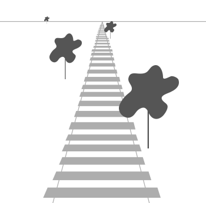
由于透视，这两条线在很远的地方看起来会相交。这正是透视投影想要模仿的效果，它是使用**透视投影矩阵**来完成的。这个投影矩阵将给定的平截头体范围映射到裁剪空间，除此之外还修改了每个顶点坐标的w值，从而使得离观察者越远的顶点坐标w分量越大。被变换到裁剪空间的坐标都会在-w到w的范围之间（任何大于这个范围的坐标都会被裁剪掉）。OpenGL要求所有可见的坐标都落在-1.0到1.0范围内，作为顶点着色器最后的输出，因此，一旦坐标在裁剪空间内之后，透视除法就会被应用到裁剪空间坐标上:
$$
out = (x/w, y/w, z/w)
$$
顶点坐标的每个分量都会除以它的w分量，距离观察者越远顶点坐标就会越小。这是w分量重要的另一个原因，它能够帮助我们进行透视投影。最后的结果坐标就是处于标准化设备空间中的。

如果对上述两个投影矩阵的计算感兴趣，推荐阅读[文章](https://www.songho.ca/opengl/gl_projectionmatrix.html)

GLM可以这样创建一个透视投影矩阵：
```
glm::mat4 proj = glm::perspective(glm::radians(45.0f), (float)width/(float)height, 0.1f, 100.0f);
```
`glm::perspective`所做的其实就是创建了一个**定义了可视空间的大平截头体**，任何在这个平截头体以外的东西最后都不会出现在裁剪空间体积内，并且将会受到裁剪。一个透视平截头体可以被看作一个不均匀形状的箱子，在这个箱子内部的每个坐标都会被映射到裁剪空间上的一个点:
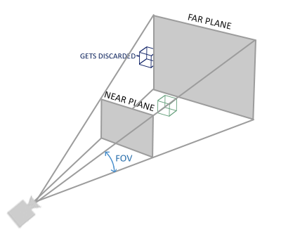
第一个参数定义了fov的值，它表示的是视野(Field of View)，并且设置了观察空间的大小。如果想要一个真实的观察效果，它的值通常设置为45.0f;
第二个参数设置了宽高比，由视口的宽除以高所得。
第三个和第四个参数设置了平截头体的近和远平面。我们通常设置近距离为0.1f，而远距离设为100.0f。所有在近平面和远平面内且处于平截头体内的顶点都会被渲染。当你把透视矩阵的 near 值设置太大时（如10.0f），OpenGL会将靠近摄像机的坐标（在0.0f和10.0f之间）都裁剪掉，这会导致一个你在游戏中很熟悉的视觉效果：在太过靠近一个物体的时候你的视线会直接穿过去。

当使用正射投影时，每一个顶点坐标都会直接映射到裁剪空间中而不经过任何精细的透视除法（它仍然会进行透视除法，只是w分量没有被改变（它保持为1），因此没有起作用）。因为正射投影没有使用透视，远处的物体不会显得更小，所以产生奇怪的视觉效果。由于这个原因，正射投影主要用于二维渲染以及一些建筑或工程的程序，在这些场景中我们更希望顶点不会被透视所干扰。某些如 Blender 等进行三维建模的软件有时在建模时也会使用正射投影，因为它在各个维度下都更准确地描绘了每个物体。下面你能够看到在Blender里面使用两种投影方式的对比：
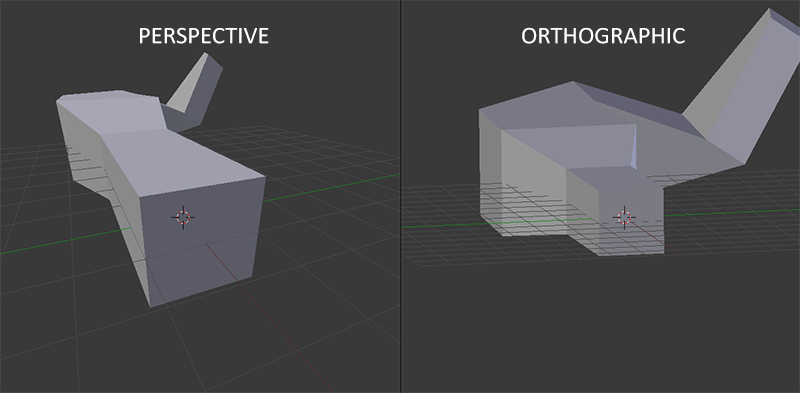

#### 变换矩阵的最终组合
我们为上述的每一个步骤都创建了一个变换矩阵：模型矩阵、观察矩阵和投影矩阵。一个顶点坐标将会根据以下过程被变换到裁剪坐标：
$$
V_{clip}=M_{projection}⋅M_{view}⋅M_{model}⋅V_{local}
$$
注意矩阵运算的顺序是相反的（记住我们需要从右往左阅读矩阵的乘法）。最后的顶点应该被赋值到顶点着色器中的`gl_Position()`，OpenGL将会自动进行透视除法和裁剪。

然后，由于顶点着色器的输出要求所有的顶点都在裁剪空间内，OpenGL会对裁剪坐标执行透视除法从而将它们变换到标准化设备坐标。OpenGL会使用`glViewPort()`内部的参数来将标准化设备坐标映射到屏幕坐标，每个坐标都关联了一个屏幕上的点（在我们的例子中是一个800x600的屏幕）。这个过程称为视口变换。

#### 3D化世界
既然我们知道了如何将3D坐标变换为2D坐标，我们可以开始使用真正的3D物体，而不是枯燥的2D平面了。

在开始进行3D绘图时，我们首先创建一个模型矩阵。这个模型矩阵包含了位移、缩放与旋转操作，它们会被应用到所有物体的顶点上，以变换它们到全局的世界空间。让我们变换一下我们的平面，将其绕着x轴旋转，使它看起来像放在地上一样。这个模型矩阵看起来是这样的：
```
glm::mat4 model;
model = glm::rotate(model, glm::radians(-55.0f), glm::vec3(1.0f, 0.0f, 0.0f));
```
通过**将顶点坐标乘以这个模型矩阵**，我们将该顶点坐标变换到世界坐标。我们的平面看起来就是在地板上，代表全局世界里的平面。
接下来我们需要创建一个观察矩阵。我们想要在场景里面稍微往后移动，以使得物体变成可见的（当在世界空间时，我们位于原点(0,0,0)）。要想在场景里面移动，先仔细想一想下面这个句子：

- 将摄像机向后移动，和将整个场景向前移动是一样的。

这正是观察矩阵所做的，我们以相反于摄像机移动的方向移动整个场景。因为我们想要往后移动，并且OpenGL是一个右手坐标系(Right-handed System)，所以我们需要沿着z轴的正方向移动。我们会通过将场景沿着z轴负方向平移来实现。它会给我们一种我们在往后移动的感觉。

在下一个教程中我们将会详细讨论如何在场景中移动。就目前来说，观察矩阵是这样的：
```
glm::mat4 view;
// 注意，我们将矩阵向我们要进行移动场景的反方向移动。
view = glm::translate(view, glm::vec3(0.0f, 0.0f, -3.0f));
```
最后我们需要做的是定义一个投影矩阵。我们希望在场景中使用透视投影，所以像这样声明一个投影矩阵：
```
glm::mat4 projection;
projection = glm::perspective(glm::radians(45.0f), screenWidth / screenHeight, 0.1f, 100.0f);
```
既然我们已经创建了变换矩阵，我们应该将它们传入着色器。首先，让我们在顶点着色器中声明一个uniform变换矩阵然后将它乘以顶点坐标：
```
#version 330 core
layout (location = 0) in vec3 aPos;
...
uniform mat4 model;
uniform mat4 view;
uniform mat4 projection;

void main()
{
    // 注意乘法要从右向左读
    gl_Position = projection * view * model * vec4(aPos, 1.0);
    ...
}
```
我们还应该将矩阵传入着色器（这通常在每次的渲染迭代中进行，因为变换矩阵会经常变动）：
```
int modelLoc = glGetUniformLocation(ourShader.ID, "model");
glUniformMatrix4fv(modelLoc, 1, GL_FALSE, glm::value_ptr(model));
... // 观察矩阵和投影矩阵与之类似
```
我们的顶点坐标已经使用模型、观察和投影矩阵进行变换了，最终的物体应该会：
- 稍微向后倾斜至地板方向。
- 离我们有一些距离。
- 有透视效果（顶点越远，变得越小）。

#### 3D化物体与z-buffer
拓展我们的2D平面为一个3D立方体。要想渲染一个立方体，我们一共需要36个顶点（6个面 x 每个面有2个三角形组成 x 每个三角形有3个顶点）。然而结果缺乏前后遮挡检测。
OpenGL存储它的所有深度信息于一个Z缓冲(Z-buffer)中，也被称为深度缓冲(Depth Buffer)。GLFW会自动为你生成这样一个缓冲（就像它也有一个颜色缓冲来存储输出图像的颜色）。深度值存储在每个片段里面（作为片段的z值），当片段想要输出它的颜色时，OpenGL会将它的深度值和z缓冲进行比较，如果当前的片段在其它片段之后，它将会被丢弃，否则将会覆盖。这个过程称为深度测试(Depth Testing)，它是由OpenGL自动完成的。

然而，如果我们想要确定OpenGL真的执行了深度测试，首先我们要告诉OpenGL我们想要启用深度测试。我们可以通过`glEnable()`函数来开启深度测试。glEnable和glDisable函数允许我们启用或禁用某个OpenGL功能。这个功能会一直保持启用/禁用状态，直到另一个调用来禁用/启用它。现在我们想启用深度测试，需要开启`GL_DEPTH_TEST`：
```
glEnable(GL_DEPTH_TEST);
```
因为我们使用了深度测试，我们也想要在每次渲染迭代之前清除深度缓冲（否则前一帧的深度信息仍然保存在缓冲中）。就像清除颜色缓冲一样，我们可以通过在glClear函数中指定DEPTH_BUFFER_BIT位来清除深度缓冲：
```
glClear(GL_COLOR_BUFFER_BIT | GL_DEPTH_BUFFER_BIT);
```

##### 多个物体渲染
在OpenGL的Render Loop中，应该先调用`ourShader.use()`，再调用`glBindVertexArray(VAO)`。因为`ourShader.use()` 激活的是全局OpenGL状态，它告诉OpenGL接下来使用哪个着色器程序；而所有的uniform设置必须在对应的着色器激活后才能生效。
如果先绑定VAO再激活着色器，uniform设置可能被应用到错误的着色器程序
那么在渲染多个物体时，出于性能考虑，频繁切换着色器比频繁切换VAO代价更高。最佳实践是：
```
// 按着色器分组绘制
ourShader1.use();
// 设置所有ourShader1的uniform

for (每个使用ourShader1的物体) {
    glBindVertexArray(对应VAO);
    glDrawArrays(...);
}

ourShader2.use();
// 设置所有ourShader2的uniform

for (每个使用ourShader2的物体) {
    glBindVertexArray(对应VAO);
    glDrawArrays(...);
}
```

### L1-7 : 摄像机
本节我们将会讨论如何在OpenGL中配置一个摄像机，并且将会讨论FPS风格的摄像机，让你能够在3D场景中自由移动。我们也会讨论键盘和鼠标输入，最终完成一个自定义的摄像机类。

#### Camera与View Space
当我们讨论摄像机/观察空间(Camera/View Space)的时候，是在讨论以摄像机的视角作为场景原点时场景中所有的顶点坐标：观察矩阵把所有的世界坐标变换为**相对于摄像机位置与方向的观察坐标**。要定义一个摄像机，我们需要它在世界空间中的**位置**、**观察的方向**、**一个指向它右侧的向量**以及**一个指向它上方的向量**。细心的读者可能已经注意到我们实际上创建了一个三个单位轴相互垂直的、以摄像机的位置为原点的坐标系。
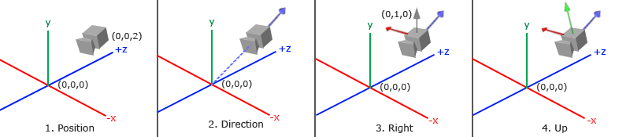
##### Camera位置
获取摄像机位置很简单。摄像机位置简单来说就是世界空间中一个指向摄像机位置的向量。我们把摄像机位置设置为上一节中的那个相同的位置：
```
glm::vec3 cameraPos = glm::vec3(0.0f, 0.0f, 3.0f);
```
不要忘记**正z轴是从屏幕指向你的**，如果我们希望摄像机向后移动，我们就沿着z轴的正方向移动。

##### Camera方向
用场景原点向量减去摄像机位置向量的结果就是摄像机的指向向量。由于我们知道摄像机指向z轴负方向，但我们希望**方向向量(Direction Vector)指向摄像机的z轴正方向**。如果我们交换相减的顺序，我们就会获得一个指向摄像机正z轴方向的向量：
```
glm::vec3 cameraTarget = glm::vec3(0.0f, 0.0f, 0.0f);
glm::vec3 cameraDirection = glm::normalize(cameraPos - cameraTarget);
```
*尽管名字叫“方向向量(Direction Vector)”，但它实际上指向从它到目标向量的相反方向。例如上图中蓝色的方向向量大概指向z轴的正方向，与摄像机实际指向的方向是正好相反的。*

##### 右轴
我们需要的另一个向量是一个右向量(Right Vector)，它代表摄像机空间的x轴的正方向。为获取右向量我们需要先使用一个小技巧：先定义一个上向量(Up Vector)。接下来把上向量和第二步得到的方向向量进行叉乘。两个向量叉乘的结果会同时垂直于两向量，因此我们会得到指向x轴正方向的那个向量。顺序不能襄樊，不然会得到相反的指向x轴负方向的向量：
```
glm::vec3 up = glm::vec3(0.0f, 1.0f, 0.0f); 
glm::vec3 cameraRight = glm::normalize(glm::cross(up, cameraDirection));
```
##### 上轴
现在我们已经有了x轴向量和z轴向量，获取一个指向摄像机的正y轴向量就相对简单了：我们把右向量和方向向量进行叉乘：
```
glm::vec3 cameraUp = glm::cross(cameraDirection, cameraRight);
```
在叉乘和一些小技巧的帮助下，我们创建了所有构成观察/摄像机空间的向量。对于想学到更多数学原理的读者，提示一下，在线性代数中这个处理叫做格拉姆—施密特正交化(Gram-Schmidt Process)。

#### Look At矩阵
使用这些摄像机向量我们就可以创建一个LookAt矩阵了，我们可以用这个矩阵乘以任何向量来将其变换到那个坐标空间。
$$
LookAt = \begin{bmatrix} \color{red}{R_x} & \color{red}{R_y} & \color{red}{R_z} & 0 \\ \color{green}{U_x} & \color{green}{U_y} & \color{green}{U_z} & 0 \\ \color{blue}{D_x} & \color{blue}{D_y} & \color{blue}{D_z} & 0 \\ 0 & 0 & 0  & 1 \end{bmatrix} * \begin{bmatrix} 1 & 0 & 0 & -\color{purple}{P_x} \\ 0 & 1 & 0 & -\color{purple}{P_y} \\ 0 & 0 & 1 & -\color{purple}{P_z} \\ 0 & 0 & 0  & 1 \end{bmatrix}
$$
其中R是右向量，U是上向量，D是方向向量P是摄像机位置向量。注意，**位置向量是相反的**，因为我们最终希望把世界平移到与我们自身移动的相反方向。把这个LookAt矩阵作为观察矩阵可以很高效地把所有世界坐标变换到刚刚定义的观察空间。
幸运的是，GLM已经提供了对于LookAt矩阵的支持。我们要做的只是定义一个**摄像机位置**，一个**目标位置**和一个表**示世界空间中的上向量的向量**（我们计算右向量使用的那个上向量）。接着GLM就会创建一个LookAt矩阵，我们可以把它当作我们的观察矩阵：
```
glm::mat4 view;
view = glm::lookAt(glm::vec3(0.0f, 0.0f, 3.0f), 
           glm::vec3(0.0f, 0.0f, 0.0f), 
           glm::vec3(0.0f, 1.0f, 0.0f));
```
`glm::LookAt()`函数需要一个位置、目标和上向量。它会创建一个和在上一节使用的一样的观察矩阵。

#### Camera自由移动的实现
首先我们必须设置一个摄像机系统，所以在我们的程序前面定义一些摄像机变量很有用：
```
glm::vec3 cameraPos   = glm::vec3(0.0f, 0.0f,  3.0f);
glm::vec3 cameraFront = glm::vec3(0.0f, 0.0f, -1.0f);
glm::vec3 cameraUp    = glm::vec3(0.0f, 1.0f,  0.0f);
```
LookAt函数现在成了：
```
view = glm::lookAt(cameraPos, cameraPos + cameraFront, cameraUp);
```
我们首先将摄像机位置设置为之前定义的`cameraPos`。方向是当前的位置加上我们刚刚定义的方向向量。这样能保证无论我们怎么移动，摄像机都会注视着目标方向。让我们摆弄一下这些向量，在按下某些按钮时更新`cameraPos`向量。

我们已经为GLFW的键盘输入定义过一个`processInput()`函数了，我们来新添加几个需要检查的按键命令：
```
void processInput(GLFWwindow *window)
{
    ...
    float cameraSpeed = 0.05f; // adjust accordingly
    if (glfwGetKey(window, GLFW_KEY_W) == GLFW_PRESS)
        cameraPos += cameraSpeed * cameraFront;
    if (glfwGetKey(window, GLFW_KEY_S) == GLFW_PRESS)
        cameraPos -= cameraSpeed * cameraFront;
    if (glfwGetKey(window, GLFW_KEY_A) == GLFW_PRESS)
        cameraPos -= glm::normalize(glm::cross(cameraFront, cameraUp)) * cameraSpeed;
    if (glfwGetKey(window, GLFW_KEY_D) == GLFW_PRESS)
        cameraPos += glm::normalize(glm::cross(cameraFront, cameraUp)) * cameraSpeed;
}
```
当我们按下WASD键的任意一个，摄像机的位置都会相应更新。如果我们希望向前或向后移动，我们就把位置向量加上或减去方向向量。如果我们希望向左右移动，我们使用叉乘来创建一个右向量(Right Vector)，并沿着它相应移动就可以了。这样就创建了使用摄像机时熟悉的横移(Strafe)效果。

注意，我们对右向量进行了标准化。如果我们没对这个向量进行标准化，最后的叉乘结果会根据cameraFront变量返回大小不同的向量。如果我们不对向量进行标准化，我们就得根据摄像机的朝向不同加速或减速移动了，但如果进行了标准化移动就是匀速的。

#### 移动速度的均一化
目前我们的移动速度是个常量。理论上没什么问题，但是实际情况下根据处理器的能力不同，有些人可能会比其他人每秒绘制更多帧，也就是以更高的频率调用processInput函数。结果就是，根据配置的不同，有些人可能移动很快，而有些人会移动很慢。当你发布你的程序的时候，你必须确保它在所有硬件上移动速度都一样。

图形程序和游戏通常会跟踪一个**时间差(Deltatime)**变量，它储存了渲染上一帧所用的时间。我们把所有速度都去乘以`deltaTime`值。结果就是，如果我们的`deltaTime`很大，就意味着上一帧的渲染花费了更多时间，所以这一帧的速度需要变得更高来平衡渲染所花去的时间。使用这种方法时，无论你的电脑快还是慢，摄像机的速度都会相应平衡，这样每个用户的体验就都一样了。
我们跟踪两个全局变量来计算出`deltaTime`值：
```
float deltaTime = 0.0f; // 当前帧与上一帧的时间差
float lastFrame = 0.0f; // 上一帧的时间
```
在每一帧中我们计算出新的`deltaTime`以备后用。
```
float currentFrame = glfwGetTime();
deltaTime = currentFrame - lastFrame;
lastFrame = currentFrame;
```
现在我们有了`deltaTime`，在计算速度的时候可以将其考虑进去了：
```
void processInput(GLFWwindow *window)
{
  float cameraSpeed = 2.5f * deltaTime;
  ...
}
```

#### 视角的转向与移动
为了能够改变视角，我们需要根据鼠标的输入改变cameraFront向量。然而，根据鼠标移动改变方向向量有点复杂，需要一些三角学知识。
##### 欧拉角
欧拉角(Euler Angle)是可以表示3D空间中任何旋转的3个值，由莱昂哈德·欧拉(Leonhard Euler)在18世纪提出。一共有3种欧拉角：俯仰角(Pitch)、偏航角(Yaw)和滚转角(Roll)，下面的图片展示了它们的含义：
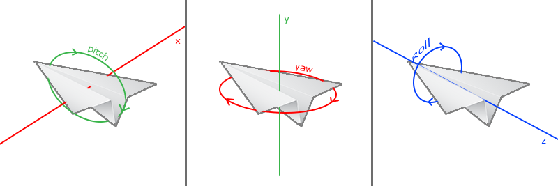
**俯仰角**是描述我们如何往上或往下看的角，可以在第一张图中看到。第二张图展示了**偏航角**，偏航角表示我们往左和往右看的程度。**滚转角**代表我们如何翻滚摄像机，通常在太空飞船的摄像机中使用。每个欧拉角都有一个值来表示，把三个角结合起来我们就能够计算3D空间中任何的旋转向量了。

对于我们的摄像机系统来说，我们只关心俯仰角和偏航角，所以我们不会讨论滚转角。给定一个俯仰角和偏航角，我们可以把它们转换为一个代表新的方向向量的3D向量。
```
direction.x = cos(glm::radians(pitch)) * cos(glm::radians(yaw)); 
direction.y = sin(glm::radians(pitch));
direction.z = cos(glm::radians(pitch)) * sin(glm::radians(yaw));
```
*注：direction代表摄像机的前轴(Front)，这个前轴是和本文第一幅图片的第二个摄像机的方向向量是相反的*

##### 鼠标输入
偏航角和俯仰角是通过鼠标（或手柄）移动获得的，水平的移动影响偏航角，竖直的移动影响俯仰角。它的原理就是，**储存上一帧鼠标的位置，在当前帧中我们当前计算鼠标位置与上一帧的位置相差多少**。如果水平/竖直差别越大那么俯仰角或偏航角就改变越大，也就是摄像机需要移动更多的距离。

首先我们要告诉GLFW，它应该隐藏光标，并捕捉(Capture)它。捕捉光标表示的是，如果焦点在你的程序上（即表示你正在操作这个程序），光标应该停留在窗口中（除非程序失去焦点或者退出）。我们可以用一个简单地配置调用来完成：
```
glfwSetInputMode(window, GLFW_CURSOR, GLFW_CURSOR_DISABLED);
```
在调用这个函数之后，无论我们怎么去移动鼠标，光标都不会显示了，它也不会离开窗口。对于FPS摄像机系统来说非常完美。

为了计算俯仰角和偏航角，我们需要让GLFW监听鼠标移动事件。和键盘输入相似，我们会用一个回调函数来完成，函数的原型如下：
```
void mouse_callback(GLFWwindow* window, double xpos, double ypos);
```
这里的xpos和ypos代表当前鼠标的位置。当我们用GLFW注册了回调函数之后，鼠标一移动`mouse_callback()`函数就会被调用：
```
glfwSetCursorPosCallback(window, mouse_callback);
```
在处理FPS风格摄像机的鼠标输入的时候，我们必须在最终获取方向向量之前做下面这几步：

- 计算鼠标距上一帧的偏移量。
- 把偏移量添加到摄像机的俯仰角和偏航角中。
- 对偏航角和俯仰角进行最大和最小值的限制。
- 计算方向向量。

第一步是计算鼠标自上一帧的偏移量。我们必须先在程序中储存上一帧的鼠标位置，我们把它的初始值设置为屏幕的中心（屏幕的尺寸是800x600）：
```
float lastX = 400, lastY = 300;
```
然后在鼠标的回调函数中我们计算当前帧和上一帧鼠标位置的偏移量：
```
float xoffset = xpos - lastX;
float yoffset = lastY - ypos; // 注意这里是相反的，因为y坐标是从底部往顶部依次增大的
lastX = xpos;
lastY = ypos;

float sensitivity = 0.05f;
xoffset *= sensitivity;
yoffset *= sensitivity;
```
注意我们把偏移量乘以了sensitivity（灵敏度）值。如果我们忽略这个值，鼠标移动就会太大了；你可以自己实验一下，找到适合自己的灵敏度值。

接下来我们把偏移量加到全局变量pitch和yaw上：
```
yaw   += xoffset;
pitch += yoffset;
```
第三步，我们需要给摄像机添加一些限制，这样摄像机就不会发生奇怪的移动了（这样也会避免一些奇怪的问题）。对于俯仰角，要让用户不能看向高于89度的地方（在90度时视角会发生逆转，所以我们把89度作为极限），同样也不允许小于-89度。这样能够保证用户只能看到天空或脚下，但是不能超越这个限制。我们可以在值超过限制的时候将其改为极限值来实现：
```
if(pitch > 89.0f)
  pitch =  89.0f;
if(pitch < -89.0f)
  pitch = -89.0f;
```
注意我们没有给偏航角设置限制，这是因为我们不希望限制用户的水平旋转。当然，给偏航角设置限制也很容易，如果你愿意可以自己实现。

第四也是最后一步，就是通过俯仰角和偏航角来计算以得到真正的方向向量：
```
glm::vec3 front;
front.x = cos(glm::radians(pitch)) * cos(glm::radians(yaw));
front.y = sin(glm::radians(pitch));
front.z = cos(glm::radians(pitch)) * sin(glm::radians(yaw));
cameraFront = glm::normalize(front);
```
计算出来的方向向量就会包含根据鼠标移动计算出来的所有旋转了。由于cameraFront向量已经包含在GLM的lookAt函数中，我们这就没什么问题了。

如果你现在运行代码，你会发现在窗口第一次获取焦点的时候摄像机会突然跳一下。这个问题产生的原因是，**在你的鼠标移动进窗口的那一刻，鼠标回调函数就会被调用，这时候的xpos和ypos会等于鼠标刚刚进入屏幕的那个位置**。这通常是一个距离屏幕中心很远的地方，因而产生一个很大的偏移量，所以就会跳了。我们可以简单的使用一个bool变量检验我们是否是第一次获取鼠标输入，如果是，那么我们先把鼠标的初始位置更新为xpos和ypos值，这样就能解决这个问题；接下来的鼠标移动就会使用刚进入的鼠标位置坐标来计算偏移量了：
```
if(firstMouse) // 这个bool变量初始时是设定为true的
{
    lastX = xpos;
    lastY = ypos;
    firstMouse = false;
}
```
最后的代码应该是这样的：
```
void mouse_callback(GLFWwindow* window, double xpos, double ypos)
{
    if(firstMouse)
    {
        lastX = xpos;
        lastY = ypos;
        firstMouse = false;
    }

    float xoffset = xpos - lastX;
    float yoffset = lastY - ypos; 
    lastX = xpos;
    lastY = ypos;

    float sensitivity = 0.05;
    xoffset *= sensitivity;
    yoffset *= sensitivity;

    yaw   += xoffset;
    pitch += yoffset;

    if(pitch > 89.0f)
        pitch = 89.0f;
    if(pitch < -89.0f)
        pitch = -89.0f;

    glm::vec3 front;
    front.x = cos(glm::radians(yaw)) * cos(glm::radians(pitch));
    front.y = sin(glm::radians(pitch));
    front.z = sin(glm::radians(yaw)) * cos(glm::radians(pitch));
    cameraFront = glm::normalize(front);
}
```
现在我们就可以自由地在3D场景中移动了！

##### 缩放
作为我们摄像机系统的一个附加内容，我们还会来实现一个缩放(Zoom)接口。在之前的教程中我们说视野(Field of View)或fov定义了我们可以看到场景中多大的范围。当视野变小时，场景投影出来的空间就会减小，产生放大(Zoom In)了的感觉。我们会使用鼠标的滚轮来放大。与鼠标移动、键盘输入一样，我们需要一个鼠标滚轮的回调函数：
```
void scroll_callback(GLFWwindow* window, double xoffset, double yoffset)
{
  if(fov >= 1.0f && fov <= 45.0f)
    fov -= yoffset;
  if(fov <= 1.0f)
    fov = 1.0f;
  if(fov >= 45.0f)
    fov = 45.0f;
}
```
当滚动鼠标滚轮的时候，`yoffset`值代表我们竖直滚动的大小。当`scroll_callback()`函数被调用后，我们改变全局变量fov变量的内容。因为45.0f是默认的视野值，我们将会把缩放级别(Zoom Level)限制在1.0f到45.0f。

我们现在在每一帧都必须把透视投影矩阵上传到GPU，但现在使用fov变量作为它的视野：
```
projection = glm::perspective(glm::radians(fov), 800.0f / 600.0f, 0.1f, 100.0f);
```
最后不要忘记注册鼠标滚轮的回调函数：
```
glfwSetScrollCallback(window, scroll_callback);
```

#### Camera类

接下来的教程中，我们将会一直使用一个摄像机来浏览场景，从各个角度观察结果。然而，由于一个摄像机会占用每篇教程很大的篇幅，我们将会从细节抽象出来，创建我们自己的摄像机对象，它会完成大多数的工作，而且还会提供一些附加的功能。和着色器对象一样，我们把摄像机类写在一个单独的头文件中。我们建议您至少看一看这个类，看看如何创建一个自己的摄像机类。

我们介绍的摄像机系统是一个FPS风格的摄像机，它能够满足大多数情况需要，而且与欧拉角兼容，但是在创建不同的摄像机系统（比如飞行模拟摄像机）时就要当心。每个摄像机系统都有自己的优点和不足，所以确保对它们进行了详细研究。比如，这个FPS摄像机不允许俯仰角大于90度，而且我们使用了一个固定的上向量(0, 1, 0)，这在需要考虑滚转角的时候就不能用了。

## 光照
### L2-1 : 颜色
本节我们将会更深入地讨论什么是颜色，并且还会为接下来的光照(Lighting)教程创建一个场景。

现实世界中有无数种颜色，每一个物体都有它们自己的颜色。我们需要使用（有限的）数值来模拟真实世界中（无限）的颜色，所以并不是所有现实世界中的颜色都可以用数值来表示的。然而我们仍能通过数值来表现出非常多的颜色，甚至你可能都不会注意到与现实的颜色有任何的差异。颜色可以数字化的由红色(Red)、绿色(Green)和蓝色(Blue)三个分量组成，它们通常被缩写为RGB。仅仅用这三个值就可以组合出任意一种颜色。例如，要获取一个珊瑚红(Coral)色的话，我们可以定义这样的一个颜色向量：
```
glm::vec3 coral(1.0f, 0.5f, 0.31f);
```
我们在现实生活中看到某一物体的颜色并不是这个物体真正拥有的颜色，而是它所反射的(Reflected)颜色。从技术上来说，情况会更复杂一些，但我们将在PBR章节中进一步探讨。

这些颜色反射的定律被直接地运用在图形领域。当我们在OpenGL中创建一个光源时，我们希望给光源一个颜色。假如我们有一个白色的太阳，所以我们也将光源设置为白色。**当我们把光源的颜色与物体的颜色值相乘，所得到的就是这个物体所反射的颜色（也就是我们所感知到的颜色）**。让我们再次审视我们的玩具：
```
glm::vec3 lightColor(1.0f, 1.0f, 1.0f);
glm::vec3 toyColor(1.0f, 0.5f, 0.31f);
glm::vec3 result = lightColor * toyColor; // = (1.0f, 0.5f, 0.31f);
```
从代码中来看，可以看到玩具的颜色**吸收**了白色光源中很大一部分的颜色，同时它根据自身的颜色值对红、绿、蓝三个分量都做出了一定的反射。这也表现了现实中颜色的工作原理。由此，我们可以定义物体的颜色为**物体从一个光源反射各个颜色分量的大小**。现在，如果我们使用绿色的光源又会发生什么呢？
```
glm::vec3 lightColor(0.0f, 1.0f, 0.0f);
glm::vec3 toyColor(1.0f, 0.5f, 0.31f);
glm::vec3 result = lightColor * toyColor; // = (0.0f, 0.5f, 0.0f);
```
可以看到，并没有红色和蓝色的光让我们的玩具来吸收或反射。这个玩具吸收了光线中一半的绿色值，但仍然也反射了一半的绿色值。玩具现在看上去是深绿色(Dark-greenish)的。我们可以看到，如果我们用绿色光源来照射玩具，那么只有绿色分量能被反射和感知到，红色和蓝色都不能被我们所感知到。这样做的结果是，一个珊瑚红的玩具突然变成了深绿色物体。

现在我们来看另一个例子，使用深橄榄绿色(Dark olive-green)的光源：
```
glm::vec3 lightColor(0.33f, 0.42f, 0.18f);
glm::vec3 toyColor(1.0f, 0.5f, 0.31f);
glm::vec3 result = lightColor * toyColor; // = (0.33f, 0.21f, 0.06f);
```
可以看到，我们可以使用不同的光源颜色来让物体显现出意想不到的颜色。有创意地利用颜色其实并不难。

#### 光照场景的创建
在接下来的教程中，我们将会广泛地使用颜色来模拟现实世界中的光照效果，创造出一些有趣的视觉效果。

首先我们需要一个物体来作为被投光(Cast the light)的对象，我们将使用前面教程中的立方体箱子。我们还需要一个物体来代表光源在3D场景中的位置。简单起见，我们依然使用一个立方体来代表光源。

填一个顶点缓冲对象(VBO)，设定一下顶点属性指针和其它一些乱七八糟的东西现在对你来说应该很容易了，所以我们就不再赘述那些步骤了。如果你仍然觉得这很困难，我建议你复习之前的教程，并且在继续学习之前先把练习过一遍。

我们首先需要一个顶点着色器来绘制箱子。与之前的顶点着色器相比，容器的顶点位置是保持不变的（虽然这一次我们不需要纹理坐标了），因此顶点着色器中没有新的代码。我们将会使用之前教程顶点着色器的精简版：
```
#version 330 core
layout (location = 0) in vec3 aPos;

uniform mat4 model;
uniform mat4 view;
uniform mat4 projection;

void main()
{
    gl_Position = projection * view * model * vec4(aPos, 1.0);
}
```

我们还要创建一个表示灯（光源）的立方体，所以我们还要为这个灯创建一个专门的VAO。当然我们也可以让这个灯和其它物体使用同一个VAO，然后简单地对它的model矩阵做一些变换，然而接下来的教程中我们会频繁地对顶点数据和属性指针做出修改，我们并不想让这些修改影响到灯（我们只关心灯的顶点位置），因此我们有必要为灯创建一个新的VAO。
```
unsigned int lightVAO;
glGenVertexArrays(1, &lightVAO);
glBindVertexArray(lightVAO);
// 只需要绑定VBO不用再次设置VBO的数据，因为箱子的VBO数据中已经包含了正确的立方体顶点数据
glBindBuffer(GL_ARRAY_BUFFER, VBO);
// 设置灯立方体的顶点属性（对我们的灯来说仅仅只有位置数据）
glVertexAttribPointer(0, 3, GL_FLOAT, GL_FALSE, 3 * sizeof(float), (void*)0);
glEnableVertexAttribArray(0);
```
现在我们已经创建了表示灯和被照物体箱子，我们只需要再定义一个片段着色器就行了：
```
#version 330 core
out vec4 FragColor;

uniform vec3 objectColor;
uniform vec3 lightColor;

void main()
{
    FragColor = vec4(lightColor * objectColor, 1.0);
}
```
这个片段着色器从uniform变量中接受物体的颜色和光源的颜色。正如本节一开始所讨论的那样，我们将光源的颜色和物体（反射的）颜色相乘。这个着色器理解起来应该很容易。我们把物体的颜色设置为之前提到的珊瑚红色，并把光源设置为白色。
```
// 在此之前不要忘记首先 use 对应的着色器程序（来设定uniform）
lightingShader.use();
lightingShader.setVec3("objectColor", 1.0f, 0.5f, 0.31f);
lightingShader.setVec3("lightColor",  1.0f, 1.0f, 1.0f);
```
要注意的是，当我们修改顶点或者片段着色器后，灯的位置或颜色也会随之改变，这并不是我们想要的效果。我们不希望灯的颜色在接下来的教程中因光照计算的结果而受到影响，而是希望它能够与其它的计算分离。我们希望灯一直保持明亮，不受其它颜色变化的影响（这样它才更像是一个真实的光源）。

为了实现这个目标，我们需要为灯的绘制创建另外的一套着色器，从而能保证它能够在其它光照着色器发生改变的时候不受影响。顶点着色器与我们当前的顶点着色器是一样的，所以你可以直接把现在的顶点着色器用在灯上。灯的片段着色器给灯定义了一个不变的常量白色，保证了灯的颜色一直是亮的：
```
#version 330 core
out vec4 FragColor;

void main()
{
    FragColor = vec4(1.0); // 将向量的四个分量全部设置为1.0
}
```
当我们想要绘制我们的物体的时候，我们需要使用刚刚定义的光照着色器来绘制箱子（或者可能是其它的物体）。当我们想要绘制灯的时候，我们会使用灯的着色器。在之后的教程里我们会逐步更新这个光照着色器，从而能够慢慢地实现更真实的效果。

使用这个灯立方体的主要目的是为了让我们知道光源在场景中的具体位置。我们通常在场景中定义一个光源的位置，但这只是一个位置，它并没有视觉意义。为了显示真正的灯，我们将表示光源的立方体绘制在与光源相同的位置，并让它一直处于白色的状态，不受场景中的光照影响。
```
glm::vec3 lightPos(1.2f, 1.0f, 2.0f);
// 把灯位移到lightPos，且缩小一点
model = glm::mat4();
model = glm::translate(model, lightPos);
model = glm::scale(model, glm::vec3(0.2f));
```
绘制灯立方体的代码应该与下面的类似：
```
lampShader.use();
// 设置模型、视图和投影矩阵uniform
...
// 绘制灯立方体对象
glBindVertexArray(lightVAO);
glDrawArrays(GL_TRIANGLES, 0, 36);
```

*遇到的弱智问题：.vs与.fs文件名拼写错误，导致Shader类无法读取到文件！*

### L2-2 : 基础光照
我们这里使用Phong光照模型(Phong Lighting Model)来模拟基础光照。

风氏光照模型的主要结构由3个分量组成：环境(Ambient)、漫反射(Diffuse)和镜面(Specular)光照。下面这张图展示了这些光照分量看起来的样子：
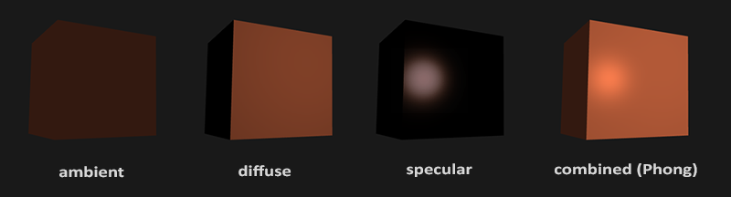

- 环境光照(Ambient Lighting)：即使在黑暗的情况下，世界上通常也仍然有一些光亮（月亮、远处的光），所以物体几乎永远不会是完全黑暗的。为了模拟这个，我们会使用一个环境光照常量，它永远会给物体一些颜色。
- 漫反射光照(Diffuse Lighting)：模拟光源对物体的方向性影响(Directional Impact)。它是风氏光照模型中视觉上最显著的分量。物体的某一部分越是正对着光源，它就会越亮。
- 镜面光照(Specular Lighting)：模拟有光泽物体上面出现的亮点。镜面光照的颜色相比于物体的颜色会更倾向于光的颜色。

模拟视觉场景通常需要模拟至少以上三种光照分量。先从环境光开始。

#### 环境光照
全局照明(Global Illumination)算法：考虑所有光源的光在不同物体的反射/散射的算法。开销过于高昂。
环境光照是一种简化模型。我们使用一个很小的常量（光照）颜色，添加到物体片段的最终颜色中，这样子的话即便场景中没有直接的光源也能看起来存在有一些发散的光。
把环境光照添加到场景里非常简单。我们用光的颜色乘以一个很小的常量环境因子，再乘以物体的颜色，然后将最终结果作为片段的颜色：
```
void main()
{
    float ambientStrength = 0.1;
    vec3 ambient = ambientStrength * lightColor;

    vec3 result = ambient * objectColor;
    FragColor = vec4(result, 1.0);
}
```

#### 漫反射光照
漫反射光照使物体上与光线方向越接近的片段能从光源处获得更多的亮度。
首先我们需要测量这个光线是以什么角度接触到这个片段的。如果光线垂直于物体表面，这束光对物体的影响会最大化（即更亮）。为了测量光线和片段的角度，我们需要使用法向量(Normal Vector)与光线向量的点积。点积越大，说明光线和片段的角度越小，这束光对片段的影响就越大，即越亮，反之亦然。

所以，计算漫反射光照需要：
- 法向量：一个垂直于顶点表面的向量。
- 定向的光线：作为光源的位置与片段的位置之间向量差的方向向量。为了计算这个光线，我们需要光的位置向量和片段的位置向量。
##### 法向量的设置
我们利用某一点周围的顶点，通过叉乘来计算出这个顶点的表面法向。但是由于3D立方体不是一个复杂的形状，所以我们也可以简单地把法线数据手工添加到顶点数据中。
除了在VAO中需要更新法向量指针外，我们还需要在片段着色器中更新法向量的接收变量。
此外，我们还需要光源的位置与片段的位置以生成光线方向向量。这里我们的光源是静态的，所以可以设定为`uniform`(记得在渲染循环中添加它)
而对于片段位置，注意到我们还需要将模型的位置矩阵乘上`model`矩阵来变化到世界坐标。
最终的VS如下：
```
#version 330 core
layout (location = 0) in vec3 aPos;
layout (location = 1) in vec3 aNormal;

uniform mat4 model;
uniform mat4 view;
uniform mat4 projection;

uniform vec3 lightPos;

out vec3 Normal;
out vec3 FragPos;

void main()
{
    gl_Position = projection * view * model * vec4(aPos,1.0f);
    FragPos = vec3(model * vec4(aPos,1.0f));
    Normal = aNormal;
}
```
那么在片段着色器中，我们需要接收`Normal`以及`FragPos`。并使用这些引入的参数来计算法向量与光线方向向量的点积，进而计算漫反射光照的分量。（注意以上向量都要标准化）
最终的FS如下：
```
#version 330 core
out vec4 FragColor;

in vec3 Normal;
in vec3 FragPos;

uniform vec3 objectColor;
uniform vec3 lightColor;
void main()
{
  float ambientStrength = 0.1;
  vec3 ambient = ambientStrength * lightColor;

  vec3 norm = normalize(Normal);
  vec3 lightDir = normalize(lightPos - FragPos);
  vec3 diffuse = max(dot(norm, lightDir), 0.0) * lightColor;

  vec3 result = (ambient + diffuse) * objectColor;

  FragColor = vec4(result, 1.0);
}
```

##### 法向量的变换
目前片段着色器里的计算都是在世界空间坐标中进行的。所以，我们是不是应该把法向量也转换为世界空间坐标？应该，但不是简单地把它乘以一个模型矩阵就能搞定的。
法向量的特点是什么？法向量只表达方向，不表达位置；且法向量没有齐次坐标，位移并不影响法向量。**我们只希望对法向量实现缩放和旋转变换。**所以我们只会使用`model`矩阵左上3x3的部分来变换法向量。
另外，如果模型矩阵执行了不等比缩放，顶点的改变会导致法向量不再垂直于表面了。因此，我们不能用这样的模型矩阵来变换法向量。修复这个行为的诀窍是使用一个为法向量专门定制的模型矩阵。这个矩阵称之为**法线矩阵(Normal Matrix)**，它使用了一些线性代数的操作来移除对法向量错误缩放的影响。法线矩阵被定义为「模型矩阵左上角3x3部分的逆矩阵的转置矩阵」。大部分的资源都会将法线矩阵定义为应用到模型-观察矩阵(Model-view Matrix)上的操作，但是由于我们只在世界空间中进行操作（不是在观察空间），我们只使用模型矩阵。

在顶点着色器中，我们可以使用`inverse`和`transpose`函数自己生成这个法线矩阵，这两个函数对所有类型矩阵都有效。注意我们还要把被处理过的矩阵强制转换为3×3矩阵，来保证它失去了位移属性以及能够乘以vec3的法向量。
```
Normal = mat3(transpose(inverse(model))) * aNormal;
```
需要额外注意的是，矩阵求逆是一项对于着色器开销很大的运算，因为它必须在场景中的每一个顶点上进行，所以应该尽可能地避免在着色器中进行求逆运算。以学习为目的的话这样做还好，但是对于一个高效的应用来说，你最好**先在CPU上计算出法线矩阵，再通过uniform把它传递给着色器（就像模型矩阵一样）**。
对于我们这里的案例而言，结果不会发生什么变化。

#### 镜面反射光照
和漫反射光照一样，镜面光照也决定于光的方向向量和物体的法向量，但是它也决定于观察方向，例如玩家是从什么方向看向这个片段的。镜面光照决定于表面的反射特性。如果我们把物体表面设想为一面镜子，那么镜面光照最强的地方就是我们看到表面上反射光的地方。

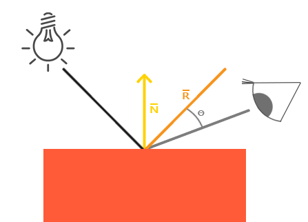

我们先根据入射光和法向计算反射光，再根据观察方向与反射光的角度差最终求得镜面反射光照的分量。
*我们选择在世界空间进行光照计算，但是大多数人趋向于更偏向在观察空间进行光照计算。在观察空间计算的优势是，观察者的位置总是在(0, 0, 0)，所以你已经零成本地拿到了观察者的位置。然而，若以学习为目的，我认为在世界空间中计算光照更符合直觉。如果你仍然希望在观察空间计算光照的话，你需要将所有相关的向量也用观察矩阵进行变换（不要忘记也修改法线矩阵）。*
要得到观察者的世界空间坐标，我们直接使用摄像机的位置向量即可（它当然就是那个观察者）。那么让我们把另一个uniform添加到片段着色器中，并把摄像机的位置向量传给着色器：
```
uniform vec3 viewPos;
```
别忘了传入给FS：
```
lightingShader.setVec3("viewPos", camera.Position);
```
现在我们已经获得所有需要的变量，可以计算高光强度了。首先，我们定义一个镜面强度(Specular Intensity)变量，给镜面高光一个中等亮度颜色，让它不要产生过度的影响。
```
float specularStrength = 0.5;
```
如果我们把它设置为1.0f，我们会得到一个非常亮的镜面光分量，这对于一个珊瑚色的立方体来说有点太多了。下一节教程中我们会讨论如何合理设置这些光照强度，以及它们是如何影响物体的。
下一步，我们计算视线方向向量，和对应的沿着法线轴的反射向量：
```
vec3 viewDir = normalize(viewPos - FragPos);
vec3 reflectDir = reflect(-lightDir, norm);
```
需要注意的是这里lightDir向量进行了取反。
剩下要做的是计算镜面分量：
```
float spec = pow(max(dot(viewDir, reflectDir), 0.0), 32);
vec3 specular = specularStrength * spec * lightColor;
```
我们先计算视线方向与反射方向的点乘（并确保它不是负值），然后取它的32次幂。这个32是高光的反光度(Shininess)。一个物体的反光度越高，反射光的能力越强，散射得越少，高光点就会越小。

##### Gouraud着色
在使用光照的早期，存在另一种使用顶点着色器计算光照的着色方法，称为Gouraud Shading。Gouraud着色的优势在于，由于它在VS中计算光照，且Vertex比起Fragment少得多，那么程序运行起来会更高效，计算开销的大头——光照计算的频率会更低。然而，该着色方法只能精确计算若干个vertex的颜色值，对于诸多fragment的颜色是由插值而来的，最终会造成某种失真。

### L2-3 : 材质
现实世界中不同物体的反射与散射能力时不同的，我们可以用材质(Material)来表示物体的反射与散射能力。
在之前，当我们描述一个表面时，我们可以分别使用环境光照(Ambient Lighting)、漫反射光照(Diffuse Lighting)和镜面光照(Specular Lighting)这三个光照分量定义一个材质颜色(Material Color)。现在，我们再添加一个反光度(Shininess)分量，结合上述的三个颜色，我们就有了全部所需的材质属性了：
```
#version 330 core
struct Material {
    vec3 ambient;
    vec3 diffuse;
    vec3 specular;
    float shininess;
}; 

uniform Material material;
```
在片段着色器中，我们创建一个结构体(Struct)来储存物体的材质属性。我们也可以把它们储存为独立的`uniform`值，但是作为一个结构体来储存会更有条理一些。我们首先定义结构体的布局(Layout)，然后简单地以刚创建的结构体作为类型声明一个uniform变量。

如你所见，我们为Phong氏光照模型的每个分量都定义一个颜色向量。`ambient`材质向量定义了在环境光照下这个表面反射的是什么颜色，通常与表面的颜色相同;`diffuse`材质向量定义了在漫反射光照下表面的颜色,反射颜色（和环境光照一样）也被设置为我们期望的物体颜色;`specular`材质向量设置的是表面上镜面高光的颜色（或者甚至可能反映一个特定表面的颜色）。最后，`shininess`影响镜面高光的散射/半径。
#### 设置材质
基于之前设置的Material结构体，从uniform变量material中访问他们：
```
void main()
{    
    // 环境光
    vec3 ambient = lightColor * material.ambient;

    // 漫反射 
    vec3 norm = normalize(Normal);
    vec3 lightDir = normalize(lightPos - FragPos);
    float diff = max(dot(norm, lightDir), 0.0);
    vec3 diffuse = lightColor * (diff * material.diffuse);

    // 镜面光
    vec3 viewDir = normalize(viewPos - FragPos);
    vec3 reflectDir = reflect(-lightDir, norm);  
    float spec = pow(max(dot(viewDir, reflectDir), 0.0), material.shininess);
    vec3 specular = lightColor * (spec * material.specular);  

    vec3 result = ambient + diffuse + specular;
    FragColor = vec4(result, 1.0);
}
```
GLSL中一个结构体在设置uniform时并无任何区别，结构体只是充当uniform变量们的一个命名空间。所以如果想填充这个结构体的话，我们必须设置每个单独的uniform，但要以结构体名为前缀：
```
lightingShader.setVec3("material.ambient",  1.0f, 0.5f, 0.31f);
lightingShader.setVec3("material.diffuse",  1.0f, 0.5f, 0.31f);
lightingShader.setVec3("material.specular", 0.5f, 0.5f, 0.5f);
lightingShader.setFloat("material.shininess", 32.0f);
```
我们将环境光和漫反射分量设置成我们想要让物体所拥有的颜色，而将镜面分量设置为一个中等亮度的颜色，我们不希望镜面分量过于强烈。我们仍将反光度保持为32。
然而从结果来看，立方体过亮了？

#### 光的属性
物体过亮的原因是环境光、漫反射和镜面光这三个颜色对任何一个光源都“全力反射”。光源对环境光、漫反射和镜面光分量也分别具有不同的强度。

前面的章节中，我们通过使用一个强度值改变环境光和镜面光强度的方式解决了这个问题。但是这次是要为每个光照分量分别指定一个强度向量。

如果我们假设`lightColor`是`vec3(1.0)`，代码会看起来像这样：
```
vec3 ambient  = vec3(1.0) * material.ambient;
vec3 diffuse  = vec3(1.0) * (diff * material.diffuse);
vec3 specular = vec3(1.0) * (spec * material.specular);
```
所以物体的**每个材质属性对每一个光照分量都返回了最大的强度**。对单个光源来说，这些`vec3(1.0)`值同样可以对每种光源分别改变，而这通常就是我们想要的。现在，物体的环境光分量完全地影响了立方体的颜色，可是环境光分量实际上不应该对最终的颜色有这么大的影响，所以我们会将光源的环境光强度设置为一个小一点的值，从而限制环境光颜色：
```
vec3 ambient = vec3(0.1) * material.ambient;
```
我们可以用同样的方式影响光源的漫反射和镜面光强度。我们应该创建一些光照属性来影响各个光照分量。我们希望为光照属性创建类似材质结构体的东西：
```
struct Light {
    vec3 position;

    vec3 ambient;
    vec3 diffuse;
    vec3 specular;
};

uniform Light light;
```
一个光源对它的ambient、diffuse和specular光照分量有着不同的强度。环境光照通常被设置为一个比较低的强度，因为我们不希望环境光颜色太过主导。光源的漫反射分量通常被设置为我们希望光所具有的那个颜色，通常是一个比较明亮的白色。镜面光分量通常会保持为vec3(1.0)，以最大强度发光。注意我们也将光源的位置向量加入了结构体。
最后的片段着色器代码：
```
#version 330 core
struct Material {
    vec3 ambient;
    vec3 diffuse;
    vec3 specular;
    float shininess;
}; 

struct Light {
    vec3 position;

    vec3 ambient;
    vec3 diffuse;
    vec3 specular;
};

uniform Material material;
uniform Light light;

out vec4 FragColor;

in vec3 Normal;
in vec3 FragPos;

uniform vec3 viewPos;

void main()
{
  vec3 ambient = material.ambient * light.ambient;

  vec3 norm = normalize(Normal);
  vec3 lightDir = normalize(light.position - FragPos);
  float diff = max(dot(norm, lightDir), 0.0);
  vec3 diffuse =  diff * material.diffuse * light.diffuse;

  vec3 viewDir = normalize(viewPos - FragPos);
  vec3 reflectDir = reflect(-lightDir, norm);
  float spec = pow(max(dot(viewDir, reflectDir), 0.0), material.shininess);
  vec3 specular = material.specular * spec * light.specular;

  vec3 result = ambient + diffuse + specular;
  FragColor = vec4(result, 1.0);
}
```

### L2-4 : 光照贴图
在上一节中，我们讨论了让每个物体都**拥有自己独特的材质从而对光照做出不同的反应的方法**。这样子能够很容易在一个光照的场景中给每个物体一个独特的外观，但是这仍不能对一个物体的视觉输出提供足够多的灵活性。

但现实世界中的物体通常并不只包含有一种材质，而是由多种材质所组成。想想一辆汽车：它的外壳非常有光泽，车窗会部分反射周围的环境，轮胎不会那么有光泽，所以它没有镜面高光，轮毂非常闪亮。汽车同样会有漫反射和环境光颜色，它们在整个物体上也不会是一样的，汽车有着许多种不同的环境光/漫反射颜色。总之，**物体在不同的部件上都有不同的材质属性。**

所以，上一节中的那个材质系统是肯定不够的，它只是一个最简单的模型，所以我们需要拓展之前的系统，引入**漫反射**和**镜面光贴图(Map)**。这允许我们对物体的漫反射分量和镜面光分量有着更精确的控制。

#### 漫反射贴图
我们希望通过某种方式对物体的每个片段单独设置漫反射颜色。**这不就是纹理吗？**在光照场景中，它通常叫做一个漫反射贴图(Diffuse Map)，它是一个表现了物体所有的漫反射颜色的纹理图像。
在着色器中使用漫反射贴图的方法和纹理教程中是完全一样的。但这次我们会将纹理储存为`Material`结构体中的一个`sampler2D`。我们将之前定义的vec3漫反射颜色向量替换为漫反射贴图。

*注意sampler2D是所谓的不透明类型(Opaque Type)，也就是说我们不能将它实例化，只能通过uniform来定义它。如果我们使用除uniform以外的方法（比如函数的参数）实例化这个结构体，GLSL会抛出一些奇怪的错误。这同样也适用于任何封装了不透明类型的结构体。*

我们也移除了环境光材质颜色向量，因为环境光颜色在几乎所有情况下都等于漫反射颜色，所以我们不需要将它们分开储存：
```
struct Material {
    sampler2D diffuse;
    vec3      specular;
    float     shininess;
}; 
...
in vec2 TexCoords;
```
如果仍想将环境光颜色设置为一个（漫反射值之外）不同的值，你也可以保留这个环境光的vec3，但整个物体仍只能拥有一个环境光颜色。如果想要对不同片段有不同的环境光值，你需要对环境光值单独使用另外一个纹理。
- !注意，这里教程在FS中将sampler2D置于结构体内，某个版本后似乎GPU不再接受这种方式，强行运行后程序会在Shader编译阶段报段错误，这里需要将sampler2D移出struct中单独计算。

#### 镜面光贴图
从上一节结果来看，结果并不那么拟真，因为木头不会有那么强的高光，而我们希望边缘的金属边框保留高光。也就是说我们的需求变成了：想要让物体的某些部分以不同的强度显示镜面高光。这个问题看起来和漫反射贴图非常相似。**是巧合吗？**

如果想实现这一点，一个想法是使用一个专门用于镜面高光的纹理贴图，来定义物体每部分的镜面光强度。
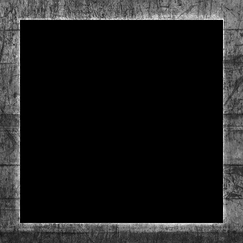

镜面高光的强度可以通过图像每个像素的**亮度**来获取。镜面光贴图上的每个像素都可以由一个颜色向量来表示，比如说黑色代表颜色向量`vec3(0.0)`，灰色代表颜色向量`vec3(0.5)`。在片段着色器中，我们接下来会取样对应的颜色值并将它乘以光源的镜面强度。一个像素越「白」，乘积就会越大，物体的镜面光分量就会越亮。

由于箱子大部分都由木头所组成，而且木头材质应该没有镜面高光，所以漫反射纹理的整个木头部分全部都转换成了黑色。箱子钢制边框的镜面光强度是有细微变化的，钢铁本身会比较容易受到镜面高光的影响，而裂缝则不会。可以使用Photoshop或Gimp之类的工具，将漫反射纹理转换为镜面光纹理。

##### 镜面光贴图的采样
镜面光贴图的采样代码和漫反射贴图的代码很类似。记得要保证正确地加载图像并生成一个纹理对象。由于我们正在同一个片段着色器中使用另一个纹理采样器，我们必须要对镜面光贴图使用一个不同的纹理单元（见纹理），所以我们在渲染之前先把它绑定到合适的纹理单元上：
```
lightingShader.setInt("material.specular", 1);
...
glActiveTexture(GL_TEXTURE1);
glBindTexture(GL_TEXTURE_2D, specularMap);
```
接下来更新片段着色器的材质属性，让其接受一个`sampler2D`而不是``vec3作为镜面光分量：
```
struct Material {
    sampler2D diffuse;
    sampler2D specular;
    float     shininess;
};
```
最后我们希望采样镜面光贴图，来获取片段所对应的镜面光强度：
```
vec3 ambient  = light.ambient  * vec3(texture(material.diffuse, TexCoords));
vec3 diffuse  = light.diffuse  * diff * vec3(texture(material.diffuse, TexCoords));  
vec3 specular = light.specular * spec * vec3(texture(material.specular, TexCoords));
FragColor = vec4(ambient + diffuse + specular, 1.0);
```
通过使用镜面光贴图我们可以可以对物体设置大量的细节，比如物体的哪些部分需要有闪闪发光的属性，我们甚至可以设置它们对应的强度。镜面光贴图能够在漫反射贴图之上给予我们更高一层的控制。

如果你想另辟蹊径，你也可以在镜面光贴图中使用真正的颜色，不仅设置每个片段的镜面光强度，还设置了镜面高光的颜色。从现实角度来说，镜面高光的颜色大部分（甚至全部）都是由光源本身所决定的，所以这样并不能生成非常真实的视觉效果（这也是为什么图像通常是黑白的，我们只关心强度）。

### L2-5 : 投光物
将光投射(Cast)到物体的光源叫做投光物(Light Caster)。在这一节中，我们将会讨论几种不同类型的投光物。学会模拟不同种类的光源是又一个能够进一步丰富场景的工具。我们首先将会讨论定向光(Directional Light)，接下来是点光源(Point Light)，它是我们之前学习的光源的拓展，最后我们将会讨论聚光(Spotlight)。在下一节中我们将讨论如何将这些不同种类的光照类型整合到一个场景之中。

#### 平行光
当一个光源处于很远的地方时，来自光源的每条光线就会近似于互相平行。当我们使用一个假设光源处于无限远处的模型时，它就被称为定向光。定向光非常好的一个例子就是太阳。太阳距离我们并不是无限远，但它已经远到在光照计算中可以把它视为无限远了。所以来自太阳的所有光线将被模拟为平行光线。
因为所有的光线都是平行的，所以物体与光源的相对位置是不重要的，因为对场景中每一个物体光的方向都是一致的。由于光的位置向量保持一致，场景中每个物体的光照计算将会是类似的。

我们可以定义一个光线方向向量而不是位置向量来模拟一个定向光。着色器的计算基本保持不变，但这次我们将直接使用光的`direction`向量而不是通过`position`来计算`lightDir`向量。
```
struct Light {
    // vec3 position; // 使用定向光就不再需要了
    vec3 direction;

    vec3 ambient;
    vec3 diffuse;
    vec3 specular;
};
...
void main()
{
  vec3 lightDir = normalize(-light.direction);
  ...
}
```
注意我们首先对`light.direction`向量取反。我们目前使用的光照计算需求一个从片段至光源的光线方向，但人们更习惯定义定向光为一个从光源出发的全局方向。所以我们需要对全局光照方向向量**取反**来改变它的方向，而且记得对向量进行标准化.

为了清楚地展示定向光对多个物体具有相同的影响，我们将会再次使用那个箱子派对的场景。我们先定义了十个不同的箱子位置，并对每个箱子都生成了一个不同的模型矩阵，每个模型矩阵都包含了对应的局部-世界坐标变换：
```
for(unsigned int i = 0; i < 10; i++)
{
    glm::mat4 model;
    model = glm::translate(model, cubePositions[i]);
    float angle = 20.0f * i;
    model = glm::rotate(model, glm::radians(angle), glm::vec3(1.0f, 0.3f, 0.5f));
    lightingShader.setMat4("model", model);

    glDrawArrays(GL_TRIANGLES, 0, 36);
}
```
同时，不要忘记定义光源的方向（注意我们将方向定义为从光源出发的方向，你可以很容易看到光的方向朝下）。
```
lightingShader.setVec3("light.direction", -0.2f, -1.0f, -0.3f);
```
- `vec4`的用法:
我们一直将光的位置和位置向量定义为`vec3`，那如果定义为`vec4`呢？当我们将**位置向量**定义为一个`vec4`时，很重要的一点是要将`w`分量设置为`1.0`，这样变换和投影才能正确应用。然而，当我们定义一个**方向向量**为`vec4`的时候，我们不想让位移有任何的效果（因为它仅仅代表的是方向），所以我们将`w`分量设置为`0.0`。
方向向量就会像这样来表示：`vec4(0.2f, 1.0f, 0.3f, 0.0f)`。这也可以作为一个**快速检测光照类型**的工具：你可以检测`w`分量是否等于`1.0`，来检测它是否是光的位置向量；`w`分量等于`0.0`，则它是光的方向向量，这样就能根据这个来调整光照计算了：
```
if(lightVector.w == 0.0) // 注意浮点数据类型的误差
  // 执行定向光照计算
else if(lightVector.w == 1.0)
  // 根据光源的位置做光照计算（与上一节一样）
```
这正是旧OpenGL（固定函数式）决定光源是定向光还是位置光源(Positional Light Source)的方法，并根据它来调整光照。

#### 点光源
为了进一步模拟真实场景，点光源(Point Light)也是必要的。它会朝着所有方向发光，但光线会随着距离逐渐衰减。
在之前的教程中，我们一直都在使用一个（简化的）点光源。然而，我们定义的光源模拟的是永远不会衰减的光线，这看起来像是光源亮度非常的强。在大部分的3D模拟中，我们都希望模拟的光源仅照亮光源附近的区域而不是整个场景。
如果你将10个箱子加入到上一节光照场景中，你会注意到在最后面的箱子和在灯面前的箱子都**以相同的强度被照亮**，并没有定义一个公式来将光随距离衰减。我们希望在后排的箱子与前排的箱子相比仅仅是被轻微地照亮。

##### 模拟衰减
随着光线传播距离的增长逐渐削减光的强度通常叫做衰减(Attenuation)。随距离减少光强度的一种方式是使用一个线性方程。这样的方程能够随着距离的增长线性地减少光的强度，从而让远处的物体更暗。然而，这样的线性方程通常会看起来比较假。在现实世界中，灯在近处通常会非常亮，但随着距离的增加光源的亮度一开始会下降非常快，但在远处时剩余的光强度就会下降的非常缓慢了。
下面这个公式根据片段距光源的距离计算了衰减值：
$$
\begin{equation} F_{att} = \frac{1.0}{K_c + K_l * d + K_q * d^2} \end{equation}
$$
在这里$d$代表了片段距光源的距离。我们定义3个（可配置的）项以计算衰减：常数项$Kc$、一次项$Kl$和二次项$Kq$。
- 常数项通常保持为1.0，它的主要作用是保证分母永远不会比1小。
- 一次项会与距离值相乘，以线性的方式减少强度。
- 二次项会与距离的平方相乘，让光源以二次递减的方式减少强度。二次项在距离比较小的时候影响会比一次项小很多，但当距离值比较大的时候它就会比一次项更大了。
下面这张图显示了在100的距离内衰减的效果:
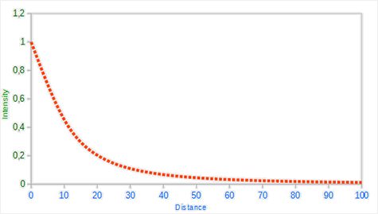

那么三个项分别选取什么呢？正确地设定它们的值取决于很多因素：环境、希望光覆盖的距离、光的类型等。在大多数情况下，这都是经验的问题，以及适量的调整。
为了实现衰减，在片段着色器中我们还需要三个额外的值：也就是公式中的常数项、一次项和二次项。它们最好储存在之前定义的`Light`结构体中。
```
struct Light {
    vec3 position;  

    vec3 ambient;
    vec3 diffuse;
    vec3 specular;

    float constant;
    float linear;
    float quadratic;
};
```
然后我们将在OpenGL中设置这些项：我们希望光源能够覆盖50的距离，所以我们会使用表格中对应的常数项、一次项和二次项：
```
lightingShader.setFloat("light.constant",  1.0f);
lightingShader.setFloat("light.linear",    0.09f);
lightingShader.setFloat("light.quadratic", 0.032f);
```
在片段着色器中实现衰减还是比较直接的：我们根据公式计算衰减值，之后再分别乘以环境光、漫反射和镜面光分量。

我们仍需要公式中距光源的距离，可以使用GLSL内建的length函数来完成这一点：
```
float distance    = length(light.position - FragPos);
float attenuation = 1.0 / (light.constant + light.linear * distance + 
                light.quadratic * (distance * distance));
```
接下来，我们将包含这个衰减值到光照计算中，将它分别乘以环境光、漫反射和镜面光颜色即可。

#### 聚光源
聚光(Spotlight)是位于环境中某个位置的光源，它只朝一个特定方向而不是所有方向照射光线。这样的结果就是只有在聚光方向的特定半径内的物体才会被照亮，其它的物体都会保持黑暗。聚光很好的例子就是路灯或手电筒。

OpenGL中聚光是用一个世界空间位置、一个方向和一个切光角(Cutoff Angle)来表示的，切光角指定了聚光的半径（译注：是圆锥的半径不是距光源距离那个半径）。对于每个片段，我们会计算片段是否位于聚光的切光方向之间（也就是在锥形内），如果是的话，我们就会相应地照亮片段。下面这张图会让你明白聚光是如何工作的：
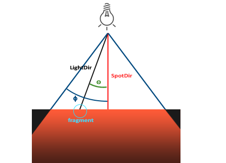
- `LightDir`：从片段指向光源的向量。
- `SpotDir`：聚光所指向的方向。
- `Phiϕ`：指定了聚光半径的切光角。落在这个角度之外的物体都不会被这个聚光所照亮。
- `Thetaθ`：LightDir向量和SpotDir向量之间的夹角。在聚光内部的话$θ$值应该比$ϕ$值小。
所以我们要做的就是计算LightDir向量和SpotDir向量之间的点积，并将它与切光角ϕ值对比。

##### 手电筒设置
手电筒(Flashlight)是一个位于观察者位置的聚光，通常它都会瞄准玩家视角的正前方。基本上说，手电筒就是普通的聚光，但它的位置和方向会随着玩家的位置和朝向不断更新。所以，在片段着色器中我们需要的值有聚光的位置向量（来计算光的方向向量）、聚光的方向向量和一个切光角。
在Light结构体中：
```
struct Light {
    vec3  position;
    vec3  direction;
    float cutOff;
    ...
};
```
接下来我们将合适的值传到着色器中：
```
lightingShader.setVec3("light.position",  camera.Position);
lightingShader.setVec3("light.direction", camera.Front);
lightingShader.setFloat("light.cutOff",   glm::cos(glm::radians(12.5f)));
```
你可以看到，我们并没有给切光角设置一个角度值，反而是**用角度值计算了一个余弦值**，将余弦结果传递到片段着色器中。原因是在片段着色器中，我们会计算`LightDir`和`SpotDir`向量的点积，我们在后续进行比较时直接使用点积进行比较即可，不然还要计算点积结果的反余弦以获取角度来进行对比，这是一个开销很大的计算。

接下来就是计算θ值，并将它和切光角ϕ对比，来决定是否在聚光的内部：
```
float theta = dot(lightDir, normalize(-light.direction));

if(theta > light.cutOff) 
{       
  // 执行光照计算
}
else  // 否则，使用环境光，让场景在聚光之外时不至于完全黑暗
  color = vec4(light.ambient * vec3(texture(material.diffuse, TexCoords)), 1.0);
```
我们首先计算了`lightDir`和取反的`direction`向量（取反的是因为我们想让向量指向光源而不是从光源出发）之间的点积。记住要对所有的相关向量标准化。*为什么在if条件中使用的是 > 符号而不是 < ？不要忘记角度值现在都由余弦值来表示的。*
从结果来看，我们确实模拟了类似恐怖游戏的手电筒第一视角。但这仍看起来有些假，主要是因为聚光有一圈硬边。当一个片段遇到聚光圆锥的边缘时，它会完全变暗，没有一点平滑的过渡。一个真实的聚光将会在边缘处逐渐减少亮度。

##### 平滑/软化边缘
为了创建一种看起来边缘平滑的聚光，一种思路是设计**内圆锥(Inner Cone)和外圆锥(Outer Cone)**，来模拟光从内圆锥逐渐减暗直到外圆锥的边界的更逼真的效果。
为了创建一个外圆锥，我们只需要再定义一个余弦值来代表聚光方向向量和外圆锥向量（等于它的半径）的夹角。然后，如果一个片段处于内外圆锥之间，将会给它计算出一个0.0到1.0之间的强度值。如果片段在内圆锥之内，它的强度就是1.0，如果在外圆锥之外强度值就是0.0。

我们可以设计一个简单的插值公式来计算这个值：
$$
\begin{equation} I = \frac{\theta - \gamma}{\epsilon} \end{equation}
$$
ϵ是内（ϕ）和外圆锥（γ）之间的余弦值差（ϵ=ϕ−γ）。最终的I值就是在当前片段聚光的强度。它的实质不过是在内外余弦值之间根据θ插值。
另外，可以使用`clamp()`来约束数值在0-1之间，这样也不需要在FS中设计`if-else`了。

### L2-6 : 多光源
这一节可以视作L2单元的总复习。
在之前的学习中我们已经学习了诸多OpenGL中关于光照的知识，其中包括风氏着色(Phong Shading)、材质(Material)、光照贴图(Lighting Map)以及不同种类的投光物(Light Caster)。在这一节中，我们将结合之前学过的所有知识，创建一个包含六个光源的完全照明场景。我们将模拟一个类似太阳的定向光(Directional Light)光源，四个分散在场景中的点光源(Point Light)，以及一个手电筒(Flashlight)。

为了在场景中使用多个光源，我们希望将光照计算封装到GLSL函数中。这样做的原因是，每一种光源都需要一种不同的计算方法，而一旦我们想对多个光源进行光照计算时，代码很快就会变得非常复杂。如果我们只在main函数中进行所有的这些计算，代码很快就会变得难以理解。

GLSL中的函数和C函数很相似，它有一个函数名、一个返回值类型，如果函数不是在main函数之前声明的，我们还必须在代码文件顶部声明一个原型。我们对每个光照类型都创建一个不同的函数：定向光、点光源和聚光。

当我们在场景中使用多个光源时，通常使用以下方法：我们需要有一个单独的颜色向量代表片段的输出颜色。对于每一个光源，它对片段的贡献颜色将会加到片段的输出颜色向量上。所以场景中的每个光源都会计算它们各自对片段的影响，并结合为一个最终的输出颜色。大体的结构会像是这样：
```
out vec4 FragColor;

void main()
{
  // 定义一个输出颜色值
  vec3 output;
  // 将定向光的贡献加到输出中
  output += someFunctionToCalculateDirectionalLight();
  // 对所有的点光源也做相同的事情
  for(int i = 0; i < nr_of_point_lights; i++)
    output += someFunctionToCalculatePointLight();
  // 也加上其它的光源（比如聚光）
  output += someFunctionToCalculateSpotLight();

  FragColor = vec4(output, 1.0);
}
```
实际的代码对每一种实现都可能不同，但大体的结构都是差不多的。我们定义了几个函数，用来计算每个光源的影响，并将最终的结果颜色加到输出颜色向量上。例如，如果两个光源都很靠近一个片段，那么它们所结合的贡献将会形成一个比单个光源照亮时更加明亮的片段。

#### 定向光
我们需要在片段着色器中定义一个函数来计算定向光对相应片段的贡献：它接受一些参数并计算一个定向光照颜色。

首先，我们需要定义一个定向光源最少所需要的变量。我们可以将这些变量储存在一个叫做`DirLight`的结构体中，并将它定义为一个uniform。需要的变量在上一节中都介绍过：
```
struct DirLight {
    vec3 direction;

    vec3 ambient;
    vec3 diffuse;
    vec3 specular;
};  
uniform DirLight dirLight;
```
接下来我们可以将dirLight传入一个有着以下原型的函数。
```
vec3 CalcDirLight(DirLight light, vec3 normal, vec3 viewDir);
```
和C/C++一样，如果我们想调用一个函数（这里是在main函数中调用），这个函数需要在调用者的行数之前被定义过。在这个例子中我们更喜欢在main函数以下定义函数，所以上面要求就不满足了。所以，我们需要在main函数之上定义函数的原型，这和C语言中是一样的。

你可以看到，这个函数需要一个DirLight结构体和其它两个向量来进行计算。如果你认真完成了上一节的话，这个函数的内容应该理解起来很容易：
```
vec3 CalcDirLight(DirLight light, vec3 normal, vec3 viewDir)
{
    vec3 lightDir = normalize(-light.direction);
    // 漫反射着色
    float diff = max(dot(normal, lightDir), 0.0);
    // 镜面光着色
    vec3 reflectDir = reflect(-lightDir, normal);
    float spec = pow(max(dot(viewDir, reflectDir), 0.0), material.shininess);
    // 合并结果
    vec3 ambient  = light.ambient  * vec3(texture(material.diffuse, TexCoords));
    vec3 diffuse  = light.diffuse  * diff * vec3(texture(material.diffuse, TexCoords));
    vec3 specular = light.specular * spec * vec3(texture(material.specular, TexCoords));
    return (ambient + diffuse + specular);
}
```
我们基本上只是从上一节中复制了代码，并使用函数参数的两个向量来计算定向光的贡献向量。最终环境光、漫反射和镜面光的贡献将会合并为单个颜色向量返回。

#### 点光源
和定向光一样，我们也希望定义一个用于计算点光源对相应片段贡献以及衰减的函数。同样，我们定义一个包含了点光源所需所有变量的结构体：
```
struct PointLight {
    vec3 position;

    float constant;
    float linear;
    float quadratic;

    vec3 ambient;
    vec3 diffuse;
    vec3 specular;
};  
#define NR_POINT_LIGHTS 4
uniform PointLight pointLights[NR_POINT_LIGHTS];
```
你可以看到，我们在GLSL中使用了预处理指令来定义了我们场景中点光源的数量。接着我们使用了这个`NR_POINT_LIGHTS`常量来创建了一个`PointLight`结构体的数组。GLSL中的数组和C数组一样，可以使用一对方括号来创建。现在我们有四个待填充数据的`PointLight`结构体。

我们也可以定义一个大的结构体（而不是为每种类型的光源定义不同的结构体），包含所有不同种光照类型所需的变量，并将这个结构体用到所有的函数中，只需要忽略用不到的变量就行了。然而，当前的方法会更直观一点，不仅能够节省一些代码，而且由于不是所有光照类型都需要所有的变量，这样也能节省一些内存。

点光源函数的原型如下：
```
vec3 CalcPointLight(PointLight light, vec3 normal, vec3 fragPos, vec3 viewDir);
```
这个函数从参数中获取所需的所有数据，并返回一个代表该点光源对片段的颜色贡献的vec3。我们再一次聪明地从之前的教程中复制粘贴代码，完成了下面这样的函数：
```
vec3 CalcPointLight(PointLight light, vec3 normal, vec3 fragPos, vec3 viewDir)
{
    vec3 lightDir = normalize(light.position - fragPos);
    // 漫反射着色
    float diff = max(dot(normal, lightDir), 0.0);
    // 镜面光着色
    vec3 reflectDir = reflect(-lightDir, normal);
    float spec = pow(max(dot(viewDir, reflectDir), 0.0), material.shininess);
    // 衰减
    float distance    = length(light.position - fragPos);
    float attenuation = 1.0 / (light.constant + light.linear * distance + 
                 light.quadratic * (distance * distance));    
    // 合并结果
    vec3 ambient  = light.ambient  * vec3(texture(material.diffuse, TexCoords));
    vec3 diffuse  = light.diffuse  * diff * vec3(texture(material.diffuse, TexCoords));
    vec3 specular = light.specular * spec * vec3(texture(material.specular, TexCoords));
    ambient  *= attenuation;
    diffuse  *= attenuation;
    specular *= attenuation;
    return (ambient + diffuse + specular);
}
```
将这些功能抽象到这样一个函数中的优点是，我们能够不用重复的代码而很容易地计算多个点光源的光照了。在main函数中，我们只需要创建一个循环，遍历整个点光源数组，对每个点光源调用`CalcPointLight`就可以了。

#### 合并结果
现在我们已经定义了一个计算定向光的函数和一个计算点光源的函数了，我们可以将它们合并放到main函数中。
```
void main()
{
    // 属性
    vec3 norm = normalize(Normal);
    vec3 viewDir = normalize(viewPos - FragPos);

    // 第一阶段：定向光照
    vec3 result = CalcDirLight(dirLight, norm, viewDir);
    // 第二阶段：点光源
    for(int i = 0; i < NR_POINT_LIGHTS; i++)
        result += CalcPointLight(pointLights[i], norm, FragPos, viewDir);    
    // 第三阶段：聚光
    //result += CalcSpotLight(spotLight, norm, FragPos, viewDir);    

    FragColor = vec4(result, 1.0);
}
```
每个光源类型都将它们的贡献加到了最终的输出颜色上，直到所有的光源都处理完了。最终的颜色包含了场景中所有光源的颜色影响所合并的结果。如果你想的话，你也可以实现一个聚光，并将它的效果加到输出颜色中。我们会将`CalcSpotLight`函数留给读者作为练习。

*在这种方法中有很多重复的计算在光类型函数上(例如计算反射向量，漫反射和高光项，以及对材料纹理进行采样)，所以这里有优化的空间。*

设置定向光结构体的`uniform`应该非常熟悉了，但是你可能会在想我们该如何设置点光源的`uniform`值，因为点光源的`uniform`现在是一个`PointLight`的数组了。这并不是我们以前讨论过的话题。

很幸运的是，这并不是很复杂，设置一个结构体数组的`uniform`和设置一个结构体的`uniform`是很相似的，但是这一次在访问uniform位置的时候，我们需要定义对应的数组下标值：
```
lightingShader.setFloat("pointLights[0].constant", 1.0f);
```
在这里我们索引了`pointLights`数组中的第一个`PointLight`，并获取了`constant`变量的位置。但这也意味着不幸的是我们必须对这四个点光源手动设置`uniform`值，这让点光源本身就产生了28个`uniform`调用，非常冗长。你也可以尝试将这些抽象出去一点，定义一个点光源类，让它来为你设置`uniform`值，但最后你仍然要用这种方式设置所有光源的`uniform`值。

别忘了，我们还需要为每个点光源定义一个位置向量，所以我们让它们在场景中分散一点。我们会定义另一个glm::vec3数组来包含点光源的位置：
```
glm::vec3 pointLightPositions[] = {
    glm::vec3( 0.7f,  0.2f,  2.0f),
    glm::vec3( 2.3f, -3.3f, -4.0f),
    glm::vec3(-4.0f,  2.0f, -12.0f),
    glm::vec3( 0.0f,  0.0f, -3.0f)
};
```
接下来我们从pointLights数组中索引对应的PointLight，将它的position值设置为刚刚定义的位置值数组中的其中一个。同时我们还要保证现在绘制的是四个灯立方体而不是仅仅一个。只要对每个灯物体创建一个不同的模型矩阵就可以了，和我们之前对箱子的处理类似。

从结果来看，很显然天空中有一个全局照明（像一个太阳），我们有四个光源分散在场景中，以及玩家视角的手电筒。

上面图片中的所有光源都是使用上一节中所使用的默认属性，但如果你愿意实验这些数值的话，你能够得到很多有意思的结果。艺术家和关卡设计师通常都在编辑器中不断的调整这些光照参数，保证光照与环境相匹配。在我们刚刚创建的简单光照环境中，你可以简单地调整一下光源的属性，创建很多有意思的视觉效果。只需要简单地调整一些光照参数，你就能创建完全不同的氛围。

相信你现在已经对OpenGL的光照有很好的理解了。有了目前所学的这些知识，我们已经可以创建出丰富有趣的环境和氛围了。尝试实验一下不同的值，创建出你自己的氛围吧。

## 模型加载
### L3-1 : Assimp
目前为止的场景都过于单一。在日常的图形程序中，通常都会使用非常复杂且好玩的模型，它们比静态的箱子要好看多了。然而，和箱子对象不同，我们不太能够对像是房子、汽车或者人形角色这样的复杂形状手工定义所有的顶点、法线和纹理坐标。我们想要的是将这些模型(Model)导入(Import)到程序当中。模型通常都由3D艺术家在Blender、3DS Max或者Maya这样的工具中精心制作。

这些所谓的3D建模工具(3D Modeling Tool)可以让艺术家创建复杂的形状，并使用一种叫做**UV映射(uv-mapping)**的手段来应用贴图。这些工具将会在导出到模型文件的时候自动生成所有的顶点坐标、顶点法线以及纹理坐标。这样子艺术家们即使不了解图形技术细节的情况下，也能拥有一套强大的工具来构建高品质的模型了。所有的技术细节都隐藏在了导出的模型文件中。但是，作为图形开发者，我们就必须要了解这些技术细节了。

所以，接下来的工作就是解析这些导出的模型文件以及提取所有有用的信息，将它们储存为OpenGL能够理解的格式。那么下一个问题是：模型的文件格式有很多种，每一种都会以它们自己的方式来导出模型数据，到底使用哪一种呢？像是Wavefront的.obj这样的模型格式，只包含了模型数据以及材质信息，像是模型颜色和漫反射/镜面光贴图。而以XML为基础的Collada文件格式则非常的丰富，包含模型、光照、多种材质、动画数据、摄像机、完整的场景信息等等。

总而言之，不同种类的文件格式有很多，它们之间通常并没有一个通用的结构。所以如果我们想从这些文件格式中导入模型的话，我们必须要去自己对每一种需要导入的文件格式写一个导入器。很幸运的是，正好有一个库——Assimp专门处理这个问题。
#### 模型加载库
Assimp是Open Asset Import Library（开放的资产导入库）的缩写。Assimp能够导入很多种不同的模型文件格式（并也能够导出部分的格式），它会将所有的模型数据加载至Assimp的通用数据结构中。当Assimp加载完模型之后，我们就能够从Assimp的数据结构中提取我们所需的所有数据了。由于Assimp的数据结构保持不变，不论导入的是什么种类的文件格式，它都能够将我们从这些不同的文件格式中抽象出来，用同一种方式访问我们需要的数据。

当使用Assimp导入一个模型的时候，它通常会将整个模型加载进一个场景(Scene)对象，它会包含导入的模型/场景中的所有数据。Assimp会将场景载入为一系列的节点(Node)，每个节点包含了场景对象中所储存数据的索引，每个节点都可以有任意数量的子节点。Assimp数据结构的（简化）模型如下：
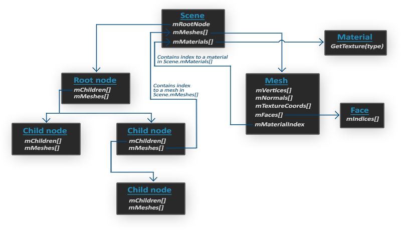
- 材质和网格(Mesh)一样，所有的场景/模型数据都包含在Scene对象中。Scene对象也包含了场景根节点的引用。
- 场景的Root node（根节点）可能包含子节点（和其它的节点一样），它会有一系列指向场景对象中`mMeshes`数组中储存的网格数据的索引。Scene下的`mMeshes`数组储存了真正的Mesh对象，节点中的`mMeshes`数组保存的只是场景中网格数组的索引。
- 一个Mesh对象本身包含了渲染所需要的所有相关数据，像是顶点位置、法向量、纹理坐标、面(Face)和物体的材质。
- 一个网格包含了多个面。Face代表的是物体的渲染图元(Primitive)（三角形、方形、点）。一个面包含了组成图元的顶点的索引。由于顶点和索引是分开的，使用一个索引缓冲来渲染是非常简单的。
- 最后，一个网格也包含了一个Material对象，它包含了一些函数能让我们获取物体的材质属性，比如说颜色和纹理贴图（比如漫反射和镜面光贴图）。

所以，我们使用Assimp的基本思路是：将一个物体加载到Scene对象中，遍历节点，获取对应的Mesh对象（需要递归搜索每个节点的子节点），并处理每个Mesh对象来获取顶点数据、索引以及它的材质属性。最终的结果是一系列的网格数据，我们会将它们包含在一个Model对象中。

##### 网格
当使用建模工具对物体建模的时候，艺术家通常不会用单个形状创建出整个模型。通常每个模型都由几个子模型/形状组合而成。组合模型的每个单独的形状就叫做一个网格(Mesh)。比如说有一个人形的角色：艺术家通常会将头部、四肢、衣服、武器建模为分开的组件，并将这些网格组合而成的结果表现为最终的模型。一个网格是我们在OpenGL中绘制物体所需的最小单位（顶点数据、索引和材质属性）。一个模型（通常）会包括多个网格。

我们将创建我们自己的Model和Mesh类来加载并使用刚刚介绍的结构储存导入后的模型。如果我们想要绘制一个模型，我们不需要将整个模型渲染为一个整体，只需要渲染组成模型的每个独立的网格就可以了。然而，在我们开始导入模型之前，我们首先需要将Assimp包含到我们的工程当中。

#### 构建Assimp
Ubuntu直接使用apt安装即可：
```
sudo apt-get update
sudo apt-get install libassimp-dev
```
不然就参考之前GLFW的构建，从Assimp的[Github页面](https://github.com/assimp/assimp/blob/master/Build.md)中使用CMake进行build。

**记得在编译时链接上assimp库！ -lassimp**

### L3-2 : 网格
通过使用Assimp载入后的模型被储存为Assimp的数据结构，但我我们最终仍要将这些数据转换为OpenGL能够理解的格式才能渲染这个物体。我们从上一节中学到，网格(Mesh)代表的是单个的可绘制实体，我们现在先来定义一个我们自己的网格类。

首先我们来回顾一下我们目前学到的知识，一个网格最少需要什么数据？至少需要一系列的顶点，每个顶点包含一个位置向量、一个法向量和一个纹理坐标向量。一个网格还应该包含用于索引绘制的索引以及纹理形式的材质数据（漫反射/镜面光贴图）。

那么在OpenGL中定义的顶点为：
```
struct Vertex {
    glm::vec3 Position;
    glm::vec3 Normal;
    glm::vec2 TexCoords;
};
```
我们将所有需要的向量储存到一个叫做`Vertex`的结构体中，我们可以用它来索引每个顶点属性。除了`Vertex`结构体之外，我们还需要将纹理数据整理到一个`Texture`结构体中。
```
struct Texture {
    unsigned int id;
    string type;
};
```
我们储存了纹理的id以及它的类型，比如是漫反射贴图或者是镜面光贴图。

知道了顶点和纹理的实现，我们可以开始定义网格类的结构了：
```
class Mesh {
    public:
        /*  网格数据  */
        vector<Vertex> vertices;
        vector<unsigned int> indices;
        vector<Texture> textures;
        /*  函数  */
        Mesh(vector<Vertex> vertices, vector<unsigned int> indices, vector<Texture> textures);
        void Draw(Shader &shader);
    private:
        /*  渲染数据  */
        unsigned int VAO, VBO, EBO;
        /*  函数  */
        void setupMesh();
};  
```
可以看到这个类并不复杂。在构造函数中，我们将所有必须的数据赋予了网格，我们在`setupMesh()`函数中初始化缓冲，并最终使用`Draw()`函数来绘制网格。注意我们将一个着色器传入了`Draw()`函数中，将着色器传入网格类中可以让我们在绘制之前设置一些`uniform`（像是链接采样器到纹理单元）。

构造函数的内容非常易于理解。我们只需要使用构造函数的参数设置类的公有变量就可以了。我们在构造函数中还调用了`setupMesh()`函数：
```
Mesh(vector<Vertex> vertices, vector<unsigned int> indices, vector<Texture> textures)
{
    this->vertices = vertices;
    this->indices = indices;
    this->textures = textures;

    setupMesh();
}
```
我们接下来讨论`setupMesh()`函数。

#### 初始化
多亏了构造函数，我们现在有一大列的网格数据可以用于渲染。在此之前我们还必须配置正确的缓冲，并通过顶点属性指针定义顶点着色器的布局。现在你应该对这些概念都很熟悉了，但我们这次会稍微有一点变动:使用结构体中的顶点数据：
```
void setupMesh()
{
    glGenVertexArrays(1, &VAO);
    glGenBuffers(1, &VBO);
    glGenBuffers(1, &EBO);

    glBindVertexArray(VAO);
    glBindBuffer(GL_ARRAY_BUFFER, VBO);

    glBufferData(GL_ARRAY_BUFFER, vertices.size() * sizeof(Vertex), &vertices[0], GL_STATIC_DRAW);  

    glBindBuffer(GL_ELEMENT_ARRAY_BUFFER, EBO);
    glBufferData(GL_ELEMENT_ARRAY_BUFFER, indices.size() * sizeof(unsigned int), 
                 &indices[0], GL_STATIC_DRAW);

    // 顶点位置
    glEnableVertexAttribArray(0);   
    glVertexAttribPointer(0, 3, GL_FLOAT, GL_FALSE, sizeof(Vertex), (void*)0);
    // 顶点法线
    glEnableVertexAttribArray(1);   
    glVertexAttribPointer(1, 3, GL_FLOAT, GL_FALSE, sizeof(Vertex), (void*)offsetof(Vertex, Normal));
    // 顶点纹理坐标
    glEnableVertexAttribArray(2);   
    glVertexAttribPointer(2, 2, GL_FLOAT, GL_FALSE, sizeof(Vertex), (void*)offsetof(Vertex, TexCoords));

    glBindVertexArray(0);
}  
```
代码应该和你所想得没什么不同，但有了Vertex结构体的帮助，我们使用了一些小技巧。

C++结构体有一个很棒的特性，它们的内存布局是连续的(Sequential)。也就是说，如果我们将结构体作为一个数据数组使用，那么它将会以顺序排列结构体的变量，这将会直接转换为我们在数组缓冲中所需要的float（实际上是字节）数组。比如说，如果我们有一个填充后的Vertex结构体，那么它的内存布局将会等于：
```
Vertex vertex;
vertex.Position  = glm::vec3(0.2f, 0.4f, 0.6f);
vertex.Normal    = glm::vec3(0.0f, 1.0f, 0.0f);
vertex.TexCoords = glm::vec2(1.0f, 0.0f);
// = [0.2f, 0.4f, 0.6f, 0.0f, 1.0f, 0.0f, 1.0f, 0.0f];
```
由于有了这个有用的特性，我们能够直接传入一大列的Vertex结构体的指针作为缓冲的数据，它们将会完美地转换为`glBufferData()`所能用的参数：
```
glBufferData(GL_ARRAY_BUFFER, vertices.size() * sizeof(Vertex), &vertices[0], GL_STATIC_DRAW);
```
自然sizeof运算也可以用在结构体上来计算它的字节大小。这个应该是32字节的（8个float * 每个4字节）。

结构体的另外一个很好的用途是它的预处理指令offsetof(s, m)，它的第一个参数是一个结构体，第二个参数是这个结构体中变量的名字。这个宏会返回那个变量距结构体头部的字节偏移量(Byte Offset)。这正好可以用在定义`glVertexAttribPointer()`函数中的偏移参数：
```
glVertexAttribPointer(1, 3, GL_FLOAT, GL_FALSE, sizeof(Vertex), (void*)offsetof(Vertex, Normal)); 
```
偏移量现在是使用offsetof来定义了，在这里它会将法向量的字节偏移量设置为结构体中法向量的偏移量，也就是3个float，即12字节。注意，我们同样将步长参数设置为了Vertex结构体的大小。

使用这样的一个结构体不仅能够提供可读性更高的代码，也允许我们很容易地拓展这个结构。如果我们希望添加另一个顶点属性，我们只需要将它添加到结构体中就可以了。由于它的灵活性，渲染的代码不会被破坏。

#### 渲染
我们需要为Mesh类定义最后一个函数——`Draw()`函数。在真正渲染这个网格之前，我们需要在调用`glDrawElements()`函数之前先绑定相应的纹理。然而，这实际上有些困难，我们一开始并不知道这个网格（如果有的话）有多少纹理、纹理是什么类型的。所以我们该如何在着色器中设置纹理单元和采样器呢？

为了解决这个问题，我们需要设定一个命名标准：每个漫反射纹理被命名为`texture_diffuseN`，每个镜面光纹理应该被命名`为texture_specularN`，其中N的范围是1到纹理采样器最大允许的数字。比如说我们对某一个网格有3个漫反射纹理，2个镜面光纹理，它们的纹理采样器应该之后会被调用：
```
uniform sampler2D texture_diffuse1;
uniform sampler2D texture_diffuse2;
uniform sampler2D texture_diffuse3;
uniform sampler2D texture_specular1;
uniform sampler2D texture_specular2;
```
根据这个标准，我们可以在着色器中定义任意需要数量的纹理采样器，如果一个网格真的包含了（这么多）纹理，我们也能知道它们的名字是什么。根据这个标准，我们也能在一个网格中处理任意数量的纹理，开发者也可以自由选择需要使用的数量，他只需要定义正确的采样器就可以了（虽然定义少的话会有点浪费绑定和uniform调用）。*像这样的问题有很多种不同的解决方案。如果你不喜欢这个解决方案，你可以自己想一个你自己的解决办法。*

最终的渲染代码是这样的：
```
void Draw(Shader shader) 
{
    unsigned int diffuseNr = 1;
    unsigned int specularNr = 1;
    for(unsigned int i = 0; i < textures.size(); i++)
    {
        glActiveTexture(GL_TEXTURE0 + i); // 在绑定之前激活相应的纹理单元
        // 获取纹理序号（diffuse_textureN 中的 N）
        string number;
        string name = textures[i].type;
        if(name == "texture_diffuse")
            number = std::to_string(diffuseNr++);
        else if(name == "texture_specular")
            number = std::to_string(specularNr++);

        shader.setInt(("material." + name + number).c_str(), i);
        glBindTexture(GL_TEXTURE_2D, textures[i].id);
    }
    glActiveTexture(GL_TEXTURE0);

    // 绘制网格
    glBindVertexArray(VAO);
    glDrawElements(GL_TRIANGLES, indices.size(), GL_UNSIGNED_INT, 0);
    glBindVertexArray(0);
}
```
我们首先计算了每个纹理类型的N-分量，并将其拼接到纹理类型字符串上，来获取对应的uniform名称。接下来我们查找对应的采样器，将它的位置值设置为当前激活的纹理单元，并绑定纹理。这也是我们在Draw函数中需要着色器的原因。我们也将"material."添加到了最终的uniform名称中，因为我们希望将纹理储存在一个材质结构体中（这在每个实现中可能都不同）。

注意我们在将漫反射计数器和镜面光计数器插入stringstream时，对它们进行了递增。在C++中，这个递增操作：variable++将会返回变量本身，之后再递增，而++variable则是先递增，再返回值。在我们的例子中是首先将原本的计数器值插入stringstream，之后再递增它，供下一次循环使用。

### L3-3 : 模型
现在是时候接触Assimp并创建实际的加载和转换代码了。这个教程的目标是创建另一个类来完整地表示一个模型，或者说是包含多个网格，多个纹理的模型。一个包含木制阳台、塔楼、甚至游泳池的房子可能仍会被加载为一个模型。我们会使用Assimp来加载模型，并将它转换(Translate)至多个在上一节中创建的Mesh对象。

Model类的结构如下：
```
class Model 
{
    public:
        /*  函数   */
        Model(char *path)
        {
            loadModel(path);
        }
        void Draw(Shader shader);   
    private:
        /*  模型数据  */
        vector<Mesh> meshes;
        string directory;
        /*  函数   */
        void loadModel(string path);
        void processNode(aiNode *node, const aiScene *scene);
        Mesh processMesh(aiMesh *mesh, const aiScene *scene);
        vector<Texture> loadMaterialTextures(aiMaterial *mat, aiTextureType type, 
                                             string typeName);
};
```
Model类包含了一个Mesh对象的vector。构造函数需要我们给它一个文件路径。在构造函数中，它会直接通过loadModel来加载文件。在private中，将会处理Assimp导入过程中的一部分。我们还将储存文件路径的目录，在之后加载纹理的时候还会用到它。

Model中的`Draw()`函数部分没有什么特别之处，基本上就是遍历了所有网格，并调用它们各自的`Draw()`函数。
```
void Draw(Shader &shader)
{
    for(unsigned int i = 0; i < meshes.size(); i++)
        meshes[i].Draw(shader);
}
```

#### 导入3D模型到OpenGL
要想导入一个模型，并将它转换到我们自己的数据结构中的话，首先我们需要包含Assimp对应的头文件：
```
#include <assimp/Importer.hpp>
#include <assimp/scene.h>
#include <assimp/postprocess.h>
```
首先需要调用的函数是`loadModel()`，它会从构造函数中直接调用。在`loadModel()`中，我们使用Assimp来加载模型至Assimp的一个叫做scene的数据结构中。正如前文所述，这是Assimp数据接口的根对象。一旦我们有了这个场景对象，我们就能访问到加载后的模型中所有所需的数据了。Assimp的优势在于，它抽象掉了加载不同文件格式的所有技术细节，只需要一行代码就能完成所有的工作：
```
Assimp::Importer importer;
const aiScene *scene = importer.ReadFile(path, aiProcess_Triangulate | aiProcess_FlipUVs);
```
我们首先声明了Assimp命名空间内的一个Importer，之后调用了它的ReadFile函数。这个函数需要一个文件路径，它的第二个参数是一些后期处理(Post-processing)的选项。除了加载文件之外，Assimp允许我们设定一些选项来强制它对导入的数据做一些额外的计算或操作。通过设定`aiProcess_Triangulate`，我们告诉Assimp，如果模型不是（全部）由三角形组成，它需要将模型所有的图元形状变换为三角形。`aiProcess_FlipUVs`将在处理的时候翻转y轴的纹理坐标（在OpenGL中大部分的图像的y轴都是反的，所以这个后期处理选项将会修复这个）。其它一些比较有用的选项有：

- aiProcess_GenNormals：如果模型不包含法向量的话，就为每个顶点创建法线。
- aiProcess_SplitLargeMeshes：将比较大的网格分割成更小的子网格，如果你的渲染有最大顶点数限制，只能渲染较小的网格，那么它会非常有用。
- aiProcess_OptimizeMeshes：和上个选项相反，它会将多个小网格拼接为一个大的网格，减少绘制调用从而进行优化。
Assimp提供了很多有用的后期处理指令。实际上使用Assimp加载模型是非常容易的，困难的是**之后使用返回的场景对象将加载的数据转换到一个Mesh对象的数组**。

完整的`loadModel()`函数将会是这样的：
```
void loadModel(string path)
{
    Assimp::Importer importer;
    const aiScene *scene = importer.ReadFile(path, aiProcess_Triangulate | aiProcess_FlipUVs);    

    if(!scene || scene->mFlags & AI_SCENE_FLAGS_INCOMPLETE || !scene->mRootNode) 
    {
        cout << "ERROR::ASSIMP::" << importer.GetErrorString() << endl;
        return;
    }
    directory = path.substr(0, path.find_last_of('/'));

    processNode(scene->mRootNode, scene);
}
```
在我们加载了模型之后，我们会检查场景和其根节点不为null，并且检查了它的一个标记(Flag)，来查看返回的数据是不是不完整的。如果遇到了任何错误，我们都会通过导入器的`GetErrorString()`函数来报告错误并返回。我们也获取了文件路径的目录路径。

如果什么错误都没有发生，我们希望处理场景中的所有节点，所以我们将第一个节点（根节点）传入了递归的`processNode()`函数。递归的退出条件(Exit Condition)是所有的节点都被处理完毕。

你可能还记得Assimp的结构中，每个节点包含了一系列的网格索引，每个索引指向场景对象中的那个特定网格。我们接下来就想去获取这些网格索引，获取每个网格，处理每个网格，接着对每个节点的子节点重复这一过程。`processNode()`函数的内容如下：
```
void processNode(aiNode *node, const aiScene *scene)
{
    // 处理节点所有的网格（如果有的话）
    for(unsigned int i = 0; i < node->mNumMeshes; i++)
    {
        aiMesh *mesh = scene->mMeshes[node->mMeshes[i]]; 
        meshes.push_back(processMesh(mesh, scene));         
    }
    // 接下来对它的子节点重复这一过程
    for(unsigned int i = 0; i < node->mNumChildren; i++)
    {
        processNode(node->mChildren[i], scene);
    }
}
```
我们首先检查每个节点的网格索引，并索引场景的mMeshes数组来获取对应的网格。返回的网格将会传递到`processMesh()`函数中，它会返回一个Mesh对象，我们可以将它存储在meshes vector中。

所有网格都被处理之后，我们会遍历节点的所有子节点，并对它们调用相同的`processMesh()`函数。当一个节点不再有任何子节点之后，这个函数将会停止执行。

认真的读者可能会发现，我们其实有一种更为简单的处理思路——抛弃索引，只遍历场景对象的所有网格：
```
// 简单做法：直接遍历所有网格（教程中提到可以这么做）
for(unsigned int i = 0; i < scene->mNumMeshes; i++) {
    aiMesh* mesh = scene->mMeshes[i];
    processMesh(mesh, scene);  // 直接处理每个网格
}
```
对于简单的静态模型，这么处理是没问题的，但是对于更多的可动或需要交互的模型而言，树的结构保证了网格之间的父子关系，允许用户不仅能对复杂对象的部件进行单独控制，还能保证一个父网格的所有子网格同时发生某种变换（例如车位移会同时带着轮子、方向盘等网格一起位移）。这样的系统能够用父子关系很容易地创建出来。另外，这种类节点的关系通常由创建了这个模型的艺术家所定义。

##### 从Assimp到网格
下一步就是将Assimp的数据解析到上一节中创建的Mesh类中。将一个aiMesh对象转化为我们自己的网格对象不是那么困难。我们要做的只是访问网格的相关属性并将它们储存到我们自己的对象中。`processMesh()`函数的大体结构如下：
```
Mesh processMesh(aiMesh *mesh, const aiScene *scene)
{
    vector<Vertex> vertices;
    vector<unsigned int> indices;
    vector<Texture> textures;

    for(unsigned int i = 0; i < mesh->mNumVertices; i++)
    {
        Vertex vertex;
        // 处理顶点位置、法线和纹理坐标
        ...
        vertices.push_back(vertex);
    }
    // 处理索引
    ...
    // 处理材质
    if(mesh->mMaterialIndex >= 0)
    {
        ...
    }

    return Mesh(vertices, indices, textures);
}
```
处理网格的过程主要有三部分：
- 获取所有的顶点数据；
- 获取它们的网格索引；
- 获取相关的材质数据。
处理后的数据将会储存在三个vector当中，我们会利用它们构建一个临时的Mesh对象，并返回它到函数的调用者那里。

##### 顶点
获取顶点数据非常简单，我们定义了一个Vertex结构体，我们将在每个迭代之后将它加到vertices数组中。我们会遍历网格中的所有顶点（使用`mesh->mNumVertices`来获取）。在每个迭代中，我们希望使用所有的相关数据填充这个结构体：
```
glm::vec3 vector; 
vector.x = mesh->mVertices[i].x;
vector.y = mesh->mVertices[i].y;
vector.z = mesh->mVertices[i].z; 
vertex.Position = vector;
```
注意，我们为了传输Assimp的数据，我们定义了一个vec3的临时变量。使用这样一个临时变量的原因是Assimp对向量、矩阵、字符串等都有自己的一套数据类型，它们并不能完美地转换到GLM的数据类型中。*Assimp将它的顶点位置数组叫做mVertices，这其实并不是那么直观。*

处理法线的步骤也是差不多的：
```
vector.x = mesh->mNormals[i].x;
vector.y = mesh->mNormals[i].y;
vector.z = mesh->mNormals[i].z;
vertex.Normal = vector;
```
纹理坐标的处理也大体相似，但Assimp允许一个模型在一个顶点上有最多8个不同的纹理坐标，我们不会用到那么多，我们只关心第一组纹理坐标。我们同样也想检查网格是否真的包含了纹理坐标：
```
if(mesh->mTextureCoords[0]) // 网格是否有纹理坐标？
{
    glm::vec2 vec;
    vec.x = mesh->mTextureCoords[0][i].x; 
    vec.y = mesh->mTextureCoords[0][i].y;
    vertex.TexCoords = vec;
}
else
    vertex.TexCoords = glm::vec2(0.0f, 0.0f);
```
vertex结构体现在已经填充好了需要的顶点属性，我们会在迭代的最后将它压入vertices这个vector的尾部。这个过程会对每个网格的顶点都重复一遍。

##### 索引
Assimp的接口定义了每个网格都有一个面(Face)数组，每个面代表了一个图元，由于使用了aiProcess_Triangulate选项，在我们这里总是三角形。
索引定义了在每个图元中我们应该以什么顺序绘制顶点，所以如果我们遍历了所有的面，并储存了面的索引到indices这个vector中就可以了。
```
for(unsigned int i = 0; i < mesh->mNumFaces; i++)
{
    aiFace face = mesh->mFaces[i];
    for(unsigned int j = 0; j < face.mNumIndices; j++)
        indices.push_back(face.mIndices[j]);
}
```
所有的外部循环都结束了，我们现在有了一系列的顶点和索引数据，它们可以用来通过`glDrawElements()`函数来绘制网格。然而事情还没有结束，我们还需要处理网格的材质。

##### 材质
和节点一样，一个网格只包含了一个**指向材质对象的索引**。如果想要获取网格真正的材质，我们还需要索引场景的`mMaterials`数组。网格材质索引位于它的`mMaterialIndex`属性中，我们同样可以用它来检测一个网格是否包含有材质：
```
if(mesh->mMaterialIndex >= 0)
{
    aiMaterial *material = scene->mMaterials[mesh->mMaterialIndex];
    vector<Texture> diffuseMaps = loadMaterialTextures(material, 
                                        aiTextureType_DIFFUSE, "texture_diffuse");
    textures.insert(textures.end(), diffuseMaps.begin(), diffuseMaps.end());
    vector<Texture> specularMaps = loadMaterialTextures(material, 
                                        aiTextureType_SPECULAR, "texture_specular");
    textures.insert(textures.end(), specularMaps.begin(), specularMaps.end());
}
```
我们首先从场景的`mMaterials`数组中获取`aiMaterial`对象。接下来我们希望加载网格的漫反射和/或镜面光贴图。一个材质对象的内部对每种纹理类型都存储了一个纹理位置数组。不同的纹理类型都以`aiTextureType_`为前缀。我们需要自己设计一个`loadMaterialTextures()`的工具函数来从材质中获取纹理。这个函数将会返回一个Texture结构体的vector，我们将在模型的textures vector的尾部之后存储它。

`loadMaterialTextures()`函数遍历了给定纹理类型的所有纹理位置，获取了纹理的文件位置，并加载并和生成了纹理，将信息储存在了一个Vertex结构体中。它看起来会像这样：
```
vector<Texture> loadMaterialTextures(aiMaterial *mat, aiTextureType type, string typeName)
{
    vector<Texture> textures;
    for(unsigned int i = 0; i < mat->GetTextureCount(type); i++)
    {
        aiString str;
        mat->GetTexture(type, i, &str);
        Texture texture;
        texture.id = TextureFromFile(str.C_Str(), directory);
        texture.type = typeName;
        texture.path = str;
        textures.push_back(texture);
    }
    return textures;
}
```
我们首先通过`GetTextureCount()`函数检查储存在材质中纹理的数量，这个函数需要一个纹理类型。我们会使用`GetTexture()`获取每个纹理的文件位置，它会将结果储存在一个`aiString`中。我们接下来使用另外一个叫做`TextureFromFile()`的工具函数，它将会用`stb_image.h`加载一个纹理并返回该纹理的ID。

注意，我们假设了模型文件中纹理文件的路径是相对于模型文件的本地(Local)路径，比如说与模型文件处于同一目录下。我们可以将纹理位置字符串拼接到之前（在loadModel中）获取的目录字符串上，来获取完整的纹理路径（这也是为什么GetTexture函数也需要一个目录字符串）。

注意，在网络上找到的某些模型会对纹理位置使用绝对(Absolute)路径，我们最好手动修改为本地路径。

这就是使用Assimp导入模型的全部了。

#### 重大优化
这还没有完全结束，因为我们还想做出一个重大的（但不是完全必须的）优化。大多数场景都会在多个网格中重用部分纹理。设想一个房子模型，它的墙壁有着花岗岩的纹理。这个纹理也可以被应用到地板、天花板、楼梯、桌子，甚至是附近的一口井上。加载纹理并不是一个低开销的操作，在我们当前的实现中，**即便同样的纹理已经被加载过很多遍了，对每个网格仍会加载并生成一个新的纹理**。这很快就会变成模型加载实现的性能瓶颈。

所以我们会对模型的代码进行微调，将所有加载过的纹理全局储存，每当我们想加载一个纹理的时候，首先去检查它有没有被加载过。如果有的话，我们会直接使用那个纹理，并跳过整个加载流程，来为我们省下很多处理能力。为了能够比较纹理，我们还需要储存它们的路径：
```
struct Texture {
    unsigned int id;
    string type;
    string path;  // 我们储存纹理的路径用于与其它纹理进行比较
};
```
接下来我们将所有加载过的纹理储存在另一个vector中，在模型类的顶部声明为一个私有变量：
```
vector<Texture> textures_loaded;
```
之后，在`loadMaterialTextures()`函数中，我们希望将纹理的路径与储存在`textures_loaded`这个vector中的所有纹理进行比较，看看当前纹理的路径是否与其中的一个相同。如果是的话，则跳过纹理加载/生成的部分，直接使用定位到的纹理结构体为网格的纹理。更新后的函数如下：
```
vector<Texture> loadMaterialTextures(aiMaterial *mat, aiTextureType type, string typeName)
{
    vector<Texture> textures;
    for(unsigned int i = 0; i < mat->GetTextureCount(type); i++)
    {
        aiString str;
        mat->GetTexture(type, i, &str);
        bool skip = false;
        for(unsigned int j = 0; j < textures_loaded.size(); j++)
        {
            if(std::strcmp(textures_loaded[j].path.data(), str.C_Str()) == 0)
            {
                textures.push_back(textures_loaded[j]);
                skip = true; 
                break;
            }
        }
        if(!skip)
        {   // 如果纹理还没有被加载，则加载它
            Texture texture;
            texture.id = TextureFromFile(str.C_Str(), directory);
            texture.type = typeName;
            texture.path = str.C_Str();
            textures.push_back(texture);
            textures_loaded.push_back(texture); // 添加到已加载的纹理中
        }
    }
    return textures;
}
```

最后，我们载入材质部分的代码如下：
```
aiMaterial* material = scene->mMaterials[mesh->mMaterialIndex]; 
/* 
    我们假设着色器sampler类型的变量名遵循以下规则：texture_diffuseN
    其中N是从 1 到 MAX_SAMPLER_NUMBER. 
    diffuse: texture_diffuseN
    specular: texture_specularN
    normal: texture_normalN
*/
    // 1. diffuse maps
    vector<Texture> diffuseMaps = loadMaterialTextures(material, aiTextureType_DIFFUSE, "texture_diffuse");
    textures.insert(textures.end(), diffuseMaps.begin(), diffuseMaps.end());
    // 2. specular maps
    vector<Texture> specularMaps = loadMaterialTextures(material, aiTextureType_SPECULAR, "texture_specular");
    textures.insert(textures.end(), specularMaps.begin(), specularMaps.end());
    // 3. normal maps
    std::vector<Texture> normalMaps = loadMaterialTextures(material, aiTextureType_HEIGHT, "texture_normal");
    textures.insert(textures.end(), normalMaps.begin(), normalMaps.end());
    // 4. height maps
    std::vector<Texture> heightMaps = loadMaterialTextures(material, aiTextureType_AMBIENT, "texture_height");
    textures.insert(textures.end(), heightMaps.begin(), heightMaps.end());
```
所以现在我们不仅有了个灵活的模型加载系统，我们也获得了一个加载对象很快的优化版本。*有些版本的Assimp在使用调试版本或者使用IDE的调试模式下加载模型会非常缓慢，所以在你遇到缓慢的加载速度时，可以试试使用发布版本。*

## 高级OpenGL
### L4-1 : 深度测试
在之前，我们运用了深度缓冲(Depth Buffer)来防止被阻挡的面渲染到其它面的前面。在这一节中，我们将会更加深入地讨论这些储存在深度缓冲（或z缓冲(z-buffer)）中的深度值(Depth Value)，以及它们是如何确定一个片段是处于其它片段后方的。

深度缓冲就像颜色缓冲(Color Buffer)一样，在每个片段中储存了信息，并且（通常）和颜色缓冲有着一样的宽度和高度。深度缓冲是由窗口系统自动创建的，它会以16、24或32位float的形式储存它的深度值。在大部分的系统中，深度缓冲的精度都是24位的。

当深度测试(Depth Testing)被启用的时候，OpenGL会将一个片段的深度值与深度缓冲的内容进行对比。OpenGL会执行一个深度测试，如果这个测试通过了的话，深度缓冲将会更新为新的深度值。如果深度测试失败了，片段将会被丢弃。

深度缓冲是在片段着色器运行之后（以及模板测试(Stencil Testing)运行之后）在屏幕空间中运行的。屏幕空间坐标与通过OpenGL的`glViewport()`所定义的视口密切相关，并且可以直接使用GLSL内建变量`gl_FragCoord`从片段着色器中直接访问。`gl_FragCoord`的x和y分量代表了片段的屏幕空间坐标（其中(0, 0)位于左下角）。`gl_FragCoord`中也包含了一个z分量，它包含了片段真正的深度值。z值就是需要与深度缓冲内容所对比的那个值。

现在大部分的GPU都提供一个叫做提前深度测试(Early Depth Testing)的硬件特性。提前深度测试允许深度测试在片段着色器之前运行。只要我们清楚一个片段永远不会是可见的（它在其他物体之后），我们就能提前丢弃这个片段。

片段着色器通常开销都是很大的，所以我们应该尽可能避免运行它们。当使用提前深度测试时，片段着色器的一个限制是你不能写入片段的深度值。如果一个片段着色器对它的深度值进行了写入，提前深度测试是不可能的。OpenGL不能提前知道深度值。

深度测试默认是禁用的，所以如果要启用深度测试的话，我们需要用GL_DEPTH_TEST选项来启用它：
```
glEnable(GL_DEPTH_TEST);
```
当它启用的时候，如果一个片段通过了深度测试的话，OpenGL会在深度缓冲中储存该片段的z值；如果没有通过深度缓冲，则会丢弃该片段。如果你启用了深度缓冲，你还应该在每个渲染迭代之前使用`GL_DEPTH_BUFFER_BIT`来清除深度缓冲，否则你会仍在使用上一次渲染迭代中的写入的深度值：
```
glClear(GL_COLOR_BUFFER_BIT | GL_DEPTH_BUFFER_BIT);
```
可以想象，在某些情况下你会需要对所有片段都执行深度测试并丢弃相应的片段，但不希望更新深度缓冲。基本上来说，你在使用一个只读的(Read-only)深度缓冲。OpenGL允许我们禁用深度缓冲的写入，只需要设置它的深度掩码(Depth Mask)设置为GL_FALSE就可以了：
```
glDepthMask(GL_FALSE);
```
注意这只在深度测试被启用的时候才有效果。

#### 深度测试函数
OpenGL允许我们修改深度测试中使用的比较运算符。这允许我们来控制OpenGL什么时候该通过或丢弃一个片段，什么时候去更新深度缓冲。我们可以调用glDepthFunc函数来设置比较运算符（或者说深度函数(Depth Function)）：
```
glDepthFunc(GL_LESS);
```
这个函数接受下面表格中的比较运算符：

| 函数 | 描述 |
|----|----|
| `GL_ALWAYS`	|永远通过深度测试|
| `GL_NEVER` |	永远不通过深度测试 |
| `GL_LESS` |	在片段深度值小于缓冲的深度值时通过测试|
| `GL_EQUAL` |	在片段深度值等于缓冲区的深度值时通过测试 |
| `GL_LEQUAL`	| 在片段深度值小于等于缓冲区的深度值时通过测试|
| `GL_GREATER` |	在片段深度值大于缓冲区的深度值时通过测试|
| `GL_NOTEQUAL` |	在片段深度值不等于缓冲区的深度值时通过测试|
| `GL_GEQUAL`	| 在片段深度值大于等于缓冲区的深度值时通过测试|

默认情况下使用的深度函数是`GL_LESS`，它将会丢弃深度值大于等于当前深度缓冲值的所有片段。

让我们看看改变深度函数会对视觉输出有什么影响。我们将使用一个新的代码配置，它会显示一个没有光照的基本场景，里面有两个有纹理的立方体，放置在一个有纹理的地板上。

在源代码中，我们将深度函数改为`GL_ALWAYS`：
```
glEnable(GL_DEPTH_TEST);
glDepthFunc(GL_ALWAYS);
```
这将会模拟我们没有启用深度测试时所得到的结果。深度测试将会永远通过，所以最后绘制的片段将会总是会渲染在之前绘制片段的上面，即使之前绘制的片段本就应该渲染在最前面。因为我们是最后渲染地板的，它会覆盖所有的箱子片段。将`glDepthFunc()`重新设置为`GL_LESS`，这会将场景还原为原有的样子。

#### 深度值精度
深度缓冲包含了一个介于0.0和1.0之间的深度值，它将会与观察者视角所看见的场景中所有物体的z值进行比较。观察空间的z值可能是投影平截头体的近平面(Near)和远平面(Far)之间的任何值。我们需要一种方式来将这些观察空间的z值变换到[0, 1]范围之间，其中的一种方式就是将它们线性变换到[0, 1]范围之间。下面这个（线性）方程将z值变换到了0.0到1.0之间的深度值：
$$
\begin{equation} F_{depth} = \frac{z - near}{far - near} \end{equation}
$$
这里的near和far值是我们之前提供给投影矩阵设置可视平截头体的那个 near 和 far 值。这个方程需要平截头体中的一个z值，并将它变换到了[0, 1]的范围中。z值和对应的深度值之间的关系可以在下图中看到：

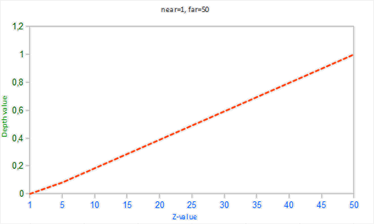

然而，在实践中是几乎永远不会使用这样的**线性深度缓冲(Linear Depth Buffer)**的。要想有正确的投影性质，需要使用一个非线性的深度方程，它是与 1/z 成正比的。它做的就是在z值很小的时候提供非常高的精度，而在z值很远的时候提供更少的精度。仔细想想，我们真的需要对1000单位远的深度值和只有1单位远的充满细节的物体使用相同的精度吗？线性方程并不会考虑这一点。

由于非线性方程与 1/z 成正比，在1.0和2.0之间的z值将会变换至1.0到0.5之间的深度值，这就是一个float提供给我们的一半精度了，这在z值很小的情况下提供了非常大的精度。在50.0和100.0之间的z值将会只占2%的float精度，这正是我们所需要的。这样的一个考虑了远近距离的方程是这样的：
$$
\begin{equation} F_{depth} = \frac{1/z - 1/near}{1/far - 1/near} \end{equation}
$$

要记住：深度缓冲中的值在屏幕空间中不是线性的（在透视矩阵应用之前在观察空间中是线性的）。深度缓冲中0.5的值并不代表着物体的z值是位于平截头体的中间了，这个顶点的z值实际上非常接近近平面！你可以在下图中看到z值和最终的深度缓冲值之间的非线性关系：

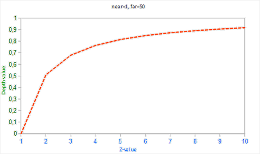

深度值很大一部分是由很小的z值所决定的，这给了近处的物体很大的深度精度。这个（从观察者的视角）变换z值的方程是嵌入在投影矩阵中的，所以当我们想将一个顶点坐标从观察空间至裁剪空间的时候这个非线性方程就被应用了。

#### 深度缓冲的可视化
在片段着色器中，内建`gl_FragCoord`向量的z值包含了那个特定片段的深度值。如果我们将这个深度值输出为颜色，我们可以显示场景中所有片段的深度值。我们可以根据片段的深度值返回一个颜色向量来完成这一工作：
```
void main()
{
    FragColor = vec4(vec3(gl_FragCoord.z), 1.0);
}
```
如果你再次运行程序的话，你可能会注意到所有东西都是白色的，看起来就想我们所有的深度值都是最大的1.0。所以为什么没有靠近0.0（即变暗）的深度值呢？

在上一部分中说到，屏幕空间中的深度值是非线性的，即它在z值很小的时候有很高的精度，而z值很大的时候有较低的精度。片段的深度值会随着距离迅速增加，所以几乎所有的顶点的深度值都是接近于1.0的。如果我们小心地靠近物体，你可能会最终注意到颜色会渐渐变暗，显示它们的z值在逐渐变小。这很清楚地展示了深度值的非线性性质。近处的物体比起远处的物体对深度值有着更大的影响。只需要移动几厘米就能让颜色从暗完全变白。

然而，我们也可以让片段非线性的深度值变换为线性的。要实现这个，我们需要仅仅**反转**深度值的投影变换。这也就意味着我们需要首先将深度值从[0, 1]范围重新变换到[-1, 1]范围的标准化设备坐标（裁剪空间）。接下来我们需要像投影矩阵那样反转这个非线性方程（方程2），并将这个反转的方程应用到最终的深度值上。最终的结果就是一个线性的深度值了。

首先我们将深度值变换为NDC，不是非常困难：
```
float ndc = depth * 2.0 - 1.0;
```
接下来使用获取到的NDC值，应用逆变换来获取线性的深度值：
```
float linearDepth = (2.0 * near * far) / (far + near - ndc * (far - near));
```
这个方程是用投影矩阵推导得出的，它使用了方程2来非线性化深度值，返回一个near与far之间的深度值。

将屏幕空间中非线性的深度值变换至线性深度值的完整片段着色器如下：
```
#version 330 core
out vec4 FragColor;

float near = 0.1; 
float far  = 100.0; 

float LinearizeDepth(float depth) 
{
    float z = depth * 2.0 - 1.0; // 转换为 NDC
    return (2.0 * near * far) / (far + near - z * (far - near));    
}

void main()
{             
    float depth = LinearizeDepth(gl_FragCoord.z) / far; // 为了演示除以 far
    FragColor = vec4(vec3(depth), 1.0);
}
```
由于线性化的深度值处于near与far之间，它的大部分值都会大于1.0并显示为完全的白色。通过在main函数中将线性深度值除以far，我们近似地将线性深度值转化到[0, 1]的范围之间。这样子我们就能逐渐看到一个片段越接近投影平截头体的远平面，它就会变得越亮，更适用于展示目的。

如果我们现在运行程序，我们就能看见深度值随着距离增大是线性的了。
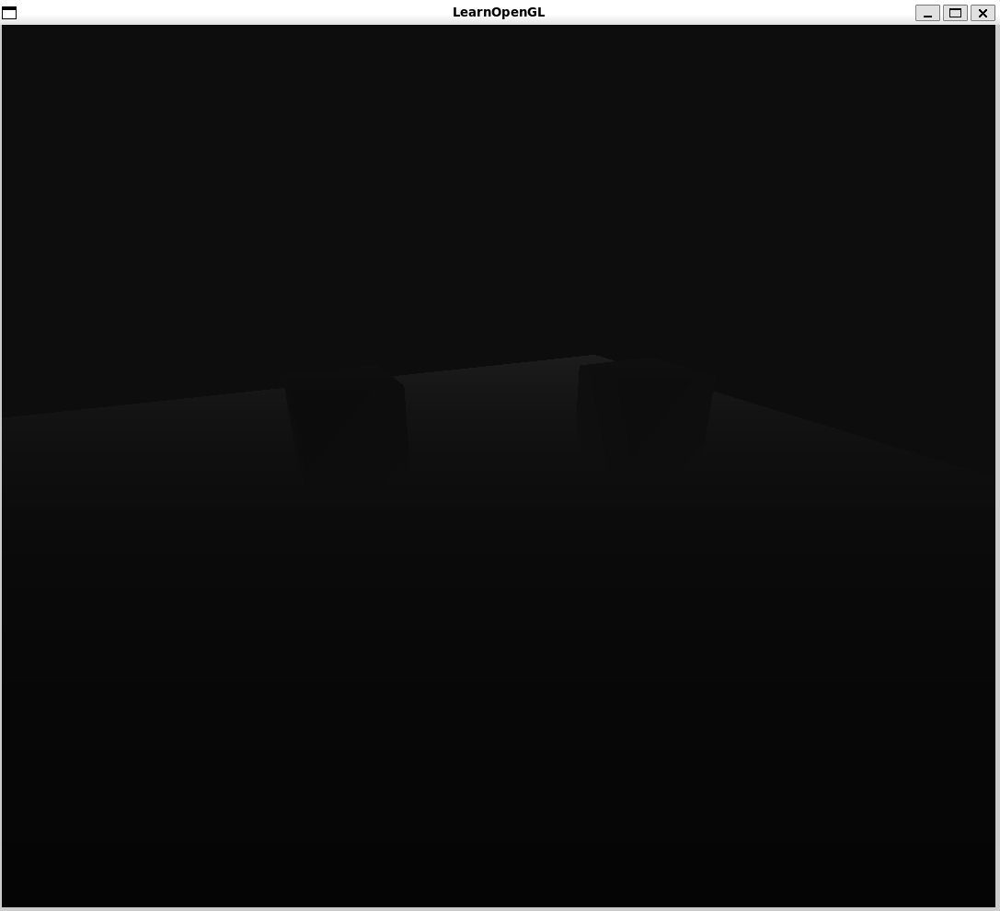

颜色大部分都是黑色，因为深度值的范围是0.1的近平面到100的远平面，它离我们还是非常远的。结果就是，我们相对靠近近平面，所以会得到更低的（更暗的）深度值。

#### 深度冲突
一个很常见的视觉错误会在两个平面或者三角形非常紧密地平行排列在一起时会发生，深度缓冲没有足够的精度来决定两个形状哪个在前面。结果就是这两个形状不断地在切换前后顺序，这会导致很奇怪的花纹。这个现象叫做深度冲突(Z-fighting)，因为它看起来像是这两个形状在争夺(Fight)谁该处于顶端。

在我们一直使用的场景中，有几个地方的深度冲突还是非常明显的。箱子被放置在地板的同一高度上，这也就意味着箱子的底面和地板是共面的(Coplanar)。这两个面的深度值都是一样的，所以深度测试没有办法决定应该显示哪一个。

如果你将摄像机移动到其中一个箱子的内部，你就能清楚地看到这个效果的，箱子的底部不断地在箱子底面与地板之间切换，形成一个锯齿的花纹。深度冲突是深度缓冲的一个常见问题，当物体在远处时效果会更明显（因为深度缓冲在z值比较大的时候有着更小的精度）。深度冲突不能够被完全避免，但一般会有一些技巧有助于在你的场景中减轻或者完全避免深度冲突:

- 第一个也是最重要的技巧是**永远不要把多个物体摆得太靠近**，以至于它们的一些三角形会重叠。通过在两个物体之间设置一个用户无法注意到的偏移值，你可以完全避免这两个物体之间的深度冲突。在箱子和地板的例子中，我们可以将箱子沿着正y轴稍微移动一点。箱子位置的这点微小改变将不太可能被注意到，但它能够完全减少深度冲突的发生。然而，这需要对每个物体都手动调整，并且需要进行彻底的测试来保证场景中没有物体会产生深度冲突。

- 第二个技巧是，尽可能**将近平面设置远一些**。在前面我们提到了精度在靠近近平面时是非常高的，所以如果我们将近平面远离观察者，我们将会对整个平截头体有着更大的精度。然而，将近平面设置太远将会导致近处的物体被裁剪掉，所以这通常需要实验和微调来决定最适合你的场景的近平面距离。

- 另外一个很好的技巧是**牺牲一些性能，使用更高精度的深度缓冲**。大部分深度缓冲的精度都是24位的，但现在大部分的显卡都支持32位的深度缓冲，这将会极大地提高精度。所以，牺牲掉一些性能，你就能获得更高精度的深度测试，减少深度冲突。

我们上面讨论的三个技术是最普遍也是很容易实现的抗深度冲突技术了。还有一些更复杂的技术，但它们依然不能完全消除深度冲突。深度冲突是一个常见的问题，但如果你组合使用了上面列举出来的技术，你可能不会再需要处理深度冲突了。

### L4-2 : 模板测试
#### 模板测试
在FS处理完一个fragment后、执行深度测试前，还需要进行模板测试(Stencil Test)。模板测试是根据又一个缓冲来进行的，它叫做模板缓冲(Stencil Buffer)。
一个模板缓冲中，（通常）每个模板值(Stencil Value)是8位的。所以每个像素/片段一共能有256种不同的模板值。我们可以将这些模板值设置为我们想要的值，然后当某一个片段有某一个模板值的时候，我们就可以选择丢弃或是保留这个片段了。*GLFW自动为用户配置了模板缓冲，但其它窗口库可能需要手动创建模板库。*

一个简单的模板缓冲例子：
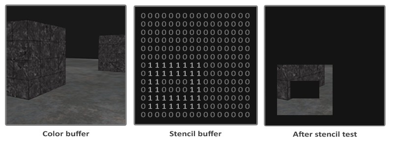

模板缓冲首先会被清除为0，之后在模板缓冲中使用1填充了一个空心矩形。场景中的片段将会只在片段的模板值为1的时候会被渲染（其它的都被丢弃了）。

模板缓冲操作允许我们在渲染片段时将模板缓冲设定为一个特定的值。所以写入模板缓冲的操作就是在渲染时手动修改模板缓冲的内容。在同一个（或者接下来的）帧中，我们可以读取这些值，来决定丢弃还是保留某个片段。使用模板缓冲的时候你可以尽情发挥，但大体的步骤如下：

- 启用模板缓冲的写入。
- 渲染物体，更新模板缓冲的内容。
- 禁用模板缓冲的写入。
- 渲染（其它）物体，这次根据模板缓冲的内容丢弃特定的片段。
所以，通过使用模板缓冲，我们可以根据场景中已绘制的其它物体的片段，来决定是否丢弃特定的片段。

你可以启用`GL_STENCIL_TEST`来启用模板测试。在这一行代码之后，所有的渲染调用都会以某种方式影响着模板缓冲。
```
glEnable(GL_STENCIL_TEST);
```
注意，和颜色和深度缓冲一样，你也需要**在每次迭代之前清除模板缓冲**。
```
glClear(GL_COLOR_BUFFER_BIT | GL_DEPTH_BUFFER_BIT | GL_STENCIL_BUFFER_BIT);
```
和深度测试的`glDepthMask()`函数一样，模板缓冲也有一个类似的函数。`glStencilMask()`允许我们设置一个位掩码(Bitmask)，它会与将要写入缓冲的模板值进行与(AND)运算。默认情况下设置的位掩码所有位都为1，不影响输出，但如果我们将它设置为0x00，写入缓冲的所有模板值最后都会变成0.这与深度测试中的`glDepthMask(GL_FALSE)`是等价的。
```
glStencilMask(0xFF); // 每一位写入模板缓冲时都保持原样
glStencilMask(0x00); // 每一位在写入模板缓冲时都会变成0（禁用写入）
```
大部分情况下你都只会使用`0x00`或者`0xFF`作为模板掩码(Stencil Mask)，但是知道有选项可以设置自定义的位掩码总是好的。

#### 模板函数
和深度测试一样，我们对模板缓冲应该通过还是失败，以及它应该如何影响模板缓冲，也是有一定控制的。一共有两个函数能够用来配置模板测试：`glStencilFunc()`和`glStencilOp()`。

`glStencilFunc(GLenum func, GLint ref, GLuint mask)`描述了**OpenGL应该对模板缓冲内容做什么**，它一共包含三个参数：
- func：设置模板测试函数(Stencil Test Function)。这个测试函数将会应用到已储存的模板值上和`glStencilFunc()`函数的ref值上。**其可用的选项和语义与深度缓冲中的函数一致。**
- ref：设置了模板测试的参考值(Reference Value)。模板缓冲的内容将会与这个ref值进行比较。
- mask：设置一个掩码，它将会与参考值和储存的模板值在测试比较它们之前进行与(AND)运算。初始情况下所有位都为1。
在之前的模板例子中，函数被设置为：
```
glStencilFunc(GL_EQUAL, 1, 0xFF)
```
这会告诉OpenGL：只要一个片段的模板值等于(`GL_EQUAL`)参考值1，片段将会通过测试并被绘制，否则会被丢弃。

`glStencilOp(GLenum sfail, GLenum dpfail, GLenum dppass)`告诉OpenGL**应该如何更新缓冲**。一共包含三个选项，我们能够设定每个选项应该采取的行为：

- sfail：模板测试失败时采取的行为。
- dpfail：模板测试通过，但深度测试失败时采取的行为。
- dppass：模板测试和深度测试都通过时采取的行为。
每个选项都可以选用以下的其中一种行为：

|行为	|描述 |
|----|---- |
|GL_KEEP	|保持当前储存的模板值 |
|GL_ZERO	|将模板值设置为0 |
|GL_REPLACE	|将模板值设置为`glStencilFunc()`函数设置的ref值 |
|GL_INCR	|如果模板值小于最大值则将模板值加1 |
|GL_INCR_WRAP	|与GL_INCR一样，但如果模板值超过了最大值则归零 |
|GL_DECR	|如果模板值大于最小值则将模板值减1 |
|GL_DECR_WRAP	|与GL_DECR一样，但如果模板值小于0则将其设置为最大值 |
|GL_INVERT	|按位翻转当前的模板缓冲值 |

默认情况下，`glStencilOp()`是设置为(`GL_KEEP, GL_KEEP, GL_KEEP`)的，所以不论任何测试的结果是如何，模板缓冲都会保留它的值。默认的行为不会更新模板缓冲，所以如果你想写入模板缓冲的话，你需要至少对其中一个选项设置不同的值。

所以，通过使用`glStencilFunc()`和`glStencilOp()`，我们可以精确地指定更新模板缓冲的时机与行为了，我们也可以指定什么时候该让模板缓冲通过，即什么时候片段需要被丢弃。

#### 实战案例：物体轮廓
直到现在其实我们都不太明白模板测试到底在做什么，这里会展示一个使用模板测试就可以完成的有用特性，它叫做物体轮廓(Object Outlining)。
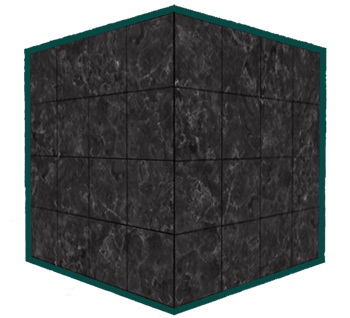

在游戏中一个常见的应用是：当我们试图选中一个单位并想要告知玩家选中的是哪个单位时，就需要对目标物体做出某种“高亮”效果，这时候就需要模板测试了。

步骤如下：
1. 启用模板写入。
2. 在绘制（需要添加轮廓的）物体之前，将模板函数设置为`GL_ALWAYS`，每当物体的片段被渲染时，将模板缓冲更新为1。
3. 渲染物体。
4. 禁用模板写入以及深度测试。
5. 将每个物体缩放一点点。
6. 使用一个不同的片段着色器，输出一个单独的（边框）颜色。
7. 再次绘制物体，但只在它们片段的模板值不等于1时才绘制。
8. 再次启用模板写入和深度测试。

这个过程将每个物体的片段的模板缓冲设置为1，当我们想要绘制边框的时候，我们主要绘制放大版本的物体中模板测试通过的部分，也就是物体的边框的位置。我们主要使用模板缓冲丢弃了放大版本中属于原物体片段的部分。

我们首先来创建一个很简单的片段着色器，它会输出一个边框颜色。我们简单地给它设置一个硬编码的颜色值，将这个着色器命名为`shaderSingleColor`：
```
void main()
{
    FragColor = vec4(0.04, 0.28, 0.26, 1.0);
}
```
我们只想给那两个箱子加上边框，所以我们让地板不参与这个过程。我们希望首先绘制地板，再绘制两个箱子（并写入模板缓冲），之后绘制放大的箱子（并丢弃覆盖了之前绘制的箱子片段的那些片段）。

我们首先启用模板测试：
```
glEnable(GL_STENCIL_TEST);
```
并设置在每一帧中模板测试通过或失败时，需要执行的操作：
```
glStencilOp(GL_KEEP, GL_KEEP, GL_REPLACE);
```
如果其中的一个测试失败了，我们什么都不做，我们仅仅保留当前储存在模板缓冲中的值。如果模板测试和深度测试都通过了，那么我们希望将储存的模板值设置为参考值，因为我们最终想实现边框效果。这一参考值后续通过`glStencilFunc()`来设置，且设置为1。

我们将模板缓冲清除为0，对箱子中所有绘制的片段，将模板值更新为1：
```
glStencilOp(GL_KEEP, GL_KEEP, GL_REPLACE);
glStencilFunc(GL_ALWAYS, 1, 0xFF);
// 参数1 (func): 测试函数 -> 总是通过(GL_ALWAYS)
// 参数2 (ref): 参考值 -> 我们想写入的模板值，这里设为 1
// 参数3 (mask): 掩码 -> 0xFF表示所有位都参与

glStencilMask(0xFF); // 启用模板缓冲写入
normalShader.use();
DrawTwoContainers();
```
通过使用GL_REPLACE模板测试函数，我们保证了箱子的每个片段都会将模板缓冲的模板值更新为1。因为片段永远会通过模板测试，在绘制片段的地方，模板缓冲会被更新为参考值。

现在模板缓冲在箱子被绘制的地方都更新为1了，我们将要绘制放大的箱子，但这次要禁用模板缓冲的写入：
```
glStencilFunc(GL_NOTEQUAL, 1, 0xFF);
glStencilMask(0x00); // 禁止模板缓冲的写入
glDisable(GL_DEPTH_TEST);
shaderSingleColor.use(); 
DrawTwoScaledUpContainers();
```
我们将模板函数设置为GL_NOTEQUAL，它会保证我们只绘制箱子上模板值不为1的部分，即只绘制箱子在之前绘制的箱子之外的部分。注意我们也禁用了深度测试，让放大的箱子，即边框，不会被地板所覆盖。

记得要在完成之后重新启用深度缓冲。

场景中物体轮廓的完整步骤会看起来像这样：
```
glEnable(GL_DEPTH_TEST);
glStencilOp(GL_KEEP, GL_KEEP, GL_REPLACE);  

glClear(GL_COLOR_BUFFER_BIT | GL_DEPTH_BUFFER_BIT | GL_STENCIL_BUFFER_BIT); 

glStencilMask(0x00); // 记得保证我们在绘制地板的时候不会更新模板缓冲
normalShader.use();
DrawFloor()  

glStencilFunc(GL_ALWAYS, 1, 0xFF); 
glStencilMask(0xFF); 
DrawTwoContainers();

glStencilFunc(GL_NOTEQUAL, 1, 0xFF);
glStencilMask(0x00); 
glDisable(GL_DEPTH_TEST);
shaderSingleColor.use(); 
DrawTwoScaledUpContainers();
glStencilMask(0xFF);
glEnable(GL_DEPTH_TEST);  
```
只要你理解了模板缓冲背后的大体思路，这个代码片段就不是那么难理解了。
从结果上来看，可以看到这两个箱子的边框重合了，这通常都是我们想要的结果（想想策略游戏中，我们希望选择10个单位，合并边框通常是我们想需要的结果）。如果你想让每个物体都有一个完整的边框，你需要**对每个物体都清空模板缓冲，并有创意地利用深度缓冲**。

你看到的物体轮廓算法在需要显示选中物体的游戏（想想策略游戏）中非常常见。这样的算法能够在一个模型类中轻松实现。你可以在模型类中设置一个`boolean`标记，来设置需不需要绘制边框。如果你有创造力的话，你也可以使用后期处理滤镜(Filter)，像是高斯模糊(Gaussian Blur)，让边框看起来更自然。

除了物体轮廓之外，模板测试还有很多用途，比如在一个后视镜中绘制纹理，让它能够绘制到镜子形状中，或者使用一个叫做阴影体积(Shadow Volume)的模板缓冲技术渲染实时阴影。模板缓冲为我们已经很丰富的OpenGL工具箱又提供了一个很好的工具。

### L4-3 : 混合
#### 混合
OpenGL中，混合(Blending)通常是实现物体透明度(Transparency)的一种技术。在OpenGL中，一个物体（或者其中的一部分）不是纯色(Solid Color)的，它的颜色是物体本身的颜色和它背后其它物体的颜色的不同强度下的结合。一个有色玻璃窗是一个透明的物体，玻璃有它自己的颜色，但它最终的颜色还包含了玻璃之后所有物体的颜色。这也是Blend这一名字的出处。所以透明度能让我们看穿物体。
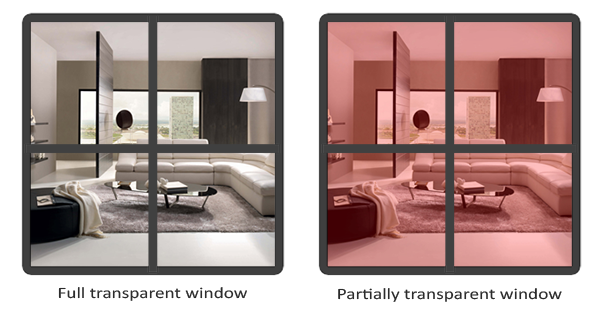
